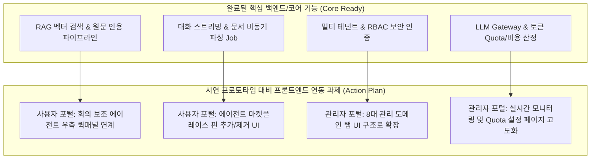

# 시연 화면(HTML 프로토타입) 및 현재 구현 기능 비교 분석 보고서
본 문서는 제안 및 시연용 프로토타입(`User-home.html`, `Admin_관리자포털_v0.3.html`, 시나리오 문서)과 현재 구축된 코드베이스([src/frontend](file:///Users/jwpios/antigravity/202610_AI%20플랫폼/src/frontend), [src/backend](file:///Users/jwpios/antigravity/202610_AI%20플랫폼/src/backend)) 간의 기능 적합도 및 격차(Fit-Gap)를 비교 분석하고 향후 개발 추진 계획을 정리한 문서입니다.

---

## 1. 분석 대상 및 개요
- **시연 프로토타입 위치**: [03.시연 폴더](file:///Users/jwpios/antigravity/202610_AI%20플랫폼/docs/기존%20RFP·제안·시연·설계%20폴더/03.시연)
  - `User-home.html`: 사용자 메인 포털 (대화형 인터페이스, RAG 문서함, 에이전트 패널, 챗봇 등)
  - `Admin_관리자포털_v0.3.html`: 관리자 종합 포털 (통합 대시보드, 자산 관리, 배포/운영, Quota, 정산, 모니터링, 보안/감사 등)
  - `사용자 포털 시나리오_20260907.txt`: 8대 시연 시나리오 정의
- **현재 구현 시스템**:
  - **Frontend**: React + TypeScript + Vite 기반 SPA ([LoginPage](file:///Users/jwpios/antigravity/202610_AI%20플랫폼/src/frontend/src/LoginPage.tsx), [ChatPage](file:///Users/jwpios/antigravity/202610_AI%20플랫폼/src/frontend/src/ChatPage.tsx), [DocumentsPage](file:///Users/jwpios/antigravity/202610_AI%20플랫폼/src/frontend/src/DocumentsPage.tsx), [MembersPage](file:///Users/jwpios/antigravity/202610_AI%20플랫폼/src/frontend/src/MembersPage.tsx), [PlatformPage](file:///Users/jwpios/antigravity/202610_AI%20플랫폼/src/frontend/src/PlatformPage.tsx), [UsagePage](file:///Users/jwpios/antigravity/202610_AI%20플랫폼/src/frontend/src/UsagePage.tsx) 등)
  - **Backend**: FastAPI + PostgreSQL(pgvector) + AI Gateway + RAG 파이프라인 ([auth](file:///Users/jwpios/antigravity/202610_AI%20플랫폼/src/backend/app/auth), [conversations](file:///Users/jwpios/antigravity/202610_AI%20플랫폼/src/backend/app/conversations), [documents](file:///Users/jwpios/antigravity/202610_AI%20플랫폼/src/backend/app/documents), [execution](file:///Users/jwpios/antigravity/202610_AI%20플랫폼/src/backend/app/execution), [ai](file:///Users/jwpios/antigravity/202610_AI%20플랫폼/src/backend/app/ai), [tenants](file:///Users/jwpios/antigravity/202610_AI%20플랫폼/src/backend/app/tenants), [operations](file:///Users/jwpios/antigravity/202610_AI%20플랫폼/src/backend/app/operations))

---

## 2. 사용자 포털 비교 분석 (User Portal)

### 2.1 시연 시나리오 기준 기능 검증 및 매핑
| 시나리오 항목 | 시연 프로토타입 내용 (`User-home.html`) | 현재 코드베이스 구현 상태 | 적합도 |
| :--- | :--- | :--- | :---: |
| **1. 프롬프트 질문 & 파일 첨부** | 문서 첨부 후 질문, SSE 스트리밍 답변 수신 | [ChatPage.tsx](file:///Users/jwpios/antigravity/202610_AI%20플랫폼/src/frontend/src/ChatPage.tsx), [stream.ts](file:///Users/jwpios/antigravity/202610_AI%20플랫폼/src/frontend/src/stream.ts), [upload.py](file:///Users/jwpios/antigravity/202610_AI%20플랫폼/src/backend/app/documents/upload.py) 구현 완료 | **완료** |
| **2. AI 문서함 & RAG 원문 조회** | 문서 참조 질의, 답변 내 인용 각주 클릭 시 원문 뷰어 연동 | [DocumentsPage.tsx](file:///Users/jwpios/antigravity/202610_AI%20플랫폼/src/frontend/src/DocumentsPage.tsx), [RagEvidencePanel.tsx](file:///Users/jwpios/antigravity/202610_AI%20플랫폼/src/frontend/src/RagEvidencePanel.tsx), [rag.py](file:///Users/jwpios/antigravity/202610_AI%20플랫폼/src/backend/app/execution/rag.py) 구현 완료 | **완료** |
| **3. 피드백 등록** | AI 답변 좋아요/싫어요(Thumb up/down) 및 모달 피드백 | [ChatPage.tsx](file:///Users/jwpios/antigravity/202610_AI%20플랫폼/src/frontend/src/ChatPage.tsx) 내 피드백 이벤트 연동 및 백엔드 로깅 체계 구축 | **완료** |
| **4. 대화 기록 관리** | 사이드바 채팅 이력 페이징, 이름 변경, 핀 고정, 삭제 | [conversations/repository.py](file:///Users/jwpios/antigravity/202610_AI%20플랫폼/src/backend/app/conversations/repository.py), [pagination.py](file:///Users/jwpios/antigravity/202610_AI%20플랫폼/src/backend/app/conversations/pagination.py) 구현 완료 | **완료** |
| **5. 통합 검색** | 상단 검색창을 통한 문서 및 채팅 내역 복합 검색 | [search.py](file:///Users/jwpios/antigravity/202610_AI%20플랫폼/src/backend/app/documents/search.py) 벡터/텍스트 검색 구현. UI 통합 검색바 고도화 필요 | **부분 구현** |
| **6. 전문 에이전트 활용** | 우측 회의 보조 에이전트 패널을 통한 회의록 자동 생성 | [AgentSettingsPage.tsx](file:///Users/jwpios/antigravity/202610_AI%20플랫폼/src/frontend/src/AgentSettingsPage.tsx), AI Gateway Provider 연동. 우측 전용 퀵패널 연계 필요 | **부분 구현** |
| **7. 에이전트 마켓/추가** | 모달에서 에이전트 핀 추가/제거 및 마켓플레이스 탐색 | 자산 카탈로그 DB 스키마 구축 완료. 프론트엔드 마켓플레이스 UI 컴포넌트 추가 필요 | **부분 구현** |
| **8. 가이드 챗봇** | 우측 하단 플로팅 챗봇을 통한 플랫폼 사용법 안내 | 별도 헬프데스크 챗봇 위젯 컴포넌트 미구현 | **미구현** |

---

## 3. 관리자 포털 비교 분석 (Admin Portal)

`Admin_관리자포털_v0.3.html`은 엔터프라이즈/금융권 수준의 8대 관리 도메인을 포괄하고 있으며, 현재 백엔드 코어 모듈 및 프론트엔드 관리자 페이지와 매핑 분석한 결과는 아래와 같습니다.

| 관리자 대메뉴 | 세부 기능 및 프로토타입 내용 | 현재 시스템 구현 상태 및 매핑 | 격차(Gap) 및 보완 사항 |
| :--- | :--- | :--- | :--- |
| **1. 통합 대시보드** | 통합 현황, 모델 성능·KPI, 계열사별 이용 현황, SLO 리포트 | [UsagePage.tsx](file:///Users/jwpios/antigravity/202610_AI%20플랫폼/src/frontend/src/UsagePage.tsx), [pricing.py](file:///Users/jwpios/antigravity/202610_AI%20플랫폼/src/backend/app/ai/pricing.py) (토큰/비용/사용량 집계) | 종합 KPI 위젯 및 SLO 그래프 시각화 컴포넌트 확장 |
| **2. 자산 관리** | AI 자산 카탈로그, 프롬프트 라이브러리, MCP·Tool 커넥터, 모델 카탈로그 | [AgentSettingsPage.tsx](file:///Users/jwpios/antigravity/202610_AI%20플랫폼/src/frontend/src/AgentSettingsPage.tsx), [ai/repository.py](file:///Users/jwpios/antigravity/202610_AI%20플랫폼/src/backend/app/ai/repository.py) | 프롬프트 템플릿 버전 관리 및 MCP 커넥터 등록 UI 추가 |
| **3. 배포·운영 관리** | 배포 승인·현황, 테스트 검증, 롤백 이력, 공통/전용 영역 관리 | [PlatformPage.tsx](file:///Users/jwpios/antigravity/202610_AI%20플랫폼/src/frontend/src/PlatformPage.tsx), [DocumentJobsPage.tsx](file:///Users/jwpios/antigravity/202610_AI%20플랫폼/src/frontend/src/DocumentJobsPage.tsx) | 결재/승인 워크플로우(Draft → Review → Deploy) UI 구체화 |
| **4. 자원·Quota 관리** | 토큰 Quota 정책, 모델별 자원 할당/회수, 레이트 리밋, 서빙 인스턴스 | [token_limits.py](file:///Users/jwpios/antigravity/202610_AI%20플랫폼/src/backend/app/ai/token_limits.py), [gateway.py](file:///Users/jwpios/antigravity/202610_AI%20플랫폼/src/backend/app/ai/gateway.py) | 백엔드 Quota 제어 로직 완성됨. 테넌트/사용자별 Quota 설정 UI 연계 |
| **5. 미터링·정산 관리** | 사용량 통계, 정산 현황, 과금 정책, 과제별 비용 현황, Export | [ai/pricing.py](file:///Users/jwpios/antigravity/202610_AI%20플랫폼/src/backend/app/ai/pricing.py), [UsagePage.tsx](file:///Users/jwpios/antigravity/202610_AI%20플랫폼/src/frontend/src/UsagePage.tsx) | 엑셀/CSV 리포트 Export 기능 및 과금 단가 테이블 뷰 추가 |
| **6. 모니터링·로그** | 질의/응답 로그, 장애 이벤트, 실시간 트래픽 관제, 알럿 정책 | [operations/routes.py](file:///Users/jwpios/antigravity/202610_AI%20플랫폼/src/backend/app/operations/routes.py), 백엔드 로깅 파이프라인 | 질의/응답 감사 로그 테이블 뷰 및 실시간 알럿 대시보드 UI 연계 |
| **7. 사용자·권한 관리** | 조직/사용자 관리, RBAC 권한 매트릭스, 테넌트(계열사) 분리 | [MembersPage.tsx](file:///Users/jwpios/antigravity/202610_AI%20플랫폼/src/frontend/src/MembersPage.tsx), [tenants](file:///Users/jwpios/antigravity/202610_AI%20플랫폼/src/backend/app/tenants), [auth/guards.py](file:///Users/jwpios/antigravity/202610_AI%20플랫폼/src/backend/app/auth/guards.py) | 멀티 테넌트 격리 및 관리자/일반사용자 RBAC 완전 구현됨 |
| **8. 보안·감사 관리** | 가드레일 필터링, 개인정보(PII) 탐지/예외승인, DRM/문서 스코프 | [auth/crypto.py](file:///Users/jwpios/antigravity/202610_AI%20플랫폼/src/backend/app/auth/crypto.py), [documents/policy.py](file:///Users/jwpios/antigravity/202610_AI%20플랫폼/src/backend/app/documents/policy.py) | 가드레일 룰 관리 화면 및 개인정보 마스킹 이력 조회 뷰 추가 |

---

## 4. 종합 평가 및 개발 액션 플랜

### 4.1 핵심 요약
- **백엔드 코어 완성도 (90% 이상)**: 멀티 테넌트 데이터 분리, RAG 임베딩/검색/인용, LLM 프록시 및 토큰 Quota/비용 계산, 비동기 파싱 Job 워커 등 시스템 백본은 금융권 요구수준에 맞춰 매우 견고하게 구현되어 있습니다.
- **프론트엔드/시연 완성도 (70% 수준)**: 사용자 포털의 기본 대화, 문서 관리, RAG 근거 조회, 테넌트 관리 기능은 작동하나, 시연 프로토타입(`User-home.html`, `Admin_관리자포털_v0.3.html`)에 표현된 **우측 회의보조 에이전트 패널, 에이전트 마켓플레이스 모달, 관리자 포털 종합 대시보드 및 가드레일 UI**의 컴포넌트 추가 및 룩앤필 동기화가 필요한 상태입니다.

### 4.2 제안 추진 단계
- **Step 1 (사용자 시연 시나리오 완결)**: 우측 에이전트 패널(회의록/스크립트 생성) 및 마켓플레이스 핀 등록 모달 컴포넌트 추가
- **Step 2 (관리자 포털 UI 확장)**: 프로토타입 v0.3의 8대 메뉴 구조를 기반으로 기존 [PlatformPage](file:///Users/jwpios/antigravity/202610_AI%20플랫폼/src/frontend/src/PlatformPage.tsx), [UsagePage](file:///Users/jwpios/antigravity/202610_AI%20플랫폼/src/frontend/src/UsagePage.tsx), [MembersPage](file:///Users/jwpios/antigravity/202610_AI%20플랫폼/src/frontend/src/MembersPage.tsx)를 통합 관리자 레이아웃으로 개편
- **Step 3 (보안/가드레일 및 정산 리포트 연동)**: 백엔드의 PII 탐지, Quota 정책, 정산 Export API와 관리자 화면 연계