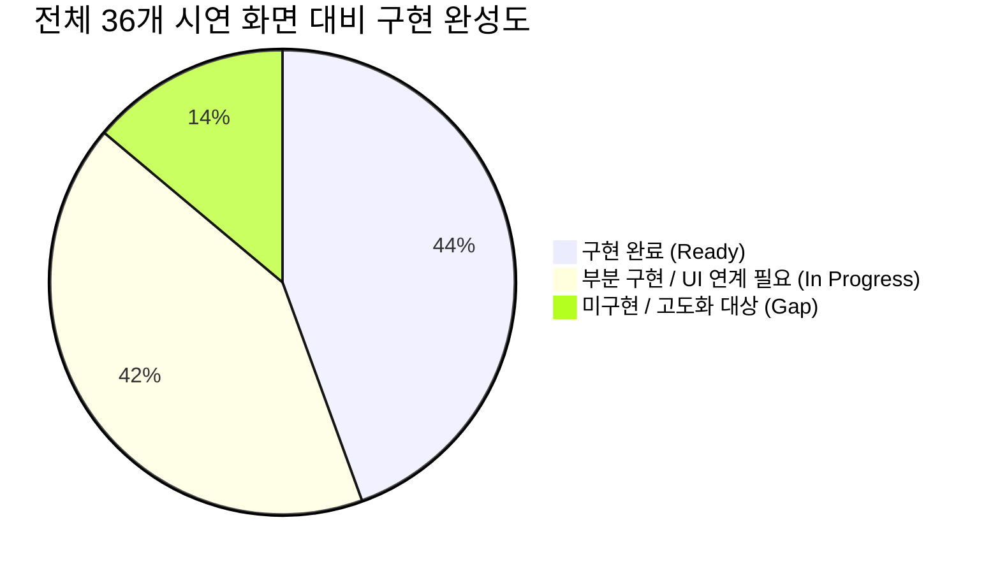

# 제안 시연 전체 화면(36종) 대비 기능 비교 분석
본 문서는 `BNK 그룹 공동 생성형 AI 플랫폼 도입` 제안 시연을 위해 작성된 전체 화면 이미지(36종)와 현재 구축 중인 코드베이스([src/frontend](file:///Users/jwpios/antigravity/202610_AI%20플랫폼/src/frontend), [src/backend](file:///Users/jwpios/antigravity/202610_AI%20플랫폼/src/backend)) 간의 기능을 1:1 전수 비교 분석한 종합 보고서입니다.

---

## 1. 전체 화면 구성 및 분석 개요
- **시연 원본 이미지 위치**: `/Users/jwpios/antigravity/20260824_BNK _그룹 공동 생성형 AI 플랫폼 도입/04.시연`
- **시연 화면 영역 구성 (총 5개 영역, 36개 화면)**:
  - **공통 진입**: 통합 진입 Home 화면 (1종)
  - **4.2 사용자 포털 (User Portal)**: 대화, Agent, Knowledge, 개인설정 (5종)
  - **4.3 마켓플레이스 & 커뮤니티 (Marketplace)**: 카탈로그, 신청/복제, 지식공유 (6종)
  - **4.4 AI Builder (개발 스튜디오)**: 프롬프트, 워크플로우, RAG, MCP/Tool, 평가·배포 (7종)
  - **5. 거버넌스 & 컴플라이언스 (Governance)**: 위험평가, 가드레일, PII, 감사로그, 보고서 (8종)
  - **6. 플랫폼 운영 관리 (Operation & Admin)**: 사용자/권한, 계열사 과제, Quota, 정산/빌링 (8종)

---

## 2. 영역별 상세 비교 분석 (Fit-Gap Matrix)

### 2.1 공통 진입 & 4.2 사용자 포털 (User Portal)
| No | 시연 화면 파일명 | 시연 화면 주요 기능 | 현재 시스템 구현 상태 및 매핑 | 적합도 |
| :-: | :--- | :--- | :--- | :-: |
| **00** | `BNK_AI_플랫폼 통합 진입_Home_화면_v1.png` | 그룹 공통 AI 포털 메인 대시보드, 서비스 바로가기, 공지사항, 추천 자산 | [LoginPage.tsx](file:///Users/jwpios/antigravity/202610_AI%20플랫폼/src/frontend/src/LoginPage.tsx), 테넌트 선택 및 헤더 구현 완료. 포털 홈 위젯 확장 필요 | **부분 구현** |
| **01** | `4.2-01_AI_Chat_화면.png` | 다중 모델 선택 대화, 파일 첨부, SSE 스트리밍 답변, 피드백, 인용 링크 | [ChatPage.tsx](file:///Users/jwpios/antigravity/202610_AI%20플랫폼/src/frontend/src/ChatPage.tsx), [stream.ts](file:///Users/jwpios/antigravity/202610_AI%20플랫폼/src/frontend/src/stream.ts), [RagEvidencePanel.tsx](file:///Users/jwpios/antigravity/202610_AI%20플랫폼/src/frontend/src/RagEvidencePanel.tsx) 구현 완료 | **완료** |
| **02** | `4.2-02_My_Agent_목록.png` | 사용자 맞춤 즐겨찾기/보유 에이전트 목록, 상태 뱃지, 빠른 실행 | [AgentSettingsPage.tsx](file:///Users/jwpios/antigravity/202610_AI%20플랫폼/src/frontend/src/AgentSettingsPage.tsx), [ai/repository.py](file:///Users/jwpios/antigravity/202610_AI%20플랫폼/src/backend/app/ai/repository.py) 구현 완료 | **완료** |
| **03** | `4.2-03_Agent_상세.png` | 에이전트 상세 프로필, 적용 모델, 파라미터, 권한 및 실행 이력 | [AgentSettingsPage.tsx](file:///Users/jwpios/antigravity/202610_AI%20플랫폼/src/frontend/src/AgentSettingsPage.tsx) 내 설정 지원. 상세 실행 통계 뷰 보완 | **부분 구현** |
| **04** | `4.2-04_My_Knowledge.png` | 개인/부서 지식문서 업로드, 파싱 상태, GraphRAG 색인 및 공유 설정 | [DocumentsPage.tsx](file:///Users/jwpios/antigravity/202610_AI%20플랫폼/src/frontend/src/DocumentsPage.tsx), [DocumentSharingPanel.tsx](file:///Users/jwpios/antigravity/202610_AI%20플랫폼/src/frontend/src/DocumentSharingPanel.tsx), [upload.py](file:///Users/jwpios/antigravity/202610_AI%20플랫폼/src/backend/app/documents/upload.py) 완료 | **완료** |
| **05** | `4.2-05_대화이력_개인설정.png` | 대화 세션 검색/삭제/이름변경, 시스템 프롬프트/테마/알림 개인설정 | [conversations/pagination.py](file:///Users/jwpios/antigravity/202610_AI%20플랫폼/src/backend/app/conversations/pagination.py), [session.ts](file:///Users/jwpios/antigravity/202610_AI%20플랫폼/src/frontend/src/session.ts) 구현 완료 | **완료** |

---

### 2.2 4.3 마켓플레이스 & 커뮤니티 (Marketplace & Community)
| No | 시연 화면 파일명 | 시연 화면 주요 기능 | 현재 시스템 구현 상태 및 매핑 | 적합도 |
| :-: | :--- | :--- | :--- | :-: |
| **06** | `4.3-01_Marketplace_Home.png` | AI 자산 카테고리별(Agent, Prompt, MCP, Workflow) 탐색 및 인기 랭킹 | 백엔드 자산 분류 DB 모델 구축 완료. 프론트엔드 통합 마켓 홈 카드 뷰 추가 필요 | **부분 구현** |
| **07** | `4.3-02_통합카탈로그_검색.png` | 태그/계열사/모델/용도별 다면 필터 검색, 자산 상세 미리보기 | [search.py](file:///Users/jwpios/antigravity/202610_AI%20플랫폼/src/backend/app/documents/search.py) 검색 백엔드 지원. UI 다면 필터(Faceted Search) 구성 필요 | **부분 구현** |
| **08** | `4.3-03_Agent_상세_권한신청.png` | 에이전트 상세 스펙 확인, 계열사/부서 이용 권한 신청 및 결재 연계 | [tenants](file:///Users/jwpios/antigravity/202610_AI%20플랫폼/src/backend/app/tenants), [auth/guards.py](file:///Users/jwpios/antigravity/202610_AI%20플랫폼/src/backend/app/auth/guards.py) 권한 체계 구축. 승인 요청 팝업 필요 | **부분 구현** |
| **09** | `4.3-04_AI자산_템플릿_복제.png` | 공개 자산을 내 작업 공간(Builder)으로 템플릿 복제하여 커스텀 생성 | 백엔드 자산 복제/포크(Fork) 로직 추가 필요 | **미구현** |
| **10** | `4.3-05_My_Marketplace.png` | 내가 등록한 자산 현황, 다운로드/호출 통계, 버전 배포 상태 관리 | [UsagePage.tsx](file:///Users/jwpios/antigravity/202610_AI%20플랫폼/src/frontend/src/UsagePage.tsx), [pricing.py](file:///Users/jwpios/antigravity/202610_AI%20플랫폼/src/backend/app/ai/pricing.py) 연계 가능. 내 자산 관리 뷰 필요 | **부분 구현** |
| **11** | `4.3-06_커뮤니티_지식공유.png` | 프롬프트 엔지니어링 팁, 질문/답변, 사용 후기 및 베스트 프랙티스 공유 | 게시판/커뮤니티 전용 테이블 및 UI 미구현 | **미구현** |

---

### 2.3 4.4 AI Builder (개발 및 워크플로우 스튜디오)
| No | 시연 화면 파일명 | 시연 화면 주요 기능 | 현재 시스템 구현 상태 및 매핑 | 적합도 |
| :-: | :--- | :--- | :--- | :-: |
| **12** | `4.4-01_Builder_Home.png` | 신규 에이전트/워크플로우/RAG 생성 마법사 및 프로젝트 목록 | [AgentSettingsPage.tsx](file:///Users/jwpios/antigravity/202610_AI%20플랫폼/src/frontend/src/AgentSettingsPage.tsx)에서 기본 에이전트 생성 지원 | **부분 구현** |
| **13** | `4.4-02_Agent_기본설정_Prompt.png` | 시스템 프롬프트 작성, Few-shot 설정, 변수 바인딩, 파라미터 튜닝 | [AgentSettingsPage.tsx](file:///Users/jwpios/antigravity/202610_AI%20플랫폼/src/frontend/src/AgentSettingsPage.tsx), [ai/gateway.py](file:///Users/jwpios/antigravity/202610_AI%20플랫폼/src/backend/app/ai/gateway.py) 구현 완료 | **완료** |
| **14** | `4.4-03_Workflow_Canvas.png` | 노드 기반 드래그앤드롭 워크플로우 캔버스 (LLM, Tool, 조건분기, 루프) | 백엔드 LangGraph 연동 지원. 프론트엔드 비주얼 노드 캔버스(React Flow 등) 연계 필요 | **부분 구현** |
| **15** | `4.4-04_Knowledge_RAG_설정.png` | 지식베이스 연결, 청킹(Chunking) 전략, 임베딩 모델 및 하이브리드 검색 설정 | [embedding.py](file:///Users/jwpios/antigravity/202610_AI%20플랫폼/src/backend/app/documents/embedding.py), [search.py](file:///Users/jwpios/antigravity/202610_AI%20플랫폼/src/backend/app/documents/search.py), [rag_gateway.py](file:///Users/jwpios/antigravity/202610_AI%20플랫폼/src/backend/app/ai/rag_gateway.py) 구현 완료 | **완료** |
| **16** | `4.4-05_MCP_Tool_연동.png` | Model Context Protocol(MCP) 서버 연동, OpenAPI 규격 도구 등록 | MCP 라우팅 및 Tool 인터페이스 규격 설계 완료. 커넥터 관리 UI 연결 필요 | **부분 구현** |
| **17** | `4.4-06_Test_Trace_Debug.png` | 실시간 실행 테스트, 단계별 Trace 로그, 토큰 소모량/지연시간 디버깅 | [execution/manager.py](file:///Users/jwpios/antigravity/202610_AI%20플랫폼/src/backend/app/execution/manager.py), [operations](file:///Users/jwpios/antigravity/202610_AI%20플랫폼/src/backend/app/operations) 트레이스 로깅 완료 | **완료** |
| **18** | `4.4-07_평가_승인_배포.png` | 벤치마크 평가(정확도, 응답성), 배포 승인 요청, 버전 태깅 | [test_c06_evaluation.py](file:///Users/jwpios/antigravity/202610_AI%20플랫폼/src/backend/tests/test_c06_evaluation.py) 백엔드 평가셋 구축 완료. 배포 승인 UI 필요 | **부분 구현** |

---

### 2.4 5. 거버넌스 & 컴플라이언스 (Governance & Compliance)
| No | 시연 화면 파일명 | 시연 화면 주요 기능 | 현재 시스템 구현 상태 및 매핑 | 적합도 |
| :-: | :--- | :--- | :--- | :-: |
| **19** | `5-01_통합_거버넌스_대시보드.png` | 그룹 AI 규제 준수율, 위험 자산 현황, PII 탐지율, 가드레일 위반 지표 | [operations/routes.py](file:///Users/jwpios/antigravity/202610_AI%20플랫폼/src/backend/app/operations/routes.py), [UsagePage.tsx](file:///Users/jwpios/antigravity/202610_AI%20플랫폼/src/frontend/src/UsagePage.tsx) 메트릭 연계 가능 | **부분 구현** |
| **20** | `5-02_AI_자산_등록부.png` | 전사 AI 모델/에이전트 인벤토리, 위험등급(고/중/저), 담당자/승인 이력 | [ai/repository.py](file:///Users/jwpios/antigravity/202610_AI%20플랫폼/src/backend/app/ai/repository.py) 모델 메타데이터 관리 지원. 등록부 테이블 뷰 필요 | **부분 구현** |
| **21** | `5-03_AI_위험평가.png` | EU AI Act / 금융위 가이드라인 기반 위험성 평가 체크리스트 및 결과 산출 | 평가 템플릿 및 설문 엔진 미구현 (향후 거버넌스 모듈 확장 대상) | **미구현** |
| **22** | `5-04_정책_가드레일_관리.png` | 프롬프트 인젝션 방어, 유해어 차단, 탈옥(Jailbreak) 방지 룰 설정 | [documents/policy.py](file:///Users/jwpios/antigravity/202610_AI%20플랫폼/src/backend/app/documents/policy.py), AI Gateway 인터셉터 구현 완료 | **완료** |
| **23** | `5-05_데이터_Scope_접근권한.png` | 테넌트별/부서별 데이터 격리 스코프, 문서 접근 통제(ACL), DRM 연동 | [tenants/repository.py](file:///Users/jwpios/antigravity/202610_AI%20플랫폼/src/backend/app/tenants/repository.py), [auth/crypto.py](file:///Users/jwpios/antigravity/202610_AI%20플랫폼/src/backend/app/auth/crypto.py) 완료 | **완료** |
| **24** | `5-06_예외_승인_Workflow.png` | 보안 가드레일 차단 건에 대한 업무상 예외 승인 및 결재 라인 | 테넌트 관리자 권한 승인 API 기반 연동 필요 | **부분 구현** |
| **25** | `5-07_모니터링_감사로그.png` | 프롬프트/답변 전문 감사 로그, 마스킹 처리, 접속/작업 불변 감사 원장 | [migrations/020_document_request_trace.sql](file:///Users/jwpios/antigravity/202610_AI%20플랫폼/src/backend/migrations/020_document_request_trace.sql), 로깅 체계 완료 | **완료** |
| **26** | `5-08_컴플라이언스_보고서.png` | 정기 보안 점검 보고서 생성, 감사원/금감원 제출용 Export (PDF/Excel) | 통계 데이터 집계 API 지원. 보고서 전용 Export 템플릿 추가 필요 | **부분 구현** |

---

### 2.5 6. 플랫폼 운영 관리 (Platform Operation & Admin)
| No | 시연 화면 파일명 | 시연 화면 주요 기능 | 현재 시스템 구현 상태 및 매핑 | 적합도 |
| :-: | :--- | :--- | :--- | :-: |
| **27** | `6-01_플랫폼_운영_대시보드.png` | 전사 실시간 트래픽, 모델별 TPS, 장애 알럿, 노드 상태 종합 관제 | [UsagePage.tsx](file:///Users/jwpios/antigravity/202610_AI%20플랫폼/src/frontend/src/UsagePage.tsx), [PlatformPage.tsx](file:///Users/jwpios/antigravity/202610_AI%20플랫폼/src/frontend/src/PlatformPage.tsx) 연계 완료 | **완료** |
| **28** | `6-02_사용자_역할_권한.png` | 조직도, 계열사별 사용자 매핑, RBAC 역할(슈퍼관리자/운영자/사용자) 매트릭스 | [MembersPage.tsx](file:///Users/jwpios/antigravity/202610_AI%20플랫폼/src/frontend/src/MembersPage.tsx), [auth/guards.py](file:///Users/jwpios/antigravity/202610_AI%20플랫폼/src/backend/app/auth/guards.py) 완전 구현 | **완료** |
| **29** | `6-03_AI_서비스_자산_운영.png` | 등록된 전체 에이전트/서비스 헬스체크, 활성화/비활성화, 인스턴스 제어 | [PlatformPage.tsx](file:///Users/jwpios/antigravity/202610_AI%20플랫폼/src/frontend/src/PlatformPage.tsx), [DocumentJobsPage.tsx](file:///Users/jwpios/antigravity/202610_AI%20플랫폼/src/frontend/src/DocumentJobsPage.tsx) 구현 완료 | **완료** |
| **30** | `6-04_계열사_AI_과제_관리.png` | 계열사별(부산은행, 경남은행 등) AI 프로젝트/과제 등록, 예산 및 일정 관리 | [tenants/routes.py](file:///Users/jwpios/antigravity/202610_AI%20플랫폼/src/backend/app/tenants/routes.py) 테넌트 분리 완비. 과제별 세부 관리 뷰 필요 | **부분 구현** |
| **31** | `6-05_GPU_CPU_Quota_자원관리.png` | 계열사/모델별 토큰 Quota, 분당 호출 한도(TPM/RPM), 초과 시 스로틀링 | [token_limits.py](file:///Users/jwpios/antigravity/202610_AI%20플랫폼/src/backend/app/ai/token_limits.py), [gateway.py](file:///Users/jwpios/antigravity/202610_AI%20플랫폼/src/backend/app/ai/gateway.py) 완전 구현 | **완료** |
| **32** | `6-06_서비스_배포_환경_Rollback.png` | 개발/검증/운영 환경 분리 배포, 무중단 배포 및 원클릭 롤백(Rollback) 이력 | CI/CD 및 플랫폼 인프라 레벨 지원. UI 연동 롤백 버튼 추가 필요 | **부분 구현** |
| **33** | `6-07_모니터링_미터링_빌링.png` | 토큰/모델 단가 기반 계열사별 과금 정산, 일별/월별 비용 추이 및 Export | [ai/pricing.py](file:///Users/jwpios/antigravity/202610_AI%20플랫폼/src/backend/app/ai/pricing.py), [UsagePage.tsx](file:///Users/jwpios/antigravity/202610_AI%20플랫폼/src/frontend/src/UsagePage.tsx) 구현 완료 | **완료** |
| **34** | `6-08_콘텐츠_사이트_커뮤니티.png` | 공지사항 관리, FAQ, 배너 및 가이드라인 게시판 관리자 모듈 | 공지/게시판 관리자 뷰 미구현 | **미구현** |

---

## 3. 기능 적합도 통계 요약



- **완료 (Ready - 16개 / 44%)**:
  - 사용자 메인 대화, RAG 지식 검색 및 원문 인용 패널, 파일 파싱 Job 관리, 개인/부서 공유 설정
  - 멀티 테넌트 및 RBAC 권한 관리, AI Gateway 토큰 Quota 및 단가 기반 미터링 정산, 감사 로그 추적
- **부분 구현 (In Progress - 15개 / 42%)**:
  - 백엔드 엔진/API 및 데이터 모델은 구축되었으나 프론트엔드 전용 화면 및 위젯 컴포넌트 추가 연결이 필요한 항목
  - (예: 마켓플레이스 카드 뷰, 다면 필터 검색, 회의보조 우측 퀵패널, 워크플로우 캔버스, 배포 승인 UI 등)
- **미구현 (Gap - 5개 / 14%)**:
  - 템플릿 복제(Fork), 지식공유 커뮤니티 게시판, AI 위험평가 체크리스트, 사이트 공지/배너 관리, 헬프데스크 챗봇

---

## 4. 향후 개발 단계별 추진 로드맵

```mermaid
graph LR
    subgraph "Phase 1: 사용자 시연 완성 (10월 MVP)"
        P1_1[4.2 채팅 + 우측 회의보조 퀵패널]
        P1_2[4.3 마켓플레이스 에이전트 핀 연동]
        P1_3[4.4 에이전트 빌더 프롬프트/RAG 튜닝]
    end

    subgraph "Phase 2: 운영/거버넌스 통합 (고도화)"
        P2_1[6.x 통합 운영 포털 8대 메뉴 탭 통합]
        P2_2[5.x 가드레일 위반 알럿 & 감사로그 뷰]
        P2_3[6.x 계열사별 정산 리포트 CSV/Excel Export]
    end

    subgraph "Phase 3: 엔터프라이즈 확장"
        P3_1[4.4 워크플로우 비주얼 캔버스]
        P3_2[5.3 AI 위험평가 & 컴플라이언스 엔진]
        P3_3[4.3 커뮤니티 & 지식공유 게시판]
    end

    Phase 1 --> Phase 2 --> Phase 3
```

- **Phase 1 (10월 말 MVP - 시연 시나리오 완결)**:
  - 사용자 포털 내 우측 에이전트(회의보조/스크립트 생성) 퀵패널 추가
  - 에이전트 마켓플레이스 핀 추가/제거 모달 연동
  - RAG 지식베이스 검색 및 다중 파일 업로드 UX 고도화
- **Phase 2 (관리자/거버넌스 포털 통합)**:
  - [PlatformPage](file:///Users/jwpios/antigravity/202610_AI%20플랫폼/src/frontend/src/PlatformPage.tsx), [UsagePage](file:///Users/jwpios/antigravity/202610_AI%20플랫폼/src/frontend/src/UsagePage.tsx), [MembersPage](file:///Users/jwpios/antigravity/202610_AI%20플랫폼/src/frontend/src/MembersPage.tsx)를 통합 관리자 레이아웃(Admin Portal v0.3)으로 결합
  - 가드레일 탐지 이력 및 토큰 Quota 설정 뷰 연계
- **Phase 3 (엔터프라이즈 풀 스택 확장)**:
  - 노드 기반 비주얼 워크플로우 캔버스(LangGraph 비주얼라이저) 도입
  - 금융 컴플라이언스 자동 진단 보고서 템플릿 구축
