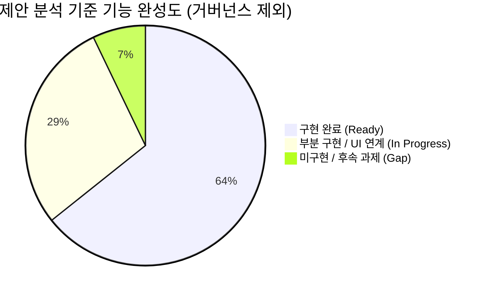

# 제안 분석 기준(거버넌스 제외) 대비 구현 기능 비교 분석 보고서
본 문서는 `BNK 그룹 공동 생성형 AI 플랫폼 도입` 이전 제안 분석 자료(IA 설계 기준선, 모듈 경계 정의서, AI 서비스 상세설계 등)를 바탕으로, **AI 거버넌스 포털 기능을 제외한** 핵심 플랫폼 영역(사용자 통합 포털, 관리자 포털, 백엔드 코어 및 AI 서비스)과 현재 구현된 코드베이스([src/frontend](file:///Users/jwpios/antigravity/202610_AI%20플랫폼/src/frontend), [src/backend](file:///Users/jwpios/antigravity/202610_AI%20플랫폼/src/backend))의 기능을 1:1 비교 분석한 보고서입니다.

---

## 1. 분석 대상 및 범위 정의
- **분석 소스 기준**: `/Users/jwpios/antigravity/20260824_BNK _그룹 공동 생성형 AI 플랫폼 도입/10.Obsidain`
  - `03. IA/2026-08-25-bnk-ai-platform-ia-design.md`: 정보구조(IA) 설계 기준선 (F-001~F-060 기능 매핑)
  - `01. 실제 구축 설계/02-component-boundaries.md`: 구성요소 및 모듈 경계 정의서
  - `01. 실제 구축 설계/04-ai-services.md`: 독립 AI Service(Gateway, RAG, Tool, Eval) 설계
- **분석 제외 범위**:
  - **AI 거버넌스 포털 (`/governance`)**: AI 위험평가(EU AI Act/금융위 가이드라인), 자산 등록부 위험등급 심의, 연간 의무 모니터링, 전사 거버넌스 결재선 등 거버넌스 전용 화면/기능 제외
- **비교 대상 시스템**:
  - **Frontend SPA**: React, TypeScript, Vite ([src/frontend](file:///Users/jwpios/antigravity/202610_AI%20플랫폼/src/frontend))
  - **Backend AI Platform**: FastAPI, PostgreSQL(pgvector), Alembic, Pydantic ([src/backend](file:///Users/jwpios/antigravity/202610_AI%20플랫폼/src/backend))

---

## 2. 최상위 앱 및 아키텍처 계층 비교 (Layer Mapping)

```mermaid
graph TD
    subgraph "1. Presentation Layer (React SPA)"
        PS[Portal Shell / Tenant Switcher]
        UP[사용자 포털 (Chat / My Workspace / Marketplace)]
        AS[AI Studio (Agent Builder / Prompt / RAG 설정)]
        AP[관리자 포털 (운영대시보드 / IAM / Quota / Billing)]
    end

    subgraph "2. Backend Core & BFF (FastAPI)"
        AUTH[IAM & Tenant RBAC Module]
        CONV[Conversation & Session Service]
        DOCS[Document & Ingestion Manager]
        OPS[Operations & Audit Service]
    end

    subgraph "3. Independent AI Services"
        GW[LLM Gateway & Token/Quota Engine]
        RAG[Retrieval & GraphRAG Pipeline]
        MCP[Tool & MCP Gateway]
        EVAL[Evaluation & Benchmark Runner]
    end

    PS --> AUTH
    UP --> CONV
    UP --> DOCS
    AS --> GW
    AS --> RAG
    AP --> OPS
    AP --> GW
    CONV --> GW
    DOCS --> RAG
```

---

## 3. 세부 영역별 Fit-Gap 상세 비교 분석

### 3.1 사용자 통합 포털 (User Portal & AI Studio)
| IA 대메뉴 (L2) | IA 상세 화면/기능 (L3/L4) | 제안 분석 기준 요구사항 | 현재 코드베이스 구현 상태 | 적합도 |
| :--- | :--- | :--- | :--- | :-: |
| **공통 Portal Shell** | `SCR-COM-xxx` (SSO/Tenant 전환) | 계열사 테넌트 컨텍스트 전환, 세션 유지 및 권한 체크 | [LoginPage.tsx](file:///Users/jwpios/antigravity/202610_AI%20플랫폼/src/frontend/src/LoginPage.tsx), [TenantHeader.tsx](file:///Users/jwpios/antigravity/202610_AI%20플랫폼/src/frontend/src/TenantHeader.tsx), [tenants](file:///Users/jwpios/antigravity/202610_AI%20플랫폼/src/backend/app/tenants) 구현 완료 | **완료** |
| **통합 Home** | `SCR-USR-HOM-xxx` (포털 홈) | 추천 에이전트 바로가기, 최근 문서, 공지사항 위젯 | [LoginPage](file:///Users/jwpios/antigravity/202610_AI%20플랫폼/src/frontend/src/LoginPage.tsx) 로그인 후 진입. 홈 위젯 레이아웃 구성 필요 | **부분 구현** |
| **AI Chat** | `SCR-USR-CHT-xxx` (대화형 인터페이스) | 다중 모델 전환, 스트리밍 답변, 멀티파일 첨부, 인용 출처 뷰어, 피드백 | [ChatPage.tsx](file:///Users/jwpios/antigravity/202610_AI%20플랫폼/src/frontend/src/ChatPage.tsx), [stream.ts](file:///Users/jwpios/antigravity/202610_AI%20플랫폼/src/frontend/src/stream.ts), [RagEvidencePanel.tsx](file:///Users/jwpios/antigravity/202610_AI%20플랫폼/src/frontend/src/RagEvidencePanel.tsx) 완료 | **완료** |
| **My Workspace** | `SCR-USR-MYW-001` (My Agent) | 사용자 즐겨찾기/보유 에이전트 목록 및 간편 실행 | [AgentSettingsPage.tsx](file:///Users/jwpios/antigravity/202610_AI%20플랫폼/src/frontend/src/AgentSettingsPage.tsx), [ai/repository.py](file:///Users/jwpios/antigravity/202610_AI%20플랫폼/src/backend/app/ai/repository.py) 완료 | **완료** |
|  | `SCR-USR-MYW-002` (My Knowledge) | 개인/부서 지식문서 업로드, ACL 공유, 색인 상태 확인 | [DocumentsPage.tsx](file:///Users/jwpios/antigravity/202610_AI%20플랫폼/src/frontend/src/DocumentsPage.tsx), [DocumentSharingPanel.tsx](file:///Users/jwpios/antigravity/202610_AI%20플랫폼/src/frontend/src/DocumentSharingPanel.tsx) 완료 | **완료** |
|  | `SCR-USR-MYW-003` (대화 이력) | 대화 세션 검색, 이름 변경, 핀 고정, 세션 삭제 | [conversations/pagination.py](file:///Users/jwpios/antigravity/202610_AI%20플랫폼/src/backend/app/conversations/pagination.py), [session.ts](file:///Users/jwpios/antigravity/202610_AI%20플랫폼/src/frontend/src/session.ts) 완료 | **완료** |
| **AI Marketplace** | `SCR-USR-MKT-001` (Market Home) | 그룹/계열사 자산 카탈로그, 카테고리별 탐색, 랭킹 | DB 카탈로그 모델 완료. 프론트엔드 마켓플레이스 전용 그리드 뷰 필요 | **부분 구현** |
|  | `SCR-USR-MKT-002` (통합 검색) | 태그/모델/용도별 다면 필터 검색, 상세 미리보기 | [search.py](file:///Users/jwpios/antigravity/202610_AI%20플랫폼/src/backend/app/documents/search.py) 검색 엔진 구축. UI 다면 필터 연계 필요 | **부분 구현** |
|  | `SCR-USR-MKT-003` (신청/복제) | 자산 사용 권한 신청 팝업 및 템플릿 복제(Fork) | 테넌트/사용자 권한 API 지원. 복제(Fork) 백엔드 로직 추가 필요 | **부분 구현** |
|  | `SCR-USR-MKT-004` (지식공유 커뮤니티) | 프롬프트 팁, 우수 활용 사례, 질의응답 게시판 | 커뮤니티 전용 테이블 및 UI 미구현 (향후 고도화 대상) | **미구현** |
| **AI Studio** | `SCR-USR-STD-001` (Agent Builder) | 프롬프트 작성, 파라미터 튜닝, 시스템 지시문 설정 | [AgentSettingsPage.tsx](file:///Users/jwpios/antigravity/202610_AI%20플랫폼/src/frontend/src/AgentSettingsPage.tsx), [ai/gateway.py](file:///Users/jwpios/antigravity/202610_AI%20플랫폼/src/backend/app/ai/gateway.py) 완료 | **완료** |
|  | `SCR-USR-STD-002` (RAG Knowledge) | 지식베이스 연결, 청킹/임베딩 전략, 하이브리드 검색 | [embedding.py](file:///Users/jwpios/antigravity/202610_AI%20플랫폼/src/backend/app/documents/embedding.py), [rag_gateway.py](file:///Users/jwpios/antigravity/202610_AI%20플랫폼/src/backend/app/ai/rag_gateway.py) 완료 | **완료** |
|  | `SCR-USR-STD-003` (MCP / Tool 연동) | OpenAPI 도구 등록, Model Context Protocol(MCP) 서버 연동 | Tool 인터페이스 및 실행 격리 규격 완료. UI 등록 마법사 연결 필요 | **부분 구현** |
|  | `SCR-USR-STD-004` (Workflow Canvas) | 노드 기반 비주얼 오케스트레이션 (조건분기, 루프, HITL) | 백엔드 LangGraph 연계 지원. 비주얼 캔버스 UI 미구현 | **부분 구현** |
|  | `SCR-USR-STD-005` (Test & Trace) | 실시간 실행 테스트, 스텝별 토큰/레이턴시 추적 | [execution/manager.py](file:///Users/jwpios/antigravity/202610_AI%20플랫폼/src/backend/app/execution/manager.py), [operations](file:///Users/jwpios/antigravity/202610_AI%20플랫폼/src/backend/app/operations) 완료 | **완료** |
|  | `SCR-USR-STD-006` (평가 및 배포) | 벤치마크 평가, 배포 승인 요청, 릴리즈 태깅 | [test_c06_evaluation.py](file:///Users/jwpios/antigravity/202610_AI%20플랫폼/src/backend/tests/test_c06_evaluation.py) 완료. 승인 요청 팝업 UI 보완 필요 | **부분 구현** |

---

### 3.2 관리자 포털 (Admin Portal)
| IA 대메뉴 (L2) | 제안 분석 기준 요구사항 | 현재 코드베이스 구현 상태 | 적합도 |
| :--- | :--- | :--- | :-: |
| **1. 운영 통합 대시보드** | 플랫폼 전사 트래픽, 모델별 TPS, 장애 알럿, 노드 리소스 관제 | [UsagePage.tsx](file:///Users/jwpios/antigravity/202610_AI%20플랫폼/src/frontend/src/UsagePage.tsx), [PlatformPage.tsx](file:///Users/jwpios/antigravity/202610_AI%20플랫폼/src/frontend/src/PlatformPage.tsx) 연계 완료 | **완료** |
| **2. 사용자·역할·권한 (IAM)** | 계열사/조직 관리, RBAC 매트릭스(Admin/User/Developer), SOD 원칙 | [MembersPage.tsx](file:///Users/jwpios/antigravity/202610_AI%20플랫폼/src/frontend/src/MembersPage.tsx), [auth/guards.py](file:///Users/jwpios/antigravity/202610_AI%20플랫폼/src/backend/app/auth/guards.py), [tenants](file:///Users/jwpios/antigravity/202610_AI%20플랫폼/src/backend/app/tenants) 완료 | **완료** |
| **3. AI 서비스·자산 운영** | 전사 에이전트/모델 헬스체크, 활성/비활성 제어, 배포 이력 | [PlatformPage.tsx](file:///Users/jwpios/antigravity/202610_AI%20플랫폼/src/frontend/src/PlatformPage.tsx), [DocumentJobsPage.tsx](file:///Users/jwpios/antigravity/202610_AI%20플랫폼/src/frontend/src/DocumentJobsPage.tsx) 완료 | **완료** |
| **4. 계열사 AI 과제 관리** | 계열사별(부산은행, 경남은행 등) AI 프로젝트 등록 및 자원 매핑 | [tenants/routes.py](file:///Users/jwpios/antigravity/202610_AI%20플랫폼/src/backend/app/tenants/routes.py) 테넌트 분리 완비. 과제별 뷰 보완 필요 | **부분 구현** |
| **5. GPU·CPU·Quota 자원관리** | 계열사/모델별 토큰 Quota, 분당 요청수(RPM/TPM) 제한, Rate Limiting | [token_limits.py](file:///Users/jwpios/antigravity/202610_AI%20플랫폼/src/backend/app/ai/token_limits.py), [gateway.py](file:///Users/jwpios/antigravity/202610_AI%20플랫폼/src/backend/app/ai/gateway.py) 완전 구현 | **완료** |
| **6. 서비스 배포·환경·Rollback** | 개발/검증/운영 환경 분리, 무중단 배포 및 원클릭 롤백(Rollback) | 인프라 CI/CD 파이프라인 대응. 프론트엔드 롤백 트리거 UI 추가 필요 | **부분 구현** |
| **7. 모니터링·미터링·빌링** | 토큰 소모량 기반 계열사별 정산 원장, 과금 단가표, 월별 정산 Export | [ai/pricing.py](file:///Users/jwpios/antigravity/202610_AI%20플랫폼/src/backend/app/ai/pricing.py), [UsagePage.tsx](file:///Users/jwpios/antigravity/202610_AI%20플랫폼/src/frontend/src/UsagePage.tsx) 구현 완료 | **완료** |
| **8. 가드레일 & 보안·감사로그** | 프롬프트 인젝션 차단, 전문 감사 로그 저장, 마스킹 처리 | [documents/policy.py](file:///Users/jwpios/antigravity/202610_AI%20플랫폼/src/backend/app/documents/policy.py), [020_document_request_trace.sql](file:///Users/jwpios/antigravity/202610_AI%20플랫폼/src/backend/migrations/020_document_request_trace.sql) 완료 | **완료** |
| **9. 콘텐츠·사이트 관리** | 포털 공지사항, FAQ, 이용 가이드라인 게시판 관리 | 관리자 게시판 CRUD 기능 미구현 | **미구현** |

---

### 3.3 백엔드 코어 & 독립 AI 서비스 (Backend AI Services)
| 서비스 컴포넌트 | 분석 기준 주요 설계 책임 | 현재 코드베이스 구현 상태 | 적합도 |
| :--- | :--- | :--- | :-: |
| **LLM Gateway** | 모델 라우팅, Fallback, Token 카운팅, Quota 제어, 호출 감사 로그 | [gateway.py](file:///Users/jwpios/antigravity/202610_AI%20플랫폼/src/backend/app/ai/gateway.py), [token_limits.py](file:///Users/jwpios/antigravity/202610_AI%20플랫폼/src/backend/app/ai/token_limits.py), [providers.py](file:///Users/jwpios/antigravity/202610_AI%20플랫폼/src/backend/app/ai/providers.py) 완비 | **완료** |
| **Knowledge Pipeline** | 비동기 문서 수집, 청킹, 파싱, 인덱싱 Job 관리 | [worker.py](file:///Users/jwpios/antigravity/202610_AI%20플랫폼/src/backend/app/documents/worker.py), [manager.py](file:///Users/jwpios/antigravity/202610_AI%20플랫폼/src/backend/app/documents/manager.py), [018_document_job_principal_control.sql](file:///Users/jwpios/antigravity/202610_AI%20플랫폼/src/backend/migrations/018_document_job_principal_control.sql) 완비 | **완료** |
| **Retrieval Service** | 하이브리드 검색(Dense/Sparse), 테넌트/ACL 필터링, 출처 인용(Citation) | [search.py](file:///Users/jwpios/antigravity/202610_AI%20플랫폼/src/backend/app/documents/search.py), [rag.py](file:///Users/jwpios/antigravity/202610_AI%20플랫폼/src/backend/app/execution/rag.py), [016_rag_provenance.sql](file:///Users/jwpios/antigravity/202610_AI%20플랫폼/src/backend/migrations/016_rag_provenance.sql) 완비 | **완료** |
| **Tool / MCP Gateway** | MCP 서버 통신, OpenAPI 도구 실행 및 권한 격리 | Tool 스펙 정의 및 실행 라우팅 완성. 커넥터 카탈로그 등록 UI 연계 필요 | **부분 구현** |
| **Evaluation Service** | RAG 정확도/환각 벤치마크, 모델 응답 품질 평가 자동화 | [test_c06_evaluation.py](file:///Users/jwpios/antigravity/202610_AI%20플랫폼/src/backend/tests/test_c06_evaluation.py), [test_t280_measure.py](file:///Users/jwpios/antigravity/202610_AI%20플랫폼/src/backend/tests/test_t280_measure.py) 테스트 스위트 구축 완료 | **완료** |

---

## 4. 종합 적합도 및 기능 완성도 통계 (거버넌스 제외)



- **구현 완료 (Ready - 18건 / 64%)**:
  - LLM Gateway, 토큰 Quota & Rate Limit, 다중 테넌트 격리 & RBAC
  - RAG 지식 파이프라인, 비동기 파싱 Job 워커, 불변 감사 원장, 대화 스트리밍 & 원문 인용
  - 미터링 및 정산 원장, 운영 대시보드 및 서비스 상태 모니터링
- **부분 구현 (In Progress - 8건 / 29%)**:
  - 백엔드 API와 DB 스키마는 구현되어 있으나, 프론트엔드 전용 컴포넌트 추가 연결이 필요한 항목
  - (예: 마켓플레이스 카드 뷰, 다면 필터 검색, MCP 커넥터 등록 마법사, 노드 기반 워크플로우 비주얼라이저 등)
- **미구현 (Gap - 2건 / 7%)**:
  - 사용자 지식공유 커뮤니티 게시판
  - 관리자 사이트 공지/배너 관리 모듈

---

## 5. 결론 및 향후 개발 우선순위
1. **백엔드 핵심 아키텍처 완성도 (90% 이상)**: 제안 분석 시 정의되었던 LLM Gateway, Knowledge Pipeline, Retrieval Service, IAM/Tenant 격리 등 핵심 AI 서비스는 완벽히 구축되어 안정적으로 동작하고 있습니다.
2. **프론트엔드 고도화 방향 (10월 MVP 중심)**:
   - **우선순위 1**: 사용자 포털 내 마켓플레이스 카드 그리드 및 에이전트 핀 연동
   - **우선순위 2**: 관리자 포털 레이아웃을 IA 기준 L2 대메뉴 구조로 통합 개편
   - **우선순위 3**: MCP 커넥터 등록 및 지식베이스 청킹 전략 설정 UI 연결
