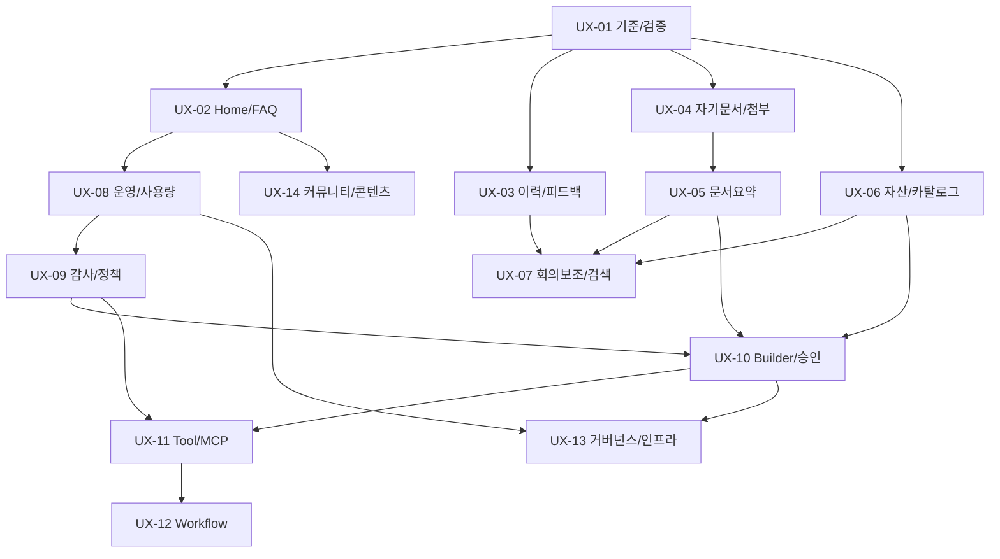

# 기능 중심 단계별 개발 추진 검토안

**목적:** 기존 멀티테넌트 AI 포털을 기반으로 시연의 사용자 업무 흐름과 관리자 운영 기능을 실제로 수행하는 플랫폼으로 확장합니다. 일정/마감/예상 기간을 전제하지 않습니다. 아래는 범위·순서 검토안이며 신규 기능 상세 설계 승인이나 구현 완료를 의미하지 않습니다.

**검토 기준:** [[07 시연 비교 자료 재검토와 개발 범위 조정안]], 원본 [[05 시연 화면과 구현 기능 비교 분석 보고서]], [[06 제안 시연 전체 화면(36종) 대비 기능 비교 분석]]. 기존 소스는 변경하지 않았습니다.

## 1. 단계와 진입/종료 기준

| 단계 | 우선 작업 | 진입 조건 | 종료 조건 |
|---|---|---|---|
| A 기준·안정성 | UX-01 | 현재 구현과 시연 목록 확보 | 화면 버전/하위요구/미확인 검증/역할·데이터 확정 |
| B 사용자 핵심 흐름 | UX-02~05 | A의 해당 요구 확정 | 자기 문서 첨부→처리/게시→질문→근거→이력/피드백이 실제 동작 |
| C Agent·업무 확장 | UX-06/07 | 자산 계약·B 문서지원 능력 확인 | 허용 카탈로그→핀/실행→회의 보조/통합 검색; 회수·전환 검증 |
| D 운영·감사·정책 | UX-08/09 | 역할·집계·감사 계약 확정 | 운영지표/한도/Export·감사조회 실동작. PII 등은 개별 평가 후 표시 |
| E Builder·Tool·Workflow | UX-10~12 | C/D의 자산·권한·정책 기초 | 버전·시험·승인·읽기 도구 실행 후 실행 가능한 Canvas 검증 |
| F 거버넌스·인프라·콘텐츠 | UX-13/14 | 관련 데이터·정책·운영 대상 확정 | 검토 가능한 보고서·과제/콘텐츠 운영 및 환경 복원·인계 증거 |

D의 기본 운영 Home은 B/C와 독립 검토 가능하지만 자산 통계는 UX-06 이후, 정책/예외 화면은 UX-09/10의 실제 데이터 이후 활성화합니다. “후속”은 삭제가 아닌 선행 조건을 가진 범위입니다. 관련 실행·제품 요구가 확정된 하위 프로젝트만 상세 설계합니다.

그래프는 주요 선행 관계이며, 각 작업 아래의 세부 조건을 함께 적용합니다. 조회 화면을 먼저 만드는 경우에도 데이터/권한 계약이 확정되지 않은 기능을 사용 가능으로 표시하지 않습니다.

## 2. 작업 묶음

각 묶음은 해당 기능의 데이터/API/권한/화면/시험을 포함합니다. 기존 파일과 API 이름이 비슷하다는 이유로 서버가 이미 완성된 것으로 처리하지 않습니다. 실제 구현은 하위 설계에서 API·schema·호출계약을 확정한 후 진행합니다.

### UX-01 범위·화면 기준과 검증 기준 정리

- **우선순위:** 최우선
- **선행 조건:** 없음
- **개발 범위:** 35개 화면 의미/36기본파일/6변형/8시나리오의 선택 버전·하위 기능 ID, 현재 구현/검증/미구현을 분리. 기존 미확인 조합·성능·깨끗한 설치/복원을 새 요구와 별도 목록으로 연결.
- **완료 기준:** 화면 ID마다 채택본·범위·역할·데이터·완료 기준·선행 작업이 있음. 완료율 산식 미정 상태의 % 사용 없음. 기존 검증 미실행을 통과로 바꾸지 않음.
- **주요 산출물:** 요구 추적표·화면 인벤토리·선행 관계표

### UX-02 포털 Home·메뉴·FAQ 안내

- **우선순위:** 높음
- **선행 조건:** UX-01
- **개발 범위:** 허용 서비스 바로가기, 사용자/관리자 탐색, 모바일 메뉴, 처음사용 안내. 첫 버전 공지는 정적 안내로 표시하고 가이드 챗봇은 FAQ로 제공.
- **완료 기준:** 현재 조직/권한에서 가능한 메뉴만 보임. 직접 URL/API 거부 유지. 조직전환의 늦은 응답 혼입0. FAQ와 실제 AI 답변을 구분.
- **주요 산출물:** Home/탐색 상세설계·화면 검증

### UX-03 대화 관리·피드백

- **우선순위:** 높음
- **선행 조건:** UX-01
- **개발 범위:** 대화 제목·핀·이력 검색·삭제 정책, 답변 좋아요/싫어요/의견. 본인/tenant 키와 revision·중복 접수 처리.
- **완료 기준:** A-U1 데이터는 A-U2/관리자 역할만으로 읽거나 편집할 수 없음. 삭제한 대화는 신규 요청/재조회 차단. 기존 발생 비용·필수 감사는 보존. 피드백 중복/변경이 명확.
- **주요 산출물:** 메타데이터/API/보존 설계·서버/화면 시험

### UX-04 자기 문서함·질문 첨부

- **우선순위:** 높음
- **선행 조건:** UX-01
- **개발 범위:** 일반 사용자 자기 소유 업로드와 게시 후 질문 첨부. 초기 TXT/MD 단일 업로드, 기존 worker·version·근거 연결 재사용. PDF/Office·일괄 업로드는 별도 추가 요구.
- **완료 기준:** 사용자가 owner/reader/조직 범위를 위조할 수 없음. 관리자 업로드 권한을 일반사용자에게 그대로 주지 않음. 접수/처리/게시 상태 구분; 동일 업로드 재전송 중복0. 게시 전 질문은 명시 보류.
- **주요 산출물:** 사용자 업로드 권한·문서 상태/API/질문 첨부 화면

### UX-05 일반 문서 요약·회의 문서 처리

- **우선순위:** 높음
- **선행 조건:** UX-04
- **개발 범위:** 기존 규정 typed fact RAG와 별도의 문서 지원 범위·답변 계약을 정의. 회의 결정사항·결산 요약은 합성 문서로 근거 있는 요약/보류/지원외 결과를 검증.
- **완료 기준:** 원문에 없는 숫자/날짜/결정사항을 생성하지 않음. 인용 위치/원문 버전 검증. 다른 tenant/회수 자료 사용0. 중앙 permit/원장·입력 상한·취소·unknown 비용 보존 유지. 기존 규정 RAG 회귀 성공.
- **주요 산출물:** 문서 유형별 답변 계약·평가셋·요약 실행/근거 화면

### UX-06 Agent 자산·카탈로그·My Agent

- **우선순위:** 높음
- **선행 조건:** UX-01; 목록/핀은UX-02 연계, 실행은UX-05 이후 필요한 범위 활성화
- **개발 범위:** 동적 Agent ID·종류·버전·공개범위·소유자, 읽기용 카탈로그/상세와 사용자 핀. 초기 모델/실행능력은 승인된 기존 공급자·제한된 유형으로 유지.
- **완료 기준:** 고정2개 Literal/CHECK·실행권한·conversation snapshot의 변경 영향 검증. 핀 추가는 권한 부여가 아님. 비허용 자산 검색/통계/제목0. 임의 모델/key/URL/tool 등록 우회 차단. 이전 대화/버전 불변.
- **주요 산출물:** 자산 모델/허가 설계·카탈로그 API·목록/상세/핀 화면

### UX-07 회의 보조·통합 검색

- **우선순위:** 높음
- **선행 조건:** 회의 보조:UX-05/06; 통합 검색:UX-03/04
- **개발 범위:** 회의명·일시·참석자·기록 입력→결정사항/담당/스크립트→개인 저장. 문서와 본인 대화의 권한내 검색·스니펫·원문 이동.
- **완료 기준:** 회의 스크립트 제안과 실제 회의 결정사항을 구분. 지원외/근거부족 명시. 검색제목·스니펫·건수와 캐시도 ACL 적용. 조직전환/Grant회수 뒤 결과/본문 차단.
- **주요 산출물:** 회의 입력/출력 계약·검색 API·회의 패널·시나리오 시험

### UX-08 관리자 운영 Home·사용량·Export

- **우선순위:** 높음
- **선행 조건:** UX-01/02
- **개발 범위:** 8대 메뉴는 제공 기능의 상태를 표시하며 단계적으로 활성화. 현재 사용량/예약/unknown·중지/한도 집계로 Home 구성. 기간별 추이·CSV Export는 서버 집계/권한을 추가.
- **완료 기준:** tenant관리와 project 읽기/변경 권한 분리. PII/GPU/TPS/SLO를 실제 수집 전 수치로 표시하지 않음. Mock/real 분리, 내부 추정과 청구 구분. Export에도 권한/범위·스프레드시트 수식 입력 처리.
- **주요 산출물:** 운영 메뉴/지표 정의·집계/Export API·대시보드/사용량 화면

### UX-09 감사조회·Scope·PII/정책

- **우선순위:** 높음, 감사조회부터 단계화
- **선행 조건:** UX-08; 자산정책UX-06, 예외승인UX-10와 계약 합의
- **개발 범위:** 요청→run/Job→call의 최소 메타데이터 감사조회. 새 조회 capability·보존·페이지/Export. PII/정책은 별도 탐지→차단/마스킹→사유→감사·평가 모듈.
- **완료 기준:** 관리자라는 이유로 개인 질문/답변/제목 공개0. PII 오탐/미탐 합성 평가. 정책을 일반/문서/RAG 입력·출력 어느 경계에 적용하는지 명시. 예외승인이 tenant/원문 ACL을 우회하지 않음.
- **주요 산출물:** 감사조회 권한/API·정책 평가셋·Scope/감사/위반 화면

### UX-10 Builder·자산 버전·승인·평가

- **우선순위:** 중간
- **선행 조건:** UX-05/06; 활성화 승인UX-09 정책 연결
- **개발 범위:** 제한된 Agent/Prompt/RAG 설정의 draft→시험→승인→활성화→이전 승인버전 복귀. 자산 복제·이용 신청. 평가 실행/결과를 제품 기능으로 연결.
- **완료 기준:** 복제는 원본 접근권한·비밀값·Grant를 자동 복제하지 않음. 현재권한/예상revision 검사. 검토자와 작성자 정책 명시. 완료/진행 run snapshot과 발생비용 불변. 설정 버전 복귀와 인프라 롤백을 구분.
- **주요 산출물:** Builder 모델/버전/승인 계약·평가 API·작성/시험/승인 화면

### UX-11 Tool/MCP 연결

- **우선순위:** 후속
- **선행 조건:** UX-06/09/10
- **개발 범위:** 커넥터 등록·허용 작업·credential 비공개 저장·tenant 대리 권한·읽기 도구부터의 실행 통제. Tool 호출 경로/비용/감사·실패 계약 신규 설계.
- **완료 기준:** 자산에 URL을 넣는 것만으로 호출하지 않음. 허용된 도구/행위·현재 주체를 매번 검사. 모델 출력은 승인/권한으로 쓰지 않음. key/log/tenant 혼입0. 필요 시 사용자의 쓰기 승인과 재실행 중복방지 계약.
- **주요 산출물:** 도구 실행 허가 설계·읽기 connector1개·통합 시험

### UX-12 Workflow Canvas와 실행엔진

- **우선순위:** 후속
- **선행 조건:** UX-10/11
- **개발 범위:** 먼저 선형 LLM→읽기Tool→검증 흐름을 실행 가능한 데이터 모델로 정의; 다음 시각 편집기. 분기/루프는 횟수·비용·시간 제한을 정의한 뒤 확장.
- **완료 기준:** 그림만 저장하고 실행 가능하다고 표시하지 않음. 각 노드의 입력/출력·snapshot·오류·취소·정산을 검증. 동시/재시작·중복 side effect 제어. tenant·원문 ACL은 모든 노드에 유지.
- **주요 산출물:** Workflow 모델/엔진·노드별trace·Canvas·장애 시험

### UX-13 거버넌스·과제·인프라 운영 확장

- **우선순위:** 후속, 하위 프로젝트 분리
- **선행 조건:** UX-08/09/10; 도구/워크플로우 자산은UX-11/12 연계
- **개발 범위:** 위험평가/담당자/과제·예산·컴플라이언스 보고 데이터, 사람 검토와 Export. 관제·환경 릴리스/복원은 운영 하위 프로젝트. GPU/CPU는 실제 자체 서빙 필요 확정 시 별도 정의.
- **완료 기준:** 보고서의 근거·검토자·정책 버전 추적. 자동 법규 준수 인증으로 표시하지 않음. 실제 환경 설치·backup/restore·헬스체크/롤백 시험. 외부 API만 사용하는 현재 상태에 가짜 GPU 할당 데이터 없음.
- **주요 산출물:** 평가/과제 모델·검토 보고서·운영/복원 절차 및 검증

### UX-14 커뮤니티·공지·가이드 서비스

- **우선순위:** 후속
- **선행 조건:** UX-02; 자산연계UX-06/10
- **개발 범위:** 게시물·공지·FAQ 관리, 노출범위/검색·신고·삭제/보존. FAQ 기반 가이드 AI는 필요 시 별도 정식 기능으로 확장.
- **완료 기준:** 비공개 자료·삭제 게시글의 검색/미리보기·AI답변 노출0. 사용자 입력 콘텐츠의 안전한 렌더링. 정적 FAQ와 생성 답변 출처/모드 구분.
- **주요 산출물:** 콘텐츠 모델/API·관리화면·가이드/게시판 시험

## 3. 공통 구현·검증 원칙

- 기존 React/TypeScript/FastAPI/PostgreSQL·RLS·공통코어를 재사용합니다. 상용 API G/W 없이 현재 인증/tenant 검사와 애플리케이션 요청 통제를 확장합니다. API G/W 전체 운영 기능이나 외부 API 상품화가 이미 구현된 것으로 표시하지 않습니다.
- 현재 중앙 AI Gateway와 원장·정산을 통해 실행합니다. 화면/새 Agent/Tool에서 SDK를 직접 호출하는 우회 경로를 만들지 않습니다.
- 초기에는 기존 모델 정책을 유지합니다. 다중 모델 선택·모델별 과금은 신규 범위 확정 후 별도 설계하며, 시연의 선택 박스를 그대로 추가해 허가되지 않은 모델을 발사하지 않습니다.
- Mock/real·실제/합성 자료·내부 비용 추정/청구액을 구분합니다. 자동 시험은 합성 자료와 모의 공급자를 기본으로 하고 실제 대표 시험은 사전 한도 내 최소 호출·명시 재시도로 수행합니다.
- 기존 primary DB/발생 비용·과거 증거/GraphRAG 원본을 보존합니다. 새로운 기능 때문에 데이터를 초기화하거나 기존 unknown을0원으로 정리하지 않습니다.
- 사용자·조직관리자·플랫폼관리자의 새 읽기/쓰기 권한은 명시합니다. 자산 등록/핀/복제/결재·관리자 화면이 문서 ACL을 확장하는 근거가 되지 않습니다.
- 기능별 정상·외부tenant/개인자료 접근·현재권한 회수·동시 revision·네트워크 결과불명·재시작·비용 보존을 검증합니다. 전 범위를 매번 반복하는 대신 변경 영향과 관련 경계에 맞는 시험을 선택합니다.
- 데이터 없는 운영지표는 “미수집/준비 중”으로 표시합니다. 모의 지표는 모의로 식별하며 규제준수/정산확정/실제 관제 값으로 표시하지 않습니다.

## 4. 기존 산출물 단계에 반영하는 방법

| 기존 단계 폴더 | 이번 확장 시 기록할 내용 | 다음 단계로 넘어가는 기준 |
|---|---|---|
| `100.프로젝트계획` | 본 검토안과 우선순위/선행 관계 | 대상 하위 작업을 선택 |
| `210.아키텍처정의` | 현재 fixed Agent·4operation과 새 자산/Tool 경계 | 재사용·변경·신규 영역과 권한 경계 설명 가능 |
| `220.요구정의` | 시연ID/8시나리오별 하위요구·포함/후속·역할·완료조건 | 요구별 판정·동작 예시 확정 |
| `230.분석` | 현재 API/모델 격차·삭제/공유/복제 영향·문서 유형 | 화면만 바꾸면 되는 범위와 서버 신규 범위 분리 |
| `240.설계` | 선택된 UX작업의 화면/API/schema·권한·버전·실패/보존 | 리뷰 가능한 설계 확정 |
| `250.구현` | 해당 작업의 서버/화면 구현·변경 기록 | 합의된 하위 기능 실동작 |
| `260.모듈테스트` | 권한/상태/정산/출력 계약의 변경 영향 시험 | 개별 실패·미실행 구분 |
| `270.파일럿적용` | 사용자 실제 화면 피드백·시나리오 확인 | 실제 피드백과 자동 검증을 분리 기록 |
| `280.통합시스템테스트` | 업무흐름·복수 조직·회수/경합·실제 대표·성능 | 요구별 pass/fail/not_run 근거 |
| `290.이행` | 새 환경 설치·DB/migration·backup/restore·실행 가이드 | 깨끗한 환경 재현 및 복원 확인 |
| `300.프로젝트종료` / `400.프로젝트관리` | 인계·사용 가이드·수용/후속 목록·의사결정 | 미완료와 제외 범위를 포함해 합의 기록 |

실제 존재하는 모듈시험 폴더 이름은 `260.모듈테스트`이며 과거 일부 결과는 `260.테스트`에 있습니다. 기존 자료를 이동하지 않고 새 작업의 근거 위치를 명시해 연결합니다. 기존 날짜가 포함된 WBS는 과거 기준으로 보존했으며 이번 확장 검토의 일정 조건으로 사용하지 않습니다.

## 5. 다음 착수 작업의 구체적 검토 범위

첫 작업은 **UX-01의 요구 기준선 정리**입니다. 산출물은 `220.요구정의`의 “시연 기능 확장 요구사항 추적표”와 `230.분석`의 “현재 구현 대비 변경 영향 분석”으로 구성합니다. 이번에는 해당 하위 산출물을 미리 완료 처리하지 않습니다.

1. 화면별 기본/2차 채택본을 명시하고 35개 화면 의미에8대 시나리오 요구를 연결합니다.
2. “완료” 표기를 하위 동작으로 나눕니다. 예: Chat=질문/SSE/취소/파일첨부/피드백/모델선택. 각각 현재 구현·현재 검증·추가 개발을 기록합니다.
3. 사용자 자기문서 업로드와 새로운 문서요약 범위, 이력 삭제/보존, Agent 등록/공개 방식의 결정을 명시합니다.
4. 기존 미확인 요구 조합·실제 Q20·성능·설치/복원을 안정성 목록에 보존하고 신규 화면 완료와 합산하지 않습니다.
5. 먼저 UX-02~05 중 한 작업의 API·데이터·권한·화면·실패/완료 기준을 상세 설계하고 사용자 화면 검토 결과를 반영합니다. 추천 첫 구현 묶음은 **UX-03 이력·피드백**이며, 서버/화면의 완결 범위가 작고 기존 대화에 바로 연결할 수 있습니다. 핵심 시연 선행 작업 UX-04 자기문서/첨부를 이어 진행합니다.

현재 목적은 개인 학습과 향후 제안·시연입니다. 처음부터 모든 엔터프라이즈 운영 기능을 동시에 개발하지 않고, 실제로 끝까지 사용할 수 있는 흐름 단위로 구현·검증·시연 자료를 쌓는 방향을 권고합니다.
