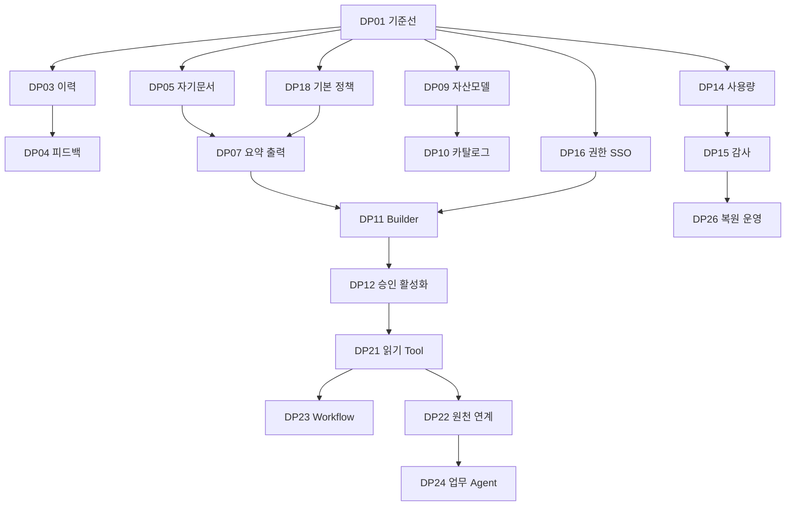

# 비거버넌스 AI 플랫폼 상세 개발 계획서 Implementation Plan

> **For agentic workers:** REQUIRED SUB-SKILL: Use superpowers:subagent-driven-development (recommended) or superpowers:executing-plans to implement this plan task-by-task. Steps use checkbox (`- [ ]`) syntax for tracking.
>
> 위 안내는 향후 구현 시 참고할 실행 방식입니다. 이번 요청은 계획서 작성이며 자동 구현·자동 위임을 시작하지 않습니다. 이 문서의 신규 API/파일/정책은 제안 계약으로, 기존 기능으로 간주하지 않습니다.

**Goal:** 거버넌스 포털을 제외한 사용자·관리자 AI 플랫폼을 기존 멀티테넌트/GraphRAG 기반에서 단계적으로 확장합니다.

**Architecture:** React/Vite 사용자·관리자 화면과 FastAPI 도메인 모듈을 확장합니다. PostgreSQL RLS·현재 권한 확인·불변 실행 snapshot·중앙 AI 허가/원장을 모든 새 기능에 유지하며, 외부 Gateway 구매 없이 공통 인증/한도/라우팅 모듈로 연결합니다.

**Tech Stack:** 현재 저장소의 React/TypeScript/Vite, FastAPI/Python, PostgreSQL/pgvector와 `src/common_core/ai_pipeline`을 유지합니다. Python >=3.13,<3.14, Node 22.23.1은 현행 설정입니다. 신규 라이브러리는 이 계획으로 설치하거나 버전을 변경하지 않습니다.

**Spec:** [09 제안 구축 분석 대비 현재 구현 비교 보고서(거버넌스 포털 제외)](</Users/jwpios/antigravity/202610_AI 플랫폼/docs/Obsidain/100.프로젝트계획/09 제안 구축 분석 대비 현재 구현 비교 보고서(거버넌스 포털 제외).md>). 상세 F/IA/T 원장은 해당 보고서의 근거 폴더를 사용합니다.

## Global Constraints

- AI 거버넌스 포털 F-050~060 및 SCR-GOV35개는 구현 범위에서 제외합니다.
- F-001~049에 별도로 정의된 관리자 보안·감사·SOD·배포/반입/과제 승인은 유지합니다.
- 일정/마감 제약은 없습니다. 특정 완료일·기간·전체 완료율을 약속하지 않습니다.
- 개인 학습·향후 제안 시연 목적입니다. 합성 데이터/모의 실행 우선, 실제 모델은 현재 승인된 저비용 설정을 재사용합니다.
- 논리적 조직 격리가 우선입니다. Private 서빙/GPU/Cell/K8s/기관 DRM·SSO 실연계는 조건부 하위 범위로 관리합니다.
- API G/W 상용 솔루션을 도입하지 않습니다. 기존 앱 공통 모듈과 표준 프로토콜 경계를 확장합니다.
- 사용자/tenant/role은 서버의 인증 컨텍스트에서 결정하며, body/모델출력의 값을 권한으로 사용하지 않습니다.
- 관리자 역할만으로 개인 대화·원문 열람을 허용하지 않습니다. 회수·한도·중복 실행·unknown 비용 보존은 완화하지 않습니다.
- 실행 중/완료 run snapshot·원문 version·발생 비용/감사 기록은 설정 변경/삭제/복제/복귀로 덮어쓰지 않습니다.
- T-019/020/029/034/062는 원본 최초오픈 제외로 추적하며 이번 구현 범위에 자동 추가하지 않습니다.

---
## 1. 개발 전략과 완료 범위

현재 기준선은 비교 보고서가 기록한 코드 `480250dc7ae6d303fc9576af22f80f8a5c4d2d10`입니다. 이번에는 계획 문서만 작성하며 기존 소스/원본 제안/비용/검증 상태를 변경하지 않습니다. 현재 일반 Chat·규정 RAG·조직 격리·문서 Job·사용량 기반 위에서, 사용자 핵심 흐름을 먼저 완성하고 자산·관리자·연계를 추가합니다.

단일 개인 개발로 원본의 모든 기업 운영 환경을 동시에 구축하는 방식은 권고하지 않습니다. 서로 독립적으로 수용 가능한 하위 계획으로 나누며 한 묶음마다 실제 동작/음성 시험/화면 검토를 완료합니다. 원본 요구를 삭제하는 대신 개인 구현·실기관 연계·조건부 인프라를 구분합니다. Spring Boot/Next.js로 전면 교체하거나 GPU를 먼저 구매하는 작업은 포함하지 않습니다.

| 제공 수준 | 채택 범위 | 완료 판정 |
|---|---|---|
| R1 사용자 실사용 | Home·이력/피드백·자기문서/첨부·근거요약·출력, 기본 감사/정책 | 합성 데이터로 end-to-end 동작·A/B owner/tenant 차단·비용 회귀·직접 화면 수용 |
| R2 자산/관리자 | 동적 Agent/Prompt·카탈로그/핀·Builder/평가/승인·역할·운영/피드백 | 기존 고정2종 호환·불변버전/SOD·공유/회수·집계/감사 일치 |
| R3 표준 연계/업무 확장 | 외부 API·읽기 Tool/MCP·합성 RDB/NAS·Workflow·10 업무 Agent | 커넥터/노드별 실행/권한/오류/재시작 증거와 업무별 평가 |
| R4 운영 인계 | 콘텐츠/과제·새환경설치·새DB restore·10 합성 tenant 검증 | 재현 가능한 manifest/런북·복원/병렬격리·사용자 수용 |
| 조건부 운영 확대 | 실제기관 SSO/AD·DRM/DLP/권원·운영망/DB·Private/GPU/Cell/HA | 실제 환경/자료/adapter 계약 확보 후 별도 증거. 모의 통과는 실연계 완료 아님 |

R1~R4는 기간이 아닌 기능 수용 묶음입니다. 새 기능에 필요한 기본 정책 DP-18과 권한은 해당 기능 실행 전에 적용합니다. 첫 구현은 DP-03 이력 관리, 이후 DP-04 피드백·DP-05 자기문서로 진행합니다. DP-03의 구현 전에 DP-01 요구 수용기준과 해당 DP의 SQL/API 상세 설계를 닫습니다.

## 2. 프로젝트 단계별 산출물과 진행 규칙

숫자 폴더는 기존 분류를 유지합니다. 실제 수행 순서는 모듈시험→통합시험→파일럿→이행이며, 폴더 번호만으로 실행 순서를 정하지 않습니다. `260.테스트`와 `260.모듈테스트`가 공존하므로 새 확장 시험은 `260.모듈테스트`에 기록하고 기존 자료는 이동하지 않습니다. 각 DP 묶음도 요구→분석→설계→구현→시험→수용 단계를 통과합니다.

| 단계 폴더 | 주요 산출물 | 단계 완료 기준 |
|---|---|---|
| 210.아키텍처정의 | 현재구조+API/AI/Tool경계, 논리 tenant/queue/cache/key, 환경 분리 | 현행 코드와 제안 차이를 명시하고 DP별 경계/호환 방식을 정의 |
| 220.요구정의 | F49/IA115/T62 하위요구·권한·수용기준·범위 | 요구별 주작업과 evidence ID가 있으며 제외/조건부가 명시 |
| 230.분석 | 업무흐름·자료상태·원문권원·현재 SQL 함수/호출 분석 | 현재구현과 신규 계약, 데이터보존/영향/실연계의 차이 확인 |
| 240.설계 | DP 묶음별 schema/API/권한/화면/오류·비용·migration 설계 | 모델/API/DB/화면의 이름과 상태전이가 일치 |
| 250.구현 | 작업별 서버·DB·화면 세로 개발 및 migration | 해당 작업의 정상/음성 시험을 통과하는 독립 동작 |
| 260.모듈테스트 | 도메인·RLS·동시성·한도·회수·정책·parser 단위/모듈 시험 | 각 작업의 case 결과/해시/환경을 저장하고 미실행 분리 |
| 280.통합시스템테스트 | 사용자→Gateway→문서/Agent→원장→감사 통합, 회귀/부하/복원 | 채택 범위의 수용 case와 evidence가 연결 |
| 270.파일럿적용 | 휴대폰/PC 직접 사용자 시나리오와 의견/결함 | 사용자 수용/보완요청을 기록하고 중요 결함 닫음 |
| 290.이행 | 배포manifest·환경설정·backup/restore·런북·권한 인계 | 새 환경 재현/복원과 중지/복귀가 증거로 확인 |

프로젝트 종료는 `300.프로젝트종료`에 제공 범위/조건부/잔여 사항을 기록합니다. 변경요청·위험·의사결정·진척은 `400.프로젝트관리`에서 관리합니다. 확정되지 않은 제품 상세는 작업의 설계 단계에서 검토하고, 외부 쓰기/배포 요청은 기존 사용자 승인 범위에 따라 판단합니다.

## 3. 모듈별 개발 구조와 공통 인터페이스

| 경로 | 책임 |
|---|---|
| src/frontend/src | Home·대화/문서·Catalog/Builder·관리자·Workflow UI. 서버 capability 기반 표시 |
| src/backend/app/conversations, documents, execution | 현행 세션/대화/run/문서/version/근거/원장 연결 확장 |
| src/backend/app/assets, feedback, meetings, search | 신규 자산/평가/승인·피드백·회의·검색 도메인 |
| src/backend/app/authorization, audit, policies, protection | 명시 capability·최소감사·정책/마스킹·권원/보호 adapter |
| src/backend/app/api_clients, tools, connectors, workflows | 서비스 인증·읽기도구·데이터 연계·Workflow 실행. 모두 중앙 허가 연결 |
| src/backend/app/ai | 현행 AI Gateway/원장+승인 모델 Registry/라우팅 |
| src/common_core/ai_pipeline | 기존 GraphRAG 공통 처리 재사용. 새로운 UI/세션/tenant 관리 코드는 넣지 않음 |
| src/backend/migrations | 새schema/정책함수/RLS, expand→backfill→검증→compat읽기→후속contract |
| src/backend/tests, src/frontend/tests | 기존 fixture/폐기용DB·MockProvider·Playwright를 사용한 작업별 회귀/음성 시험 |
| ops | 환경manifest·배포/backup/restore/장애 런북. 조건부 실환경과 로컬 검증 분리 |

신규 이름은 구현 계획의 제안 경로입니다. 현재 파일 존재 여부와 신규 파일을 하위 계획에 구분했습니다. 현재 migration은000~020이며021~024는 첫 네 schema 작업의 예약명입니다. 그 뒤 schema는 앞선 실제 migration 순서를 확인하고 신규 설계에서 번호를 배정합니다. 기존 숫자/count를 고정한 catalog 시험은 새schema의 실제 검증으로 조정하되 기존 RLS/정책 안전성 assertion을 삭제하지 않습니다.

모든 새 HTTP 응답은 기존 `response(request,data)` envelope와 서버 request ID를 유지합니다. 신규 DTO는 extra=forbid, 실제 ID UUID, 크기 제한, 현재 AuthContext를 사용합니다. mutable resource는 expected_revision 낙관적 잠금; 실행/외부작업은 client_send_id/client_operation_id idempotency를 사용합니다. HTTP422는 형식/미허용필드,409는 상태/revision/ID 내용충돌,403은 인증된 주체의 허가거부,404는 타소유 private 자원 숨김,429는 호출한도,503은 stop/의존서비스 실패로 정합니다. 기존 에러코드와 다른 명칭은 해당 설계에서 함께 등록합니다.

## 4. 상세 WBS와 선행 관계

| 작업 | 범위 | 선행 | 검토/시험 단위 |
|---|---|---|---|
| DP-01 | 요구·화면·검증 기준선 확정 | 없음 | 독립 산출물+case+수용 증거 |
| DP-02 | 포털 구조·공통 UX·Home·도움말 | DP-01 | 독립 산출물+case+수용 증거 |
| DP-03 | 대화 제목·핀·검색·삭제 | DP-01 | 독립 산출물+case+수용 증거 |
| DP-04 | 답변 평가·피드백·개선관리 | DP-03 | 독립 산출물+case+수용 증거 |
| DP-05 | 자기 문서함·업로드·질문 첨부 | DP-01 | 독립 산출물+case+수용 증거 |
| DP-06 | 파일 파서·OCR·수집 검사 확장 | DP-05, DP-18 | 독립 산출물+case+수용 증거 |
| DP-07 | 일반 문서 요약·재생성·출력 | DP-05, DP-18 | 독립 산출물+case+수용 증거 |
| DP-08 | 회의 보조·권한 내 통합검색 | DP-03, DP-07, DP-10 | 독립 산출물+case+수용 증거 |
| DP-09 | 동적 자산 모델·고정 Agent 호환 이전 | DP-01 | 독립 산출물+case+수용 증거 |
| DP-10 | 카탈로그·My Agent·사용권한·공유 | DP-09, DP-02 | 독립 산출물+case+수용 증거 |
| DP-11 | Builder·Prompt/RAG Playground·복제 | DP-07, DP-09, DP-16 | 독립 산출물+case+수용 증거 |
| DP-12 | 자산 검토·승인·활성화·설정 복귀 | DP-11, DP-17, DP-18 | 독립 산출물+case+수용 증거 |
| DP-13 | 모델 Registry·다중모델 Gateway | DP-09, DP-18 | 독립 산출물+case+수용 증거 |
| DP-14 | 사용량·운영 대시보드·CSV Export | DP-01, DP-02 | 독립 산출물+case+수용 증거 |
| DP-15 | 감사조회·최소 Trace·보존/출력 | DP-14 | 독립 산출물+case+수용 증거 |
| DP-16 | 역할·조직·SOD·SSO 연계 | DP-01 | 독립 산출물+case+수용 증거 |
| DP-17 | 데이터 Scope·공유·반입 승인 | DP-05, DP-15, DP-16 | 독립 산출물+case+수용 증거 |
| DP-18 | PII·콘텐츠 정책·가드레일 | DP-01 | 독립 산출물+case+수용 증거 |
| DP-19 | 데이터 보호·DRM/DLP·권원 adapter | DP-16, DP-17, DP-18 | 독립 산출물+case+수용 증거 |
| DP-20 | API Gateway·표준 외부 API | DP-13, DP-16, DP-18 | 독립 산출물+case+수용 증거 |
| DP-21 | 읽기 Tool/MCP Gateway·Connector | DP-12, DP-18, DP-20 | 독립 산출물+case+수용 증거 |
| DP-22 | RDB/NAS·데이터 가상화·망연계 | DP-17, DP-19, DP-21 | 독립 산출물+case+수용 증거 |
| DP-23 | Workflow 모델·실행엔진·Canvas | DP-12, DP-21 | 독립 산출물+case+수용 증거 |
| DP-24 | 업무 Agent 10종 단계별 평가 | DP-07, DP-10, DP-12, DP-22 | 독립 산출물+case+수용 증거 |
| DP-25 | 공지·CMS·커뮤니티·과제·알림 | DP-02, DP-04, DP-12, DP-16 | 독립 산출물+case+수용 증거 |
| DP-26 | 환경 배포·백업 복원·관제·확장 | DP-14, DP-15, DP-20 | 독립 산출물+case+수용 증거 |
| DP-27 | 조건부 Private 서빙·GPU 관리 | DP-13, DP-26 | 독립 산출물+case+수용 증거 |
| DP-28 | 통합시험·파일럿·이행·인계 | DP-02, DP-03, DP-04, DP-05, DP-07, DP-09, DP-10, DP-14, DP-15, DP-18 | 독립 산출물+case+수용 증거 |



이 그림은 주요 경로이고 전체 선행은 WBS 표를 적용합니다. 스펙/설계에 필요한 계약은 구현 선행과 구분하여 미리 작성할 수 있습니다. DP-24는10종 업무별 평가 gate를 적용하며 DP-27은 조건부입니다. DP-28은 각 릴리스 범위의 시험이며 후속 기능 전체가 끝날 때까지 기다리는 단일 최종 시험이 아닙니다.

## 5. 상세 하위 계획과 추적표

- [01 범위와 기준선 개발 계획](</Users/jwpios/antigravity/202610_AI 플랫폼/docs/Obsidain/200.프로젝트실행/240.설계/비거버넌스 확장 개발 계획/01 범위와 기준선 개발 계획.md>): 요구·검증 기준선
- [02 사용자 포털 상세 개발 계획](</Users/jwpios/antigravity/202610_AI 플랫폼/docs/Obsidain/200.프로젝트실행/240.설계/비거버넌스 확장 개발 계획/02 사용자 포털 상세 개발 계획.md>): 사용자 포털
- [03 자산 Agent Builder 상세 개발 계획](</Users/jwpios/antigravity/202610_AI 플랫폼/docs/Obsidain/200.프로젝트실행/240.설계/비거버넌스 확장 개발 계획/03 자산 Agent Builder 상세 개발 계획.md>): 자산·Agent Builder
- [04 관리자 보안 상세 개발 계획](</Users/jwpios/antigravity/202610_AI 플랫폼/docs/Obsidain/200.프로젝트실행/240.설계/비거버넌스 확장 개발 계획/04 관리자 보안 상세 개발 계획.md>): 관리자·보안
- [05 Gateway Tool 업무 Agent 상세 개발 계획](</Users/jwpios/antigravity/202610_AI 플랫폼/docs/Obsidain/200.프로젝트실행/240.설계/비거버넌스 확장 개발 계획/05 Gateway Tool 업무 Agent 상세 개발 계획.md>): Gateway·연계·업무 Agent
- [06 콘텐츠 운영 환경 상세 개발 계획](</Users/jwpios/antigravity/202610_AI 플랫폼/docs/Obsidain/200.프로젝트실행/240.설계/비거버넌스 확장 개발 계획/06 콘텐츠 운영 환경 상세 개발 계획.md>): 콘텐츠·운영 환경
- [07 통합 검증 이행 상세 개발 계획](</Users/jwpios/antigravity/202610_AI 플랫폼/docs/Obsidain/200.프로젝트실행/240.설계/비거버넌스 확장 개발 계획/07 통합 검증 이행 상세 개발 계획.md>): 통합 검증·이행

- [비거버넌스 확장 개발 요구 추적표](</Users/jwpios/antigravity/202610_AI 플랫폼/docs/Obsidain/200.프로젝트실행/220.요구정의/비거버넌스 확장 개발 요구 추적표.md>): F49·IA115·T62별 현재 상태, 주개발 작업과 지원 작업

각 하위 계획에는 관련 F/T, 실제/신규 파일, 제안 API/입출력, schema/상태, 작업 단계, 시험 case와 종료 기준이 있습니다. 최종 source 계약은 해당 묶음의240 설계 산출물로 확정하므로 신규 API가 이미 제공되는 것으로 해석하지 않습니다.

## 6. 테스트·데이터·비용과 검수 방법

- 기존 폐기용 DB fixture와 MockProvider로 정상/오류/owner/tenant/revision/한도/회수/중복 case를 먼저 재현합니다. 비용이 있는 실제모델 호출을 실패 재현용으로 쓰지 않습니다.
- 일반사용자 A-U1/A-U2, 타조직 B-user, 조직관리자, project읽기/변경 담당을 구분합니다. 관리자라도 개인내용 접근 불가. 데이터/정책/공유 작업에는 권한회수 중 race case를 포함합니다.
- 기존 GraphRAG typed fact·exact quote·원문 version·vector/graph ACL을 회귀합니다. 요약/회의와 규정 답변을 같은 계약으로 확대하지 않습니다.
- 실제 모델은 현재 환경 설정과 stop/cap/permit/ledger를 재사용합니다. 모델/단가는 새로 선정하지 않습니다. 새실험은 사전 사례목록/최대호출/한도와 중단조건을 산출물에 기록하고 mock/real을 분리합니다.
- 기존 상세60의44pass/16not_run, ACL16의11pass/5not_run, V41하위143의135pass/8not_run은 새 기능의 자동 합격이 아닙니다. 새 hash/환경/case 기준으로 증거를 연결합니다.
- 성능·10tenant·새환경restore·실제 Q20·HA/DR은 기존 미확인 목록에 남깁니다. 측정 전 pass나 임의 목표달성 %를 기록하지 않습니다.
- 업무Agent의 내부 추론문은 저장/표시하지 않습니다. 노드 상태·도구 입출력의 허가된 최소값·근거·오류코드로 디버깅합니다.

시험 실행은 저장소에 이미 설정된 Python/Node 도구를 사용합니다. 아래는 향후 구현 후 실행할 명령이며 이번에 실행하지 않았습니다.

```bash
# cwd: src/backend
.venv/bin/python -m pytest tests/test_dp03_acceptance.py -q
# cwd: src/frontend
npm run build
npm run test:e2e -- tests/dp03-acceptance.spec.ts
```

각 DP의 서버시험 파일과 브라우저시험 파일은 하위 계획에 지정합니다. 전체 회귀는 schema/공통권한/gateway 변경 묶음 이후 한 번, 추가 변경/실패/새 우려가 생길 때 다시 수행합니다. 동일 시험 반복횟수를 진척률에 합산하지 않습니다.

## 7. 실행 관리와 위험 대응

| 위험/결정 | 개발 대응 | 완료 증거 |
|---|---|---|
| 고정 Agent/SQL CHECK 변경 | alias호환+snapshot 보존+expand/backfill+회귀 DP09 | 기존 대화/이력/근거/ledger hash와 새실행 모두 일치 |
| 새 화면의 tenant/원문 우회 | 서버 현재권한·RLS·회수gate, 목록/카운트/Export/캐시 포함 | 다른owner/조직 및 회수 중 negative case |
| PII/출력 필터 한계 | 규칙패턴 범위/오탐·미탐 공개, 검사전송/stream 정책 명시 | 합성 평가셋 결과와 미지원 목록 |
| 외부 연계 자료/환경 없음 | mock 계약 검증+실연계 blocked/not_run 기록 | 실제sandbox 확보 후 adapter별증거 |
| 과대 범위 | R1~R4 별도 수용·한 작업 진행 후 화면 검토 | 기능별 수용/보완/잔여표 |
| 비용/unknown/재호출 | 중앙 허가/원장, automaticfallback 금지, actual 최소대표 | send/call/receipt/예약/known/unknown 일치 |
| infra 운영비 증가 | 개인 MVP 유지, GPU/HA/Cell은 조건부 DP27/26 | 필요성·실환경·성능 측정 후 별도결정 |
| UI 전체 최종화 지연 | 공통 shell 후 실제업무동작과 같이 화면 개선 | 키보드/모바일/권한/UI 직접 수용 |

변경 요청은 `400.프로젝트관리/비거버넌스 확장 변경요청.md`에 요청→영향 F/IA/T→선행/데이터/권한/비용→채택/보류→시험/수용 순으로 기록합니다. 이 파일은 실제 첫 변경요청 발생 시 만듭니다. 진행은 작업별 미착수/설계중/구현중/시험중/수용/조건부로 표시합니다. 가중치/채택 범위를 확정하기 전 전체 %는 계산하지 않습니다.

## 8. 다음 착수 작업

1. DP-01에서 이력/피드백/자기문서의 하위요구와 current API/DB 계약을 확정하고 기존 미실행 시험을 분리합니다.
2. DP-03의021 migration·보존/revision·SQL 정책함수·조회 커서·API·화면을240 산출물로 닫습니다.
3. DP-03 정상/타소유/타조직/충돌/삭제/진행run case를 먼저 작성해 현재 실패를 확인합니다.
4. 서버→DB→이력 화면의 독립 변경을 구현하고 영향 회귀·모바일 화면 검토를 수행합니다.
5. 작업 증거를260/280에 저장한 뒤 DP-04 피드백, DP-05 자기문서/첨부를 순차 수행합니다.

이번 산출물은 위 개발의 계획서입니다. 제품 구현·유료 호출·원본자료 수정·배포는 수행하지 않았습니다.

## 9. 수행 상태

DP-01 요구 기준선 정의를 완료했습니다. [수행 결과](</Users/jwpios/antigravity/202610_AI 플랫폼/docs/Obsidain/200.프로젝트실행/220.요구정의/08 DP-01 요구 기준선 확정 결과와 구현 전달.md>)에 하위요구98개·첫 흐름 수용case12개·IA115/T62 연결과 검증 결과를 기록했습니다. 신규 제품 수용은 미실행이며 다음 작업은 DP-03 대화 이력 관리의240 상세 설계와 구현입니다.

DP-03 제목 변경·핀·제목 검색·논리 삭제의 구현과 모의 검증을 완료했습니다. [14 DP-03 대화 관리 검증과 후속 작업](</Users/jwpios/antigravity/202610_AI 플랫폼/docs/Obsidain/200.프로젝트실행/280.통합시스템테스트/14 DP-03 대화 관리 검증과 후속 작업.md>). 다음 작업은 DP-04 답변 피드백입니다. 전체 제안 요구사항 완료 및 기관 수용 검증과 구분합니다.

DP-04 답변 평가·비공개 의견·변경·철회와 최소 조직 집계의 구현·모의 검증을 완료했습니다. [15 DP-04 답변 피드백 검증과 후속 작업](</Users/jwpios/antigravity/202610_AI 플랫폼/docs/Obsidain/200.프로젝트실행/280.통합시스템테스트/15 DP-04 답변 피드백 검증과 후속 작업.md>). 다음 작업은 DP-05 개인 문서함·질문 첨부입니다. 전체 F013·F026 및 기관 수용 검증과 구분합니다.


### 최신 수행 상태 (2026-10-07)

DP-05 TXT/Markdown 개인 문서 등록·처리 상태·삭제·게시 버전 질문 첨부의 구현과 모의 검증을 완료했습니다. [[16 DP-05 개인 문서함 검증과 후속 작업]]에 결과를 기록했습니다. 다음은 [[13 DP-06 파일 파서 확장과 수집 검사 상세 작업 계획]]의 형식별 요구 기준과 DP-18 수집·색인 최소 정책 설계입니다. 신규 파일 형식 구현에 앞서 해당 정책 선행 조건을 충족합니다. 전체 F014/F015·DP-06·DP-18·기관 수용 완료로 확대하지 않습니다.


### DP-06 첫 파일 확장 묶음 수행 결과 — 2026-10-07

DP-06 P0 수집 최소 검사·P1 텍스트 PDF·PDF 관련P3를 구현·모의 검증했다. [[17 DP-06 텍스트 PDF와 수집 검사 검증 및 후속 작업]]에 고유 서버275개·전체 화면80개·빌드·기존32개 테이블 원본 열/행 보존과 유료 호출0회 결과를 기록했다. DP-06은 Office/OCR, DP-18은 일반 질문/출력/Tool 정책·조직별 정책 관리가 남은 부분 완료다. 다음 [[15 DP-06 DOCX 파서 확장 상세 작업 계획]]을 수행한다. 사용자 직접 인수·기관 운영 검증은 남아 있다.


### DP-06 DOCX 수행 결과 — 2026-10-07

제한된 DOCX 본문·표와 문단/셀 근거·등록 원본 내려받기를 구현·모의 검증했다. [[18 DP-06 DOCX 본문과 표 검증 및 후속 작업]]에 고유 서버339개·전체 화면83개·빌드·기존32개 테이블 원본 열/행과 SQL000~024 보존·유료 호출0회를 기록했다. DP-06은 XLSX/PPTX/OCR이 남은 부분 완료이며 다음 [[17 DP-06 XLSX 파서 확장 상세 작업 계획]]을 수행한다. DP-18 전체 정책 및 사용자 직접 인수/기관 검증은 후속이다.


### DP-06 XLSX 수행 결과 — 2026-10-07

제한된 XLSX 시트·셀과 출처·정확한 원본 내려받기를 구현·모의 검증했다. [[19 DP-06 XLSX 시트와 셀 검증 및 후속 작업]]에 고유 서버425개·전체 화면86개·빌드·기존32개 테이블 원본 열/행과 SQL000~024 보존·유료 호출0회를 기록했다. DP-06은 PPTX/OCR이 남은 부분 완료이며 다음 [[19 DP-06 PPTX 파서 확장 상세 작업 계획]]을 수행한다. 사용자 직접 인수/기관 검증 및 DP-18 전체 정책은 후속이다.


### 작업 순서 변경 — 2026-10-07

사용자 요청으로 PPTX·OCR을 후속 보류한다. DP-06은 제한 PDF/DOCX/XLSX 검증 부분 완료이며 전체 완료로 처리하지 않는다. 이전 ‘다음 PPTX’ 기록보다 이번 순서 변경을 우선한다. 다음 작업은 DP-07 원문 발췌 요약·별도 재생성·Markdown 내려받기다. [[15 DP-07 문서 요약 1차 수용 기준]]·[[08 DP-07 문서 요약 변경 영향 분석]]·[[21 DP-07 문서 요약 1차 상세 설계]]를 작성했고 사용자 설계 검토 대기다. DP-18 요약 전용 최소 입력/결과 정책은 구현 선행으로 포함한다. 번역/자유재작성/PDF출력/다문서 요약과 전체 DP-18은 후속이다. 상세 결정은 [[비거버넌스 확장 변경요청]] CR-001에 기록한다. 아직 DP-07 코드/DB 변경·시험을 수행하지 않았다.


### DP-07 설계 승인과 구현 착수 — 2026-10-07

사용자 승인으로 [[21 DP-07 문서 요약 1차 상세 설계]]·[[22 DP-07 문서 요약 구현 실행 계획]]의 단일 문서 원문 발췌 요약·재생성·Markdown 출력을 구현한다. DP-18 요약 전용 최소 정책을 선행 포함한다. 구현·시험 결과는 착수 기록과 구분하여 후속 기록한다.


### DP07 첫 묶음 검증 — 2026-10-08

단일 원문 발췌 요약·별도 재생성·Markdown 출력을 구현·모의 검증했다. [[21 DP-07 문서 요약 검증 및 후속 작업]]에 서버고유470·전체화면100/후속요약16·빌드·독립검토·기존32테이블 원래열/행과25SQL 보존·유료호출0을 기록한다. 전체100 개별 증거의 일부 소실과 집계복구를 명시했다. DP07은 번역/재작성/PDF/다문서/과거요약관리 후속인 부분완료, DP18은 요약최소정책까지 부분검증이다. PPTX/OCR 보류 유지. 사용자인수/실모델품질/기관 운영 검증은 후속이다. 다음 작업은 DP02/DP09 등WBS 선행관계를 검토하며 새 기능은 착수하지 않았다.

## 2026-10-12 · 상용화 요구 해석 정정과 전체 기능 개발 재검토

사용자는 상용화 요구가 즉시 운영환경 전환이 아니라 제안 기능을 실제 서비스 오픈 수준으로 구현하라는 뜻이라고 정정했다. [[200.프로젝트실행/230.분석/09 전체 기능명세서 기준 개발 완료 여부 검토 보고서]]와 [[200.프로젝트실행/230.분석/10 전체 화면과 기술요건 구현 대조표]]에서 원본F60/IA150/T62·BR15/TC25를 현재 코드/기존검증과 대조했다. F전체완료 인정0/부분31/미구현29(이전 제외거버넌스11 포함), 기존F49는부분31/미구현18이다. 좁은 DP03/04/05 등 실제 구현 완료를 부모F전체완료와 구분한다. 다음은 기능 잔여 중심으로 DP09 동적자산→DP10 카탈로그/DP13 모델→DP11 Builder→DP12 일반승인→연계/Workflow/업무Agent를 진행하는 제안이다. 실제 SSO/운영환경은 필요한 기능 수용과 마지막 연동 과제로 관리하며 모든 기능개발의 선행 대기 이유로 사용하지 않는다. 기존 화면 A/A+B·브랜드·포트 설정 유지, 거버넌스 제외·PPTX/OCR 보류 유지. 이번은 검토 보고이며 신규 제품 개발/배포를 수행하지 않았다.
