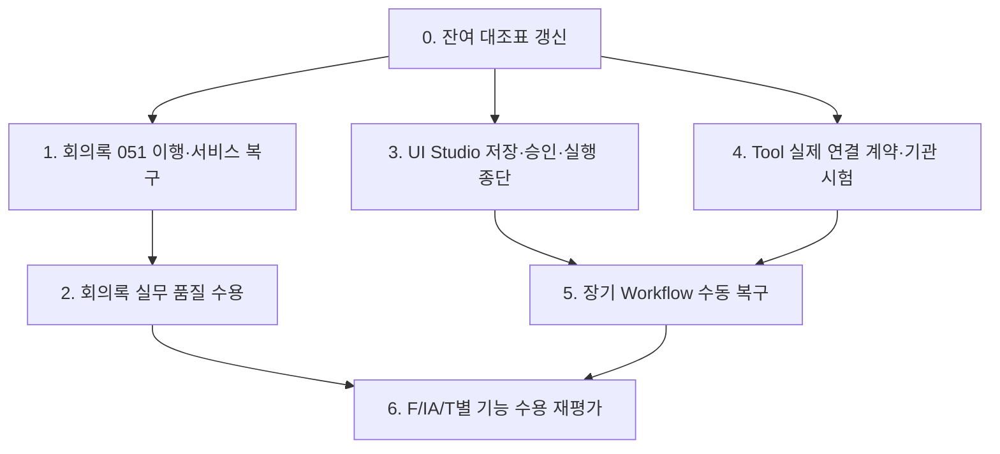

# 미완료 기능 잔여 개발 통합 상세 계획

## 1. 목적과 기준

이 계획은 2026-10-16 현재 코드·구현 보고·검증 자료에서 확인한 미완료 범위를 개발 가능한 작업 단위로 정리한다. 본 문서는 **계획**이며 신규 기능 개발 승인, 운영 배포 승인 또는 실제 업무 수용 판정이 아니다. 개별 개발 착수는 기존 사용자 승인 범위에 따르고, 나머지 9개 업무 Agent 및 원본에서 보류·제외된 기능은 별도 승인 전까지 현재 작업 범위에 포함하지 않는다.

기준 문서: [[200.프로젝트실행/230.분석/09 전체 기능명세서 기준 개발 완료 여부 검토 보고서]], [[200.프로젝트실행/230.분석/10 전체 화면과 기술요건 구현 대조표]], [[200.프로젝트실행/240.설계/23 포털 UI UX 확정과 사이트 분리 검토]], [[34 회의록 문서 자료 날짜 처리 및 품질 평가 상세 개발 계획]], [[31 업무 Agent 10종 승인 연결 상세 작업 계획]], [[32 관리 B안 Tool Workflow 승인 화면 확장 상세 작업 계획]], [[29 Tool 승인 버전과 영속 실행 상세 작업 계획]], [[30 승인 Workflow 실행과 업무 Agent 연결 상세 작업 계획]], [[35 시각적 블록 조립형 UI Studio 상세 구현 계획]], [[36 AI Studio 통합 메뉴 및 Hub 구조 상세 구현 방안]], [[200.프로젝트실행/250.구현/36 T-035 MCP 및 외부 Tool 연동 노코딩 자동변환 구현 결과]], [[200.프로젝트실행/250.구현/2026-10-15 기존 계정 데이터 보존 및 040 개발 보류 해소 보고서]].

## 2. 현재 기준선과 잔여 항목

### 완료로 확인된 좁은 범위

- 사용자 A 홈·관리자 A 홈·관리자 B 승인 상세 구조, 사용자/관리자 독립 빌드와 local 포트 구분.
- DP09~DP12의 동적 Agent 초안·Builder 시험·승인 게시·사용자 실행·복원 승인·실행 이력 등 별도 보고서에서 검증된 범위.
- 관리 B의 Tool/Workflow 신청·상세·결정·이력 화면과 선별 브라우저 검증.
- AI Studio 진입 허브 및 React Flow 기반 3-pane Workflow Studio 1차 화면.
- T-035 파서/라우팅/관리 UI 코드와 7개 테스트 및 사용자·관리자 빌드의 구현 보고서상 통과.
- 회의록 AGENT_03 문서/날짜/품질 UI의 최종 선별 브라우저 검증과 독립 코드 검토.

### 개발 또는 수용이 남은 범위

1. **회의록 기능의 현재 개발 DB 이행 및 복구**: source migration 051은 작성됐지만 2026-10-15 DB 보고 기준 활성 개발 DB는 000~050, 총 51개 migration 적용 상태다. 051 적용, 적용 전 검증된 백업, 적용 후 데이터·권한·서비스 확인이 남아 있다.
2. **회의록 업무 품질 수용**: 실제 제공자·승인된 비식별 업무 자료·정답 기준을 이용한 의미 품질 확인은 하지 않았다. 계약/구조 시험과 합성 fixture 통과를 업무 품질 합격으로 간주하지 않는다.
3. **UI Studio의 실제 자산 흐름**: 캔버스·노드 편집과 기존 승인 실행 화면은 연결돼 있으나 시각적 그래프를 승인 가능한 Workflow 정의로 저장·불러오기·버전 비교·실행 결과에 안정적으로 왕복시키는 종단 수용이 필요하다.
4. **T-035 외부 연결 수용**: 구현된 파서/게이트웨이 단위시험은 실제 기관 REST/SOAP/JDBC/FEP/MCP 연결, 인증서·비밀 관리, 승인 환경 전환, 장애·재시도 및 업무 권한의 실연동을 증명하지 않는다.
5. **장기 실행 복구**: 완료 checkpoint 보존 및 unknown/interrupted 자동 재발사 금지는 구현됐으나 사용자 확인 후 중단 run을 재개하는 API/UI, 복구 조정과 분산 worker 수용은 미완료다.
6. **전체 기능명세 잔여**: 09/10 검토 문서는 10월 12일 기준의 F/IA/T 대조표다. 이후 DP와 T-035 구현을 반영한 최신 행 단위 재대조가 필요하다. 갱신 전의 0/31/29 등의 수치를 현재 진행률로 사용하지 않는다.
7. **운영 전환과 실제 기관 수용**: Entra/외부기관/상용 운영 환경은 기능 구현과 분리된 후속 통합·승인 범위다. 이를 기능 개발의 대체 완료 기준으로 삼지 않는다.

## 3. 공통 제약

- 제품명은 ‘생성형 AI 플랫폼’; UI 방향은 사용자 A, 관리자 A 홈 + 관리자 B 승인·검증이다.
- `src/backend/migrations/000`~`052`의 각 기존 SQL 파일과 적용 checksum은 보존한다. 신규 migration 번호는 소스 목록·활성 DB 적용 이력·계획 예약 번호를 확인한 뒤 선택한다. 적용된 DB 상태와 소스 파일 번호를 혼동하지 않는다.
- 활성 개발 DB의 기준은 2026-10-15 보고서의 SQL 000~050 적용, 040 일치, pending 0이다. 051·052는 소스 존재만으로 DB 적용 완료가 아니다.
- DB/브라우저 fixture는 순차 실행한다. 시험 전·후 원본 데이터 행/열·계정 hash·migration checksum·서비스 상태를 기록하고, 임의 초기화·재seed·옛 DB migration 이력 수정은 금지한다.
- 개발자 직접 PATCH가 막힌 승인 자산은 변경안 제출과 권한 있는 타인 승인 경로를 따른다. draft, mock, fixture, 계획, 구현, 시험, 업무 수용, 운영 배포를 서로 바꿔 부르지 않는다.
- 새 기능은 현재 tenant·owner·role·문서/자산 ACL, CSRF, SOD, CAS, 비용 admission/ledger, 취소·늦은 응답 fence, audit 규칙을 유지한다. 기존 승인 snapshot과 과거 실행을 소급 변경하지 않는다.
- 실제 외부 접근·업무자료·정답·보안 승인 정보가 없는 항목은 계약대역으로 개발·검증하고 실연동 미검증으로 명시한다. 유료 모델 호출은 사전 승인·제공자 설정·비용 한도가 준비된 별도 수용 작업에서만 한다.
- PPTX/OCR 사용자 보류, 거버넌스 이전 제외, 나머지 9종 Agent 후속 확장 결정을 유지한다.

## 4. 실행 순서

DB 이행과 업무 품질 수용은 별도 gate다. UI Studio, Tool connector, Workflow 복구는 독립 브랜치 가능한 계획 단위지만 공통 권한·승인·원장 계약을 공유하므로 각 단계의 교차 검토를 거친다.

## 5. Workstream 0 — 잔여 기준선 재대조

**목표:** 기존 감사표를 최신 source와 DP09~DP12, T-035 구현 및 최신 시험 증거에 맞춰 행 단위로 갱신하고 모든 잔여 항목을 계획에 연결한다.

**확인 파일:** `docs/Obsidain/200.프로젝트실행/230.분석/09 전체 기능명세서 기준 개발 완료 여부 검토 보고서.md`, `10 전체 화면과 기술요건 구현 대조표.md`, `evidence/20261012-full-function-audit/*.json`, 각 DP 구현 보고서와 최신 코드.

**작업:**

1. F-001~060, SCR-150, T-001~062의 원본 행 ID·포함/보류 결정·기존 판정 근거를 보존한다.
2. 10월 12일 이후 완료된 DP09~DP12, 회의록 AGENT_03, UI Studio, AI Studio Hub, T-035를 각 관련 행에 연결한다.
3. 각 행의 현재 상태를 `구현 미확인 / 부분 구현 / 좁은 범위 구현 완료 / 전체 수용 검증 완료 / 보류·제외`로 명확히 구분한다. ‘전체 수용 검증 완료’에는 요구별 정상·권한 거부·테넌트 경계·오류/재시도·감사 증거를 연결한다.
4. 기존 원본 보류·제외인 PPTX/OCR·거버넌스·T-034 등은 잔여로 재분류하지 않는다. 나머지 9 Agent도 확장 승인 전 개발 착수 대상으로 계산하지 않는다.
5. 잔여 행마다 구현 계획/수용 증거/외부 선행조건을 wikilink로 연결한다. 전체 상태 숫자는 새 대조 완료 후 새 기준일을 붙여서만 보고한다.

**완료 조건:** F/IA/T 원본 행 누락 0, 모든 변경 판정에 source/test 근거가 있고 제외/보류와 개발 잔여가 분리됨, 새 숫자가 진척률로 오인되지 않음.

## 6. Workstream 1 — 회의록 051 적용 및 개발 서비스 복구

**목표:** 이미 검토된 회의록 기능을 기존 계정·업무 데이터가 보존된 활성 개발 DB에 안전하게 적용하고 사용자/관리자/API 서비스를 수용한다.

**참조:** [[34 회의록 문서 자료 날짜 처리 및 품질 평가 상세 개발 계획]], [[2026-10-15 회의록 문서 날짜 및 품질 기록 구현 보고서]], `200.프로젝트실행/260.테스트/evidence/Meeting-context-20261015/`.

**작업 단위:**

1. 실행 직전 `active-fixture.json`, `app.env`의 비민감 상태, 활성 DB 식별자, 소유 서비스/포트, `schema_migrations`의 적용 번호·checksum을 읽기 전용으로 기록한다. 000~050 source checksum 및 현 DB 000~050 일치를 확인한다.
2. 서비스 정지는 실행 명령/작업표식과 PID 소유권이 확인된 서비스에 한정한다. 소유권이 불명확하면 중단하고 수동 확인 지점을 보고한다.
3. DB backup을 비공개 경로에 생성하고 별도 restore target에 복원해 데이터베이스 접속, 기존 계정 인증 및 기존 핵심 표의 행수/안정적 digest를 비교한다. 비밀·DSN·개인 원문은 Obsidian/evidence에 남기지 않는다.
4. 복원 검증 후 활성 개발 DB에 migration runner로 신규 051만 적용한다. 기존 migration SQL 수정, 이력 row 편집, 초기화/seed는 금지한다. migration은 재실행 안전성·FORCE RLS·권한·append-only 성질을 검증한다.
5. 051 적용 전후 기존 사용자·대화·문서 metadata·Agent/Workflow/Tool 승인·실행 원장의 행/열/digest, 계정 password hash, SQL 적용 이력을 비교한다. 신규 회의록 품질 표는 빈 상태 또는 예상 구조이며 과거 실행 backfill은 없어야 한다.
6. 사용자5173·관리자5174·API8000을 정식 소유 service control로 복구한다. health, 기존 계정 login/logout, 핵심 role/API 읽기, 기존 chat/document/approval/run 읽기, 회의록 문서목록/실행/평가 API와 자료 권한차단을 확인한다.
7. 증거에 backup/restore 지문과 명령 요약·migration preserve 결과·health/기존 계정 확인·cleanup/service ownership를 남기고 계획34와 구현보고를 갱신한다.

**완료 조건:** 백업 복원 시험 통과, 051만 적용, 과거 데이터·계정·000~050 checksum 보존, 서비스 3종 정상, 회의록 신규 API와 기존 사용자 주요 흐름 회귀 확인, 비밀 없는 재현 증거 보존.

**중단 조건:** backup 복원 불가, 소유 서비스 확인 불가, 기존 데이터 지문 변화, migration 충돌/권한 불일치, health/기존 login/API 실패. 부분 적용 상태를 정확히 보존하고 임의 rollback SQL로 덮지 말고 기존 migration recovery 설계를 따른다.

## 7. Workstream 2 — 회의록 실제 업무 품질 수용

**목표:** 결정사항·액션아이템 정확성을 우선으로 AGENT_03 결과를 실제 업무 문맥에서 측정하고 품질 기준을 승인한다.

**작업 단위:**

1. 자료 소유 부서가 승인한 비식별 회의 원문과 결정/미정/액션 정답을 최소 업무유형별로 구성한다. 결정, 담당자, 기한, 근거 인용, 불확정 처리, 중복/누락 사례를 포함하고 사용 목적·보유기간·접근자를 기록한다.
2. 합격선은 실행 전에 업무 책임자·검토자와 정한다. 자동 점수는 단독 승인 판정이 아니며 정확성 항목에 특히 잘못된 결정/액션 생성과 누락의 가중치 및 치명 오류 조건을 정한다.
3. 승인된 provider/model·버전·temperature/token 설정·비용 상한을 별도 환경 설정에 두고, 명시 승인 전까지 mock/계약대역만 사용한다. 실제 호출 시 run ID·모델 식별·비용·오류를 기록하되 원문/답변 개인정보는 비밀 없는 증거로 복사하지 않는다.
4. 동일 데이터셋·동일 계약으로 baseline과 수정 후보를 반복 실행하고 결정 정확도, 액션 누락/환각, 담당자, 기한 및 근거 인용의 오류를 유형별로 집계한다. 회의일 없는 상대기한·영업일·상충하는 표현은 미확정 사유가 맞는지 확인한다.
5. 2인 검토 또는 업무 책임자 조정으로 판정 불일치를 기록한다. 실패 케이스를 회귀 fixture로 익명화해 저장하고 버전별 결과를 비교한다.
6. 승인자 서명/날짜·표본 범위·합격선·잔여 오류·모델/제공자 제한을 정식 시험 보고서에 기록한다. 기준 미달이면 수정 계획으로 되돌리고 통과로 표기하지 않는다.

**완료 조건:** 승인된 gold set, 사전 합격선, 반복 가능한 결과, 사람 검토·불일치 처리, 치명 오류와 한계 명시. 개발/기술 통과와 업무 수용 결과를 별도 판정한다.

**범위 제외:** OCR·전사 도입, 나머지 9 Agent, 기관 미제공 자료로의 품질 주장, 사전승인 없는 paid provider.

## 8. Workstream 3 — Workflow Studio 자산 저장·승인·실행 연결

**목표:** 이미 구현된 캔버스를 기존 승인 Workflow 도메인과 연결해 Draft 편집 → 검증 → 불변 버전 저장 → 타인 검토/승인 → 사용자 실행 → trace 결과 표시까지 일관된 종단 흐름으로 완성한다.

**참조:** [[35 시각적 블록 조립형 UI Studio 상세 구현 계획]], [[36 AI Studio 통합 메뉴 및 Hub 구조 상세 구현 방안]], [[30 승인 Workflow 실행과 업무 Agent 연결 상세 작업 계획]], [[32 관리 B안 Tool Workflow 승인 화면 확장 상세 작업 계획]].

**대상 파일(현재 구현과 대조 후 조정):** `src/frontend/src/workflow/WorkflowStudio.tsx`, `workflowAdapter.ts`, `WorkflowInspector.tsx`, `WorkflowCanvasPage.tsx`, `AIStudioHubPage.tsx`, `src/frontend/apps/admin-web/src/App.tsx`; backend `src/backend/app/workflows/{approved_models,repository,service,routes}.py`, workflow approval/execution tests. 기존 도메인 경로를 재사용하며 새 API/schema는 필요성이 입증된 경우에만 추가한다.

**작업 단위:**

1. **계약 대조:** 실제 `WorkflowDefinition`/approved version schema와 Flow node/edge 타입을 필드별 대조한다. UI 전용 좌표·선택·실행 배지 데이터는 서버 실행 설정에서 분리한다. unknown node/config는 저장·실행 전 거부한다.
2. **정적 검증:** 시작/종료 노드 수, 허용 노드 타입, 필수 config, source/target port 호환, dangling edge, cycle, 미사용 민감 입력, node/edge 제한을 FE와 서버에서 같은 오류 ID로 검사한다. 서버 검증을 최종 권한으로 둔다.
3. **초안 저장/복원:** 현재 조직/사용자 scope에서 초안 저장·버전 불러오기·충돌 처리(CAS)·임시복구를 연결한다. API 미지원이면 기존 승인 버전 endpoint를 초안 API처럼 오용하지 않고 별도 설계를 먼저 확정한다.
4. **승인 제출:** 제출은 저장된 exact definition digest와 자산 version에 묶는다. 제출 후 변경은 새 revision이며 과거 신청을 retarget하지 않는다. 승인·게시·rollback은 기존 타인 승인/관리 B 흐름에만 연결한다.
5. **실행 표시:** 승인된 exact version만 실행 가능하게 하고 실제 parent/child run의 node ID·status·safe output reference를 보여준다. raw input, private checkpoint, token, secret은 UI response에 내보내지 않는다. unknown/interrupted, retry/receipt, 취소 및 late response를 명확히 표시한다.
6. **테스트:** adapter round-trip/property tests, strict schema/서버 권한·CAS API tests, 폐기형 DB/API browser tests, HTTP contract stub tests를 구분한다. 1440/1024/768·키보드·브라우저 뒤로가기·페이지 갱신을 확인한다. fixture DB/harness는 순차 실행한다.

**완료 조건:** 그래프가 저장/재조회 시 semantic-equivalent, 임의 정의·순환·권한 없는 Tool 차단, 승인 exact version seal, 사용자 실행이 Workflow ledger에 남음, 화면 trace가 서버 원장과 일치, 권한 철회·취소·unknown 노출이 안전함.

## 9. Workstream 4 — T-035 외부 Tool 실제 연결 준비 및 기관 수용

**목표:** T-035의 구현된 등록/파서/라우팅을 실제 connector contract와 안전한 외부 호출로 전환하되 endpoint 접근·계정·승인 자료가 없는 동안 실연동으로 표시하지 않는다.

**참조:** [[200.프로젝트실행/250.구현/36 T-035 MCP 및 외부 Tool 연동 노코딩 자동변환 구현 결과]], [[29 Tool 승인 버전과 영속 실행 상세 작업 계획]], [[30 승인 Workflow 실행과 업무 Agent 연결 상세 작업 계획]].

**작업 단위:**

1. 기관별 Tool inventory를 만들고 시스템 owner, 목적/업무, 최소 scope, protocol, API/spec version, data classification, 호출/응답 schema, timeout, idempotency, rate limit, 장애 담당, 테스트 endpoint, 허용된 시험자료, dev/prod 승인자를 필수로 기록한다.
2. connector protocol별 실제 수행 범위를 명시한다. OpenAPI는 HTTPS REST, WSDL은 SOAP binding/action·TLS, JDBC는 허용 read-only view와 bind parameter, 금융전문은 institution-approved field layout/encoding/length/checksum; MCP는 server identity·tool allowlist·capability 경계를 계약한다. 미지원 기능은 명시 거부한다.
3. 자격증명은 현재 `credentials.py`의 실제 보안 특성을 CSO/crypto 검토로 검증한다. 키 생성·보관·회전·폐기·복호화 접근 주체·복원 절차를 정하고, 제품 배포 보안키 관리 기능이 부족하면 기관 연동 전 secret manager/HSM 연계 설계를 별도 구현한다. 암호화 함수 단위시험만으로 운영 안전성을 인정하지 않는다.
4. 외부 호출은 server-side egress allowlist, DNS/IP rebinding 대응, TLS 검증, redirect 제한, private/link-local/metadata IP 차단, response size/content-type/schema 제한, timeout/circuit/rate limit, idempotency key, audit correlation을 적용한다. 사용자 입력으로 임의 URL·SQL·금융전문 field를 우회 지정하지 못하게 한다.
5. Draft는 승인되지 않은 Dev profile만 사용하며 운영 profile은 승인된 exact tool version + publication + current entitlement 조합에서만 허용한다. 환경/승인 상태 변경, 철회, 공개대상/사용자 회수 시 실행 claim 및 child checkpoint에서 다시 검사한다. 이미 발사된 호출은 unknown/settlement 보존 원칙을 유지한다.
6. 계약대역의 정상·timeout·TLS/인증 오류·잘못된 schema·대용량·중복요청·429/5xx·늦은 응답·철회 경쟁·비인가 redirect를 재현한다. 허가된 기관 sandbox에 연결할 때는 제한 계정과 합성자료로만 별도 실연동 시험을 수행한다.
7. 정확한 신규 DB migration 적용 순서를 확인한다. 현 활성 DB 051 회의록 migration이 먼저 검증돼야 하며, 052는 현재 소스 파일이 있다는 사실과 DB 적용 상태를 분리한다. 각 migration 전 backup/restore·checksum·기존 데이터 보존을 확인한다.

**완료 조건:** 코드 계약 시험 통과와 실기관 sandbox 시험을 각각 기록. 각 connector 유형별로 성공/실패/중복/권한회수 증거, secret 접근감사, 승인 환경 route, rollback/운영담당을 확인한다. 일부 protocol의 실연동을 전체 T-035 수용으로 일반화하지 않는다.

## 10. Workstream 5 — 중단 Workflow 수동 점검·재개

**목표:** crash/lease 만료/Tool 결과 불명 run을 안전하게 관측하고, 중복 비용이나 부작용 없이 승인된 checkpoint부터 사람 확인을 거쳐 재개할 수 있는 운영 절차를 구현한다.

**참조:** [[30 승인 Workflow 실행과 업무 Agent 연결 상세 작업 계획]], [[2026-10-13 W5b 승인 Workflow 실행 원장 및 Agent Tool 연결 구현 보고서]], [[32 관리 B안 Tool Workflow 승인 화면 확장 상세 작업 계획]].

**작업 단위:**

1. persisted parent/step/child ledger의 `accepted/running/completed/failed/interrupted/unknown/cancelled` 전이와 lease/heartbeat/fence를 모델링한다. `unknown` 외부 side effect는 자동 재발사 금지.
2. 재개 API 계약은 `run_id`, 현재 run revision, 승인된 definition digest, 중단 step, 확인 주체/사유, 재개 전략을 입력받고 CAS 처리한다. 오래된 상태·철회 자산·회수 문서·불명 Tool은 409/안전한 review required로 응답한다.
3. 별도 authorized reconciliation action으로 기관 receipt 조회 또는 사람이 외부 시스템 처리 여부를 확인한다. 확인 불가능하면 unknown 유지; 이전 child를 지우거나 비용 원장을 되돌리지 않는다.
4. 기존 완료 checkpoint는 immutable하게 재사용한다. 재실행 가능한 pure/idempotent node만 정의 기반으로 다시 시도하며 외부 side effect node는 idempotency token 또는 별도 기관 확인 없이는 재개하지 않는다.
5. 관리자 B에서 중단/불명 run 목록·단계·실행 시각·담당·안전상태·확인 증거를 최소 메타데이터로 표시한다. 운영 재개는 현재 권한과 다른 담당자 승인/이중확인 정책을 적용한다.
6. crash matrix를 DB commit/dispatch 전후, lease expiry, duplicate worker, cancel race, revoke race, late response, receipt loss, process restart로 나눠 반복 검증한다. fake clock·contract adapter·disposable DB를 순차 사용한다.

**완료 조건:** 완료 step 중복실행 0, 불명 side effect 자동 재호출 0, 수동 재개 CAS/audit 증거, 권한 회수 후 결과 비노출, 비용/receipt 원장 보존, 복구 안내가 사용자와 관리자에 일관됨. 분산 장애/부하 수치는 별도 규모시험이 없으면 미검증으로 남긴다.

## 11. Workstream 6 — 기타 전체 기능명세 잔여의 실행 패키지화

기능 감사 재대조 후, 우선순위를 보안·업무연속성·핵심 사용자 가치에 따라 승인된 기능 묶음으로 분리한다. 기존 부분 구현을 새로 만드는 계획을 작성하지 않고 실제 남은 acceptance criteria만 하위 계획으로 만든다.

### 패키지 6A: 공통 보호·모델·Tool 계약

- T-008/009/010/045/046/047 등에 해당하는 입력·출력 PII/기밀 탐지, prompt injection, 유해콘텐츠·정책 규칙, 차단/마스킹/예외 이력.
- T-013 및 계획20/21의 모델 registry·capability·비용·권한 기반 선택·fallback 및 Builder binding.
- 각 신규 policy/model/tool 설정에 불변 version·타인 승인·현재 적용 gate·감사 정보를 적용한다.
- 수용: 정상/차단/정책 장애 fail-closed, 개인정보 비저장·마스킹, tenant와 역할 경계, model/provider fallback/비용 ledger 시험.

### 패키지 6B: 자산 카탈로그·재사용·운영 사용권

- F-020~024/T-038 등 Agent/Prompt/Workflow/Tool/Knowledge/Model 유형·태그·검색·공개 범위·복제 lineage·구독/회수·사용자/부서별 이용 신청.
- DP10/DP11/DP12의 고정·동적 Agent 구현을 기반으로 일반 유형 확장을 계획하되 draft 공개 금지와 exact publication gate를 유지한다.
- 수용: 게시 자산만 검색, 검색 결과 재조회 때 current entitlement, revoke 즉시 신규 실행 차단, 복제 원본/버전 출처 유지, 개인 preference가 권한을 부여하지 않음.

### 패키지 6C: 검색·문서 처리·RAG 품질

- T-021/023/024/026/027/028/030/031 등 metadata HITL, chunking/embedding 선택, 현재 승인된 문서 형식, hybrid/rerank, RAG playground, re-index 전환.
- PPTX/OCR은 사용자 보류 결정이 풀리기 전 개발 범위 밖. 현재 HWP/암호화/대용량 제한을 문서화하고 기능 확장 전 악성 파일·자원 제한 검토.
- 수용: 동일 자료/ACL에서 검색 재현성, 근거 연결, 원문 변조/권한 회수 시 차단, index 버전 전환 rollback, 지연/비용 측정.

### 패키지 6D: 업무 Workflow/Agent 및 관측성

- 승인 Workflow 실행·Tool 연결 기반 위에 승인된 업무 단위로 업무 Agent를 차례로 확장한다. 초기 사용자 범위 AGENT_03만 우선하며 나머지 9종은 별도 사용자 확정 후 착수한다.
- T-039~043 등 단계별 trace·디버그·Agent별 metering·품질/편향 평가를 개인정보 최소화 및 기존 원장에 연결한다.
- 수용: 입력/출력/단계 상태의 권한 제한, aggregate와 개인 데이터 분리, 평가셋/결과 버전 봉인, 비용·실패율·복구 측정.

### 패키지 6E: 사용자 운영 기능·관리 CMS

- F-003/007/013/017/018/025/026/027 및 관련 IA의 온보딩/도움말, 알림, 통합검색, 피드백 개선 workflow, export, 공지/커뮤니티/CMS 잔여를 기능별 계획으로 분리한다.
- 사용자 A·관리자 A/B 디자인 확정을 따른다. 실제 값·정책/권한이 없는 카드·수치를 임의 fixture로 완료 표시하지 않는다.
- 수용: 권한 범위 검색/알림, 사용자 취소·삭제·보존정책, export 민감정보·출처 검사, 콘텐츠 버전/예약/회수 감사.

### 패키지 6F: 조직·계열사·인증 통합

- 실제 환경을 사용할 수 있을 때 OIDC/Entra, 조직 생명주기·membership 동기화, session/CSRF, 계열사 공유 및 독립 실행영역/저장소 요구를 확정한다.
- 도메인/기관 설정 부재 시 connector contract·인증 interface·tenant authorization test까지 개발할 수 있으며 실 SSO/네트워크 수용 완료로 표시하지 않는다.
- 수용: 인증/회수/계정비활성화의 access cutoff, cross-tenant 거부, 세션 logout, 조직 변경 race, 실제 IdP 시험 결과.

각 패키지는 담당 기능 ID, 화면 ID, 데이터 migration, API/UI, 위협 검토, 고유 회귀, 업무 수용자를 가진 **독립 하위 상세 계획**으로 구체화한 뒤 착수한다. 기존 원본에서 제외된 거버넌스 전용 기능과 사용자 보류는 하위 패키지에 포함하지 않는다.

## 12. Workstream 7 — 통합 수용과 전체 완료 판정

1. 최신 재대조표에서 포함 범위의 각 행을 실행 시나리오와 실제 증거 파일에 연결한다.
2. 사용자·조직 관리자·플랫폼 관리자·비인가/철회 사용자 역할을 기준으로 정상, 거부, 다른 tenant, timeout, 재시도, 중복, 장애복구, 감사/비용 원장 검증을 수행한다.
3. 각 시험 결과를 실제 API/DB, HTTP stub, mock provider, static/build, 사람 업무 수용으로 분류한다. 서로 다른 실행의 case count를 합산하지 않는다.
4. 기존 fixture와 활성 개발 DB 결과를 구분하고, migration backup/restore, source checksum, old-row preservation, user/admin build boundary와 주요 browser widths를 확인한다.
5. F/IA/T 전체 완료 인정은 그 항목의 기능 동작과 요구별 수용 검증이 모두 충족된 뒤에만 갱신한다. 전체 포함 범위가 끝나기 전 프로젝트 전체 완료/기관 수용/운영 배포라고 표기하지 않는다.
6. 실제기관 UAT·Entra·운영 배포는 기능 종료와 별도 승인 및 이행 계획에서 관리한다.

## 13. 우선순위와 의존성

| 순위 | 작업 | 선행 조건 | 결과 |
|---|---|---|---|
| 0 | 기능 감사 기준선 갱신 | 최신 코드·증거 읽기 | 신뢰 가능한 최신 잔여목록 |
| 1 | 회의록 051 개발 DB 이행/복구 | 사용자 범위 승인, 백업·restore 검증 | 현재 사용자 환경의 회의록 기능 사용 가능 |
| 2 | AGENT_03 실제 업무 품질 수용 | 비식별 표본·정답·승인 provider/업무검토자 | 제한된 업무 품질 판정 |
| 3 | UI Studio 저장/승인/실행 종단 | workflow schema와 approval API 대조 | visual authoring에서 실행까지 연결 |
| 4 | Tool connector별 외부 sandbox 수용 | endpoint/credential/업무·보안 승인 | 프로토콜 유형별 실연동 판정 |
| 5 | 수동 run 복구·조정 | parent/child ledger·기관 receipt contract | 장애 시 안전 재개/unknown 조정 |
| 6 | 기능 ID별 독립 잔여 패키지 | 최신 감사 기준선·별도 우선순위/승인 | F/IA/T별 점진적 수용 |

## 14. 변경 기록과 승인 경계

- 이 통합 계획을 Obsidian `100.프로젝트계획`에 저장하고 기존 세부 계획을 대체하지 않고 wikilink로 연결한다.
- 개발 착수 시 해당 Workstream의 승인 여부·범위·외부 선행조건을 작업 로그에 기록한다. 사용자 보류 범위를 자동으로 승인된 것으로 확대하지 않는다.
- 각 의미 있는 개발 단위 완료 시 `400.프로젝트관리/02 포털 UI UX 작업 기록.md` 및 해당 250/260/280 단계 문서를 갱신한다. 설계 변경이면 설계23의 변경 이력도 보존 갱신한다.

## 15. 2026-10-16 진행 현황

- 사용자가 잔여 기능 개발을 지시했다. Workstream 1 migration 051은 기존 데이터 복원 대조 후 적용했다. 이어 기존 pending 052와 신규 053을 별도 복원 DB에서 순차 적용·대조 후 활성 개발 DB에 이행했다. 이전 checksum과 business row digests 유지, 신규 초안 테이블 0행 및 FORCE RLS를 확인했다.
- API8000 `/api/v1/health` HTTP 200, 사용자5173 `/user/home` 및 관리자5174 `/manage/admin` HTTP 200이다. 익명 초안 API 요청은 401 AUTH_REQUIRED로 인증 gate가 동작한다.
- Workstream 5 수동 Workflow 복구를 054/055로 추가했다. 신청자→다른 PADMIN 결정→소유자 확인 구조와 checkpoint 기반 이어하기를 구현했고, unknown Tool/unfinished Agent side effect는 재호출하지 않는다. stale head 및 멱등 재시도 상태를 보완했다. 기존 74개 테이블 행 digest와 migration 55개 checksum 보존, user/admin 빌드를 확인했다. 인증된 두 사용자 복구 왕복은 미검증이다.
- Workstream 1의 기존 계정 로그인, 핵심 API 회귀와 회의록 API 권한 시나리오는 수행하지 않아 통합 수용 완료로 보지 않는다. AGENT_03 실제 업무 품질 수용은 승인된 비식별 자료·정답·제공자 준비가 없어 미완료다.
- Workstream 3에 개인 Workflow draft 목록·상세·저장 API 및 불변 revision/CAS/idempotency/audit/RLS schema를 추가했고 Studio UI 저장·불러오기 연결을 구현했다. 실패를 모의 성공으로 표시하던 폴백은 제거했고, 명시된 승인 버전만 실행하게 했다.
- Canvas Studio에서 저장된 draft revision만 승인 요청 준비에 진입하도록 연결했다. 선형 trigger→선행 Tool(선택)→게시 Agent→response 구조만 exact Agent/Tool snapshot과 명시적 변수 binding으로 strict ApprovedWorkflow에 변환하며, 지원 외 노드·분기·병합은 거부한다. 서버 schema 검증 및 기존 `/admin/workflow-approvals` 제출·승인 B receipt를 연결했으나 승인/게시/실행은 별도 상태다.
- user/admin 독립 빌드 통과(`modules 28/52`, boundary 검증 true). 인증된 API 권한·CAS, 브라우저 저장 왕복·승인 제출, 승인 exact version의 Studio 실행 trace 검증은 미완료다. Workflow 회복, T-035 기관 실연동, F/IA/T 재대조도 아직 진행 전이다.
- 코드 변경과 다음 작업 증거: [[200.프로젝트실행/250.구현/2026-10-16 잔여 기능 개발 중간 보고서]] 및 [[200.프로젝트실행/250.구현/37 Workflow 중단 실행 수동 복구 구현 결과]].
- 코드 작업 시 변경 파일, migration, 실제 시험 명령·결과, 독립 검토, 실패/수정, 미완료 범위, 다음 단계, fixture/실제 DB 구분을 남긴다.
- 계획 수립 시 변경 파일은 본 계획과 작업 기록뿐이다. 앱 코드·DB·서비스·운영 환경은 변경하지 않는다.

## 변경 이력

| 날짜 | 변경 | 근거 |
|---|---|---|
| 2026-10-16 | 최신 구현/시험을 반영한 미완료 잔여의 통합 실행 계획을 수립 | 사용자 요청, 최신 저장소 상태 및 Obsidian 계획·구현·검증 문서 대조 |
