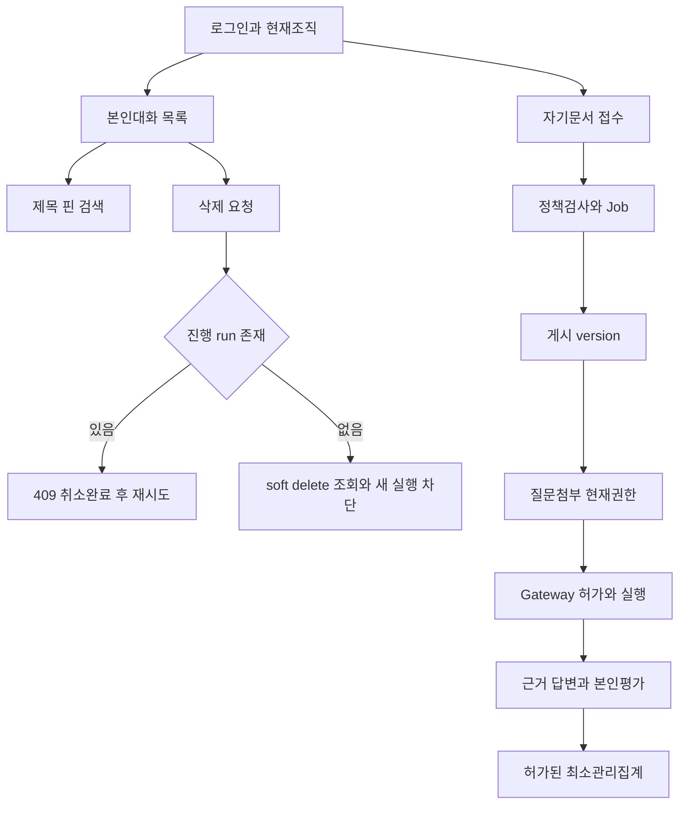

# 업무와 데이터 흐름 분석

작성: 2026-10-06 / DP-01 / 요구정의→DP-03 상세설계 전달

[비거버넌스 하위요구 수용기준](</Users/jwpios/antigravity/202610_AI 플랫폼/docs/Obsidain/200.프로젝트실행/220.요구정의/비거버넌스 하위요구 수용기준.md>) · [10 비거버넌스 AI 플랫폼 상세 개발 계획서](</Users/jwpios/antigravity/202610_AI 플랫폼/docs/Obsidain/100.프로젝트계획/10 비거버넌스 AI 플랫폼 상세 개발 계획서.md>)

## 1. 현재 코드 경계와 재사용

| 현재 파일/모듈 | 현재 책임 | 확장 분석 |
|---|---|---|
| app/types.py AuthContext | session/user/current tenant/effective role | body에서owner/tenant대체금지; 향후capability와연계 |
| conversations/routes.py | 고정Agent DTO,create/list/messages/run/cancel | title/pin/search/delete DTO/route 신규; 기존extra=forbid·CSRF·requestID유지 |
| conversations/repository.py | tenant_transaction+security SQL 함수 호출 | owner/RLS/잠금/revision를SQL정책함수와같은transaction에서검사 |
| conversations/pagination.py | owner/tenant/kind/target 바인딩 signed cursor | pinned sort/key/query fingerprint·cursor version추가; 기존cursor호환정책설계 |
| migrations/005~008,015~020 | 대화/run/원장,문서/근거·trace | metadata추가와삭제조회gate영향. 기존완료run/hash/비용원장보존 |
| documents/policy.py | 게시version의현재허가·원문resolver | 사용자첨부/Export에서도재사용. 최신미공유version이허가구version을숨기지않음 |
| src/common_core/ai_pipeline | typed graph/fact/vector/인용공통 | 요약출력과typed규정답변계약분리; UI나웹세션을공통코어에혼합하지않음 |
| app/ai 및execution | 중앙permit→dispatch→원장·stop/cap/unknown | 새요약/재생성/Tool도동일허가/비용원칙. retry로불확실결과재dispatch금지 |

위는기존소스정적분석입니다. 신규권한/경계/기능은아직제공되지않습니다. 기준소스hash는비교보고서와동일이며이번수정없습니다.

## 2. 업무 흐름

문서처리상태와질문첨부가능상태는분리합니다. 삭제/회수/활성version전환에도신규읽기와실행은현재권한을검사합니다. UI에서선택된version이나역할은서버권한을대체하지않습니다.

## 3. DP-03 설계 전달 계약

| 설계항목 | 전달 기준 |
|---|---|
| 저장필드 | portal.conversations에title/pinned/metadata_revision/deleted_at; metadata_revision초기0. title초기값은현행화면의기존표시와같은정책으로backfill; body에서자동추출하지않음 |
| title검증 | 공백trim후1~120Unicode문자; NUL/CR/LF 금지; extra필드금지. DB와DTO동일조건 |
| 변경API | PATCH /api/v1/conversations/{id} title/pinned중최소1개+expected_revision. 허가200; 값다른stale409; 동일현재값재전송의정확한조건240에서정의 |
| 검색API | GET /api/v1/conversations q/pinned/cursor/limit. 제목문자열조건을parameterbinding하고%/_를literalescape. pinned desc/created_at desc/id desc |
| cursor | owner/tenant/kind/query fingerprint/version/sort-position signature. 다른조건/tenant/owner422. 배포시oldcursor거부422후UI처음페이지재조회 |
| 삭제API | DELETE body expected_revision; 진행run409; owner현재허가로softdelete. 삭제후같은owner DELETE재전송200 safeack조건240에서구체화 |
| 삭제와run잠금 | 대화rowlock을수정/삭제/runadmission 공통순서로사용; terminal확인과deleted검사같은transaction; SQL정책함수ownership/search_path/EXECUTE권한유지 |
| 삭제조회gate | list/messages/by-send/get-run/events/evidence/source/export에해당대화또는run의private삭제상태적용. 원문서권한은독립적으로현재검사 |
| 보존 | portal.messages/runs/config_snapshot·ops.call_attempts/usage_events/audit_events 삭제/비용반환/복귀0. 사용자삭제확인이물리삭제보증으로표시되지않음 |
| 관리자 | title/body/query대상이개인대화면관리자예외없음; 필요한최소감사만독립capability로조회 |
| UI | 제목편집·핀·검색·삭제확인·409안내. 낙관표시후실패원복; 조직전환요청세대/취소로old응답혼입차단 |
| migration | 제안021_conversation_metadata.sql. 복구용backup/기존카탈로그/RLS/SQL함수영향분석; counts고정시험은기능/권한검증으로갱신하고핵심assertion삭제금지 |

DP-03 구현코드계약을확정하는다음240산출물에는SQL함수signature/DTO/response/errorcode/잠금순서/추적event/fixture를정의합니다. 이번분석은그계약을임의로기존API인것처럼실행하지않습니다.

## 4. 실패·경합·권한 시나리오

1. title수정과pin수정은revision충돌을발생시키며UI는현재값재조회후다시확인합니다.
2. 삭제와send동시는대화잠금으로직렬화합니다. send먼저면busy409; delete먼저면send404. 발생dispatch비용은재정산하지않습니다.
3. 로그인/소속회수뒤session 또는membership검사실패; repository에서고정ID만으로대화를변경하지않습니다.
4. 검색/Export/핀목록캐시도tenant/owner/query/version에바인딩하고회수/삭제뒤무효화합니다.
5. context회수/Job처리실패는기존원문ACL/Jobprincipal gate를유지합니다. 직접UI만차단하는구현을완료로처리하지않습니다.

## 5. 기존 검증 잔여 목록의 승계

[기존 미실행 원장](../220.요구정의/evidence/DP01-non-governance-baseline/existing-verification.json)에원본matrix와hash를보존했습니다. 상세60:44pass/16not_run,ACL16:11pass/5not_run,V41하위143:135pass/8not_run. 이번문서검증은제품미실행을통과로바꾸지않습니다.

실제Q20전체·부하/p95/10tenant병렬·새환경restore·HA/DR·사용자직접수용은별도수행합니다. 개별미실행은원본분류/사유를그대로추적하고DP-28에연결합니다. 대표A/B actual정상2문항과추가8호출을위요건전체수용으로확대하지않습니다.
