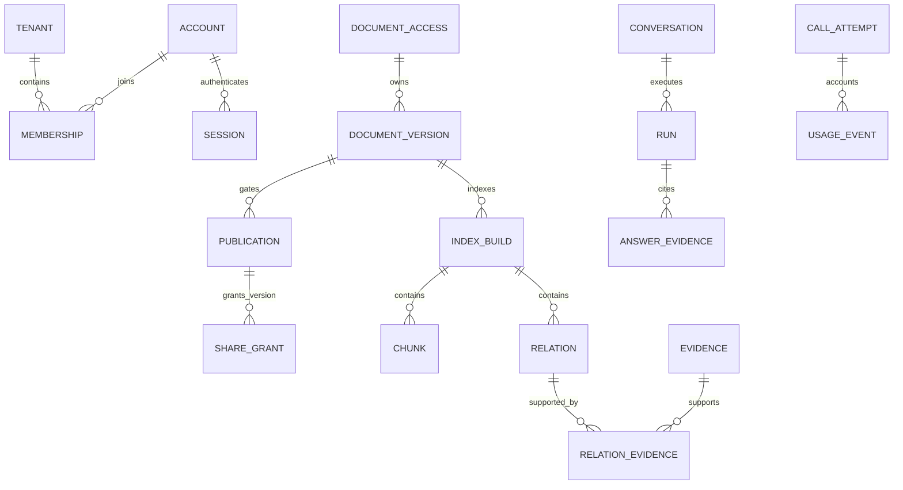

# 데이터 모델과 RLS 설계

> **현재 기준 — 2026-10-04 종합 승인:** 사용자가 종합 설계 보고 후 “네 진행 바랍니다”로 후속 진행을 지시하여 이 설계를 확정했다. [[200.프로젝트실행/250.구현/01 인증과 테넌트 기반 구현 계획]]으로 전달한다. 아래 각 D240 작업 당시의 검토 대기/미수행 서술은 작성 이력이다. 현재250의A01~03 환경·업무DB/RLS·풀과실제인증·세션은구현·시험완료다. 조직관리API·화면/AI·전체시험은후속이며250 결과문서를따른다.

## 1. 결론·상태·설계 선택

하나의 PostgreSQL에서 공통 테이블과 tenant/owner/version 키를 사용한다. 사람의 문서 읽기, 제한된 색인 Job, 시스템 사용량 기록의 DB 권한을 분리하고, 콘텐츠 행에는 RLS를 강제한다. 공유 자료는 A 소유를 유지하며 B에는 승인된 버전의 읽기 Grant만 준다. 관리용 상태와 본문을 다른 저장 대상으로 나눠 개인 자료를 보호한다.

D240-02 문서 작성/자체 점검 완료. 직전 사용자 “네 진행 바랍니다”로D240-01 결과를 입력으로 다음 설계를 진행했다. 상세 명세는240 종합 검토 전 설계안이다. 계정/DB/extension/역할 생성·접속·마이그레이션·실제 RLS/동시성/재시작 시험은 수행하지 않았다. SQL 실행 파일/앱 코드를 생성하지 않았다.

입력: [[200.프로젝트실행/240.설계/02 인증과 테넌트 권한 설계]], [[200.프로젝트실행/210.아키텍처정의/01 테넌트 격리 아키텍처 검토]], [[200.프로젝트실행/210.아키텍처정의/03 AI 호출과 저장소 운영 기준]], [[200.프로젝트실행/220.요구정의/06 요구사항과 검증 추적표]], [[200.프로젝트실행/230.분석/03 GraphRAG와 백엔드 재사용 분석]], [[200.프로젝트실행/230.분석/05 합성 데이터와 평가 기준]].

| 선택안 | 효과·부담 | 판단 |
|---|---|---|
| A. 한 runtime DB 자격으로 웹/색인/원장 쓰기 | 설정은 적으나 웹 쿼리에 색인 본문/원장 쓰기 권한까지 섞임 | 이번 상세 설계의 권고안에서 제외 |
| B. 같은 DB의 web/index/meter runtime 역할 분리 | 제한 Job과 시스템 정산의 저장 권한을 구분, 서버 설정3개 필요 | **권고**. 같은 FastAPI/DB 내부 역할이며 별도 서버·Gateway 제품이 아님 |
| C. 조직별 schema/DB | 물리/스키마 운영 격리 가능, 비용/운영 증가 | 승인된 공통 테이블/RLS 방식을 유지하므로 제외 |

schema는 `security`, `portal`, `rag`, `ops`로 책임을 구분한다. A/B별 schema가 아니다. 모든 앱 쿼리는 schema-qualified 이름을 쓰며 search_path만 바꿔 조직을 선택하지 않는다. 아래는 논리/물리 테이블 계약으로, 실제DDL·마이그레이션 파일·라이브러리 경로는250 기능별 계획에서 작성한다.

## 2. 공통 식별·데이터 규칙

- 운영ID는 UUID, 시간은 UTC timestamptz, revision은 양의 bigint, 상태/역할/범위는 고정 enum 또는CHECK로 제한한다. JSONB는 Agent 설정·불변 실행 snapshot·정제된 상세에만 쓰고 tenant/owner/권한/관계 키를 JSON에 숨기지 않는다.
- 조직 자료는 tenant_id NOT NULL. 전역 인증/프로젝트 운영 자료는 명시적으로 구분한다. tenant 자료에NULL을 넣어 전 조직 자료로 취급하지 않는다.
- tenant 자원은 `(tenant_id, id)`의 고유 키를 갖는다. 하위 FK에 부모 tenant를 포함하여 A의 ID를 B의 행에 연결하지 못하게 한다. 대화 owner와 문서 version/index도 참조 조건에 포함한다.
- visibility는 private/org 두 종류다. 공유 여부는 별도 exact-version Grant로 표현하고 visibility=public/global을 추가하지 않는다.
- document_id·tenant_id·owner_user_id·visibility는 등록 후 불변. private reader 목록도 초기 등록 후 UI 변경하지 않는다. 서비스 검사 외에 제한된 쓰기 함수/불변 필드 보호를 적용한다.
- 문서/대화/사용량/계정 사이에 광범위 ON DELETE CASCADE를 두지 않는다. 문서 삭제는 먼저 tombstone으로 접근 차단하고 파생 정리를 별도 처리한다. 원장/대화 증거 참조는 삭제 후에도 식별 관계를 보존한다.
- 파일/본문 hash를 공개ID나 조직 간 중복 조회 키로 사용하지 않는다. 같은 내용이라도 다른 조직/개인 자료의 존재를 비교 응답으로 노출하지 않는다.

합성 매핑은 tenant A=`10000000-0000-4000-8000-00000000000a`, B=`10000000-0000-4000-8000-00000000000b`를 초기화 기준값으로 제안한다. A/B 라벨은 평가 식별자이며 UUID는 권한 증명이 아니다. 나머지 actor/document/EV/R/Grant의 평가ID는 별도 초기화 매핑으로 실제UUID에 연결한다. 문서EV/R을 실제 색인 결과에 정답으로 주입하지 않는다. 현재 매핑/계정/DB 행은 생성하지 않았다.

## 3. 인증·정책 제어 데이터

`security`는 인증 비밀/권한 판정용 저장소다. 웹 역할은 원본 테이블을 직접 SELECT/INSERT/UPDATE/DELETE할 수 없고, 아래11절의 제한된 함수만 호출한다. 이 영역에는 개인 질문·문서 제목/본문·임베딩을 넣지 않는다. tenant를 포함한 정책 자료도 전 조직 관리 목록으로 raw 반환하지 않는다. 콘텐츠 테이블의 RLS와 정책 제어 자료의 명시적 테이블/함수 권한을 함께 적용한다.

| 테이블 | 키·주요 필드 | 제약·책임 |
|---|---|---|
| security.accounts | user_id PK, login_id, password_hash, active, auth_revision, created_at | login_id UNIQUE/정규화. UI 계정 생성/비밀번호 수정 없음 |
| security.tenants | tenant_id PK, fixture_label, display_name, active, revision | A/B 합성 조직. 소속 목록에는 허용된 조직만 반환 |
| security.memberships | `(tenant_id,user_id)` PK, membership_id UNIQUE, role USER/TADMIN, active, revision | tenant/account FK. PADMIN은 별도 global 권한과 관리 소속을 결합 |
| security.platform_access | user_id PK/FK, is_padmin, permissions, active, revision | 공통 집계/중지 권한. 일반 역할 UI로 쓰기 금지 |
| security.managed_tenants | `(tenant_id,user_id)` PK, active, revision | membership/platform_access 참조. PADMIN 관리 대상만 저장, TADMIN은 membership.role로 판정 |
| security.sessions | session_id PK, token_hash UNIQUE, user_id, auth_revision, csrf_secret, issued_at, last_activity_at, expires_at, revoked_at | token 원문 없음.8h/유휴30m·최신 계정 revision 검증, 유휴 갱신 단조 증가 |
| security.login_windows | `(purpose,key_kind,key_digest)` PK, window_started_at, count | 로그인 input/IP·run 접수·등록/재처리·조회 창을 purpose별 독립 namespace로 유지. HMAC key, 고정창/원자 count. 로그인창과 API창을 상호 reset하지 않음 |
| security.operation_receipts | `(tenant_id,initiator_user_id,operation_kind,client_operation_id)` PK, request_hash, document/version/index/job 불투명참조, created_at | upload/retry 접수와 같은 transaction. 현재 관리권한의 최소 결과 함수만; 제목/파일명/본문/원문hash/비밀 없음. 같은ID 다른내용409 |
| security.document_access | `(tenant_id,document_id)` PK, owner_user_id, visibility, deleted_at, acl_revision, created_at | owner는 같은 tenant membership FK. 제목/파일명/본문 없음. 권한·삭제 상태의 정본 |
| security.private_readers | `(tenant_id,document_id,user_id)` PK | 같은 조직 member FK, private 문서만 등록 초기 생성, read만 허용 |
| security.publications | `(tenant_id,document_id,version_id)` PK, published_index_id NULL 허용, active, revision | 정확 버전의 공개 gate. payload/index와 복합 FK, 정본 공개 상태. 삭제면 이 gate만으로 읽기 허용 불가 |
| security.share_grants | grant_id PK, owner_tenant_id, document_id, version_id, recipient_tenant_id, active, revision, issued_by, issued_at, revoked_at | 원 소유 publication FK. org만/owner≠recipient. 해당 버전/수신 조직의 활성 Grant 최대1개 |
| security.job_authorizations | `(tenant_id,job_id)` PK, initiator_user_id, document_id/version_id/index_id, action internal_index/internal_cleanup, deletion_revision 조건부, lease_hash/lease_epoch/expires_at/revoked_at | index는현재 initiator 권한 필수. cleanup은삭제대상/위임/revision/lease의purge-only예외, 본문SELECT/새임베딩/재공개 없음;18절 |

`membership.role`은 USER/TADMIN만 저장한다. 평가 ACT-PADMIN은 platform_access와 managed_tenants 및 활성 membership을 결합한 effective_role이다. P-A의 A membership은USER로 저장하되 effective_role=PADMIN, B 관리 소속은 없다. DUAL-ADM의 TADMIN은 각 조직 membership에 저장한다. 기존 합성 manifest의 액터 역할 표기는 평가 라벨로 보존한다.

document_access/private_readers/publications/Grant는 정책의 단일 정본이며 payload의 사본 ACL과 양쪽을 독립 수정하지 않는다. 권한 조회 함수가 이 영역을 읽어 boolean/허용된 최소 필드를 반환한다. 일반 사용자의 소속 목록은 본인만, 관리 소속 목록은현재 관리조직의 최소 사용자 정보만 반환한다. 타인 password_hash/session/다른 조직 소속은 반환하지 않는다.

## 4. 포털·실행 데이터

| 테이블 | 키·주요 필드 | 제약·책임 |
|---|---|---|
| portal.agent_configs | `(tenant_id,agent_key)` PK, config_version, enabled, settings, updated_by/at | agent_key=general/rules_rag. 모델 선택 UI 없음. 실제 사용한 config snapshot을 실행에 보존 |
| portal.conversations | `(tenant_id,conversation_id)` PK, owner_user_id, agent_key, client_conversation_id NULL허용, created_at, updated_at | owner는같은 조직 membership FK, tenant/owner/agent_key 불변. 고정Agent FK와 `(tenant,conversation,owner,agent_key)` UNIQUE; client ID는tenant/owner범위 UNIQUE |
| portal.messages | `(tenant_id,message_id)` PK, conversation_id/owner_user_id/sequence_no/role/body/run_id, server payload_kind/payload_purged, created_at | 부모owner/대화Agent·run FK/UNIQUE sequence. 분류불변/본문RLS·source seal은18절;rag assistant를general로위장금지 |
| portal.runs | `(tenant_id,run_id)` PK, conversation_id, owner_user_id, client_send_id/request_hash, agent_key/config_snapshot, origin_session_id, execution_mode, state/stage/revision, execution_epoch/heartbeat_at/lease_expires_at, answer_kind/source_count/provenance_sealed, cancel_requested_at, started_at/ended_at, error_code | `(tenant,owner,client_send_id)` UNIQUE. `(tenant,conversation,owner,agent_key)` FK로대화Agent일치. 본문/quote snapshot은여기에복제하지않음; 상태/lease/본문gate는18절 |
| portal.answer_evidence | `(tenant_id,run_id,ordinal)` PK, source_tenant_id/document_id/version_id/index_id/evidence_id, source_hash/location_snapshot/quote_snapshot/payload_purged | 본인run·정확source FK·sealed count일치. control provenance열과본문권한분리;합법cross-tenant Grant검사/현재quote ACL |

대화/메시지/run/answer_evidence의 RLS는 본인+현재 조직을 강제한다. admin도 타인 개인 내용을 읽지 못한다. usage 운영 화면은 이 테이블을join해 질문/답변을 반환하지 않는다. 저장 답변에 인용 본문을 넣는지와 회수 후 표시 방식은D240-05에 전달하며 이번 문서에서 완료 처리하지 않는다.

client_send_id는 같은 정상 질문을 합치는 내용hash가 아니다. 같은ID+같은request_hash는 기존run 반환, 같은ID+다른요청은 충돌이다. 조직/owner가 다르면 별도 범위다. 입력/대화/run 접수는 같은 트랜잭션으로 저장하고, 저장 실패 시 provider 호출을 시작하지 않는다.

## 5. 문서·색인·Graph·근거 데이터

| 테이블 | 키·주요 필드 | 제약·책임 |
|---|---|---|
| rag.document_versions | `(tenant_id,document_id,version_id)` PK, version_no/title/source_object_key/source_sha256/media_type/byte_length, ingest_hmac/parser_revision/source_mapping/payload_purged, created_at | document_access FK·문서내version UNIQUE. title/path/hash는공개운영필드아님;parser구간/삭제tombstone보존 |
| rag.index_builds | `(tenant_id,index_id)` PK, document_id/version_id, execution_mode/pipeline_fingerprint/source_fingerprint, embedding_model/dimensions/schema_revision, state/revision, expected/completed_batches/checkpoint_summary/coverage/payload_purged, created_at | 정확version FK, `(tenant,doc,version,pipeline,mode)` UNIQUE·1536차원. mode간공개/재사용금지·검증후pointer전환 |
| rag.jobs | `(tenant_id,job_id)` PK, index_id, initiator_user_id, job_kind internal_index/internal_cleanup, execution_mode, state/stage/revision, retry_of_job_id, attempt_no, error_code, heartbeat_at/lease_epoch/lease_expires_at, created_at/ended_at | index/initiator membership FK. activity/epoch검사; 제목/원문path/raw오류없음. completed의공개/정리는job_kind별검증 |
| rag.chunks | `(tenant_id,index_id,chunk_id)` PK, document_id/version_id/ordinal/text/location/embedding vector(1536)/source_sha256, batch_ordinal/call_id/payload_purged | 정확index/version FK·ordinal UNIQUE. staging/삭제후payload NULL허용, 공개완성값검증·batch checkpoint와벡터같은transaction |
| rag.entities | `(tenant_id,index_id,entity_id)` PK, document_id, version_id, semantic_key, type, label, properties | index/doc/version FK. 문서index별 개체 인스턴스. 같은 이름으로 A/B를 합치지 않음 |
| rag.relations | `(tenant_id,index_id,relation_id)` PK, from_entity_id, to_entity_id, relation_type, properties | 양 끝을동일tenant/index entity에FK. 동일문서 근거 없이 관계생성 금지 |
| rag.evidence | `(tenant_id,index_id,evidence_id)` PK, document_id/version_id/chunk_id/start/end/exact_quote/source_sha256/payload_purged | 동일index/chunk/doc/version FK. 원문mapping/hash·관계별구간검증,소거후식별tombstone보존 |
| rag.relation_evidence | `(tenant_id,index_id,relation_id,evidence_id)` PK | relation/evidence 각각복합FK. 관계와 그 관계의근거만 연결 |

index_build의state는 처리 상태, publications의published_index_id는 사용자 공개 상태다. 두 의미를 섞지 않는다. staging chunk/entity/relation/evidence는 worker만 접근하며, 사람은 공개 gate가 가리키는 동일 index만 조회한다. 완성 전 새 index를 현재 공개index로 교체하지 않는다. 검증 실패/권한회수/중지면pointer를갱신하지 않는다.

초기 소규모6문서/7버전에서는 pgvector의 **정확 검색**을 사용하고 HNSW/IVFFlat 인덱스는 추가하지 않는다. tenant/index/문서 조건용B-tree를 먼저 설계한다. 허용 버전 후보의 RLS/ACL을 통과한 벡터만 검색·문맥에 사용한다. 속도/품질의 실제 수치는 미측정이다.

semantic_key는 예를 들어 A:process:loan-review이며, 같은 조직의 여러 허용 문서에서 같은 업무를 묶는 검색 키다. 저장 entity는 index별로 나눠 다른 private/미공유 버전의 label/properties가 전역entity행에 섞이지 않게 한다. cross-document 질의는 **각각 허용된 문서 인스턴스**를 semantic_key로 연결해 조립한다. relation/evidence의 provenance는 원 index에 남긴다. 합성 정답R/EV는 평가측 매핑이며 실제 추출/청킹 결과와 비교할 대상이다.

published evidence FK는 삭제 즉시 파괴하지 않는다. 먼저 접근 차단하고 내용/벡터를 정리할 때 식별 tombstone과 최소provenance를 보존하는 경계를D240-05에서 확정한다. 전역entity를 삭제해 다른 문서의 허용 관계를 지우는 방식은 사용하지 않는다.

## 6. 사용량·한도·최소 기록 데이터

| 테이블 | 키·주요 필드 | 제약·책임 |
|---|---|---|
| ops.project_budget | budget_id PK, period/mode, approved_cap_krw, operational_cap_krw, reserved_krw/accounted_krw, active_slot, stopped/stop_latch, revision | `(period,mode)` UNIQUE. 2026-10 real 승인30,000/운영25,000; mock 별도. 기발생정산상한초과는기록후중지, 비용소거없음 |
| ops.tenant_budgets | `(tenant_id,budget_id)` PK, allocated_cap_krw/local_cap_krw/reserved_krw/accounted_krw/active_slot/stopped/revision | project period/mode FK·local≤allocated·합산배정≤운영상한. 기발생정산상한초과보존,현재 project/tenant 잠금으로허가 |
| ops.call_attempts | `(tenant_id,call_id)` PK, run_id XOR job_id, initiator_user_id/operation/attempt_no, budget_id/mode/Agent/config_revision/step_key/input_fingerprint, permit_revision/permit_expires_at/dispatch_claim/epoch/dispatched_at, reserved_krw/state/usage_snapshot/price_snapshot/provider_request_id/provider_end_status/slot_held/cost_overrun | tenant/대상/owner FK·step/attempt 부분 UNIQUE. 한번dispatch/정산,usage Unknown과remote종결별도,권한회수뒤기발생정산보존 |
| ops.usage_events | `(tenant_id,event_id)` PK, call_id/event_kind/delta_reserved_krw/delta_accounted_krw/token_counts/price_snapshot/created_at | append-only·`(tenant,call,event_kind)` UNIQUE·state CAS. reserve/mark_unknown/settle/release; settle/release 상호배타 |
| ops.audit_events | event_id PK, scope_kind, tenant_id 조건부, actor_id, action, opaque_target_id, result, safe_reason, revisions, created_at | tenant 기록는tenant필수/조직RLS, platform 기록는고정함수만조회. 본문/비밀 없음 |

금액은 nonnegative numeric(18,6) KRW로 저장하고 정산 delta만 음수 가능하다. USD단가/환산값/기준시각은불변price_snapshot, 실제/모의는별도필드로남긴다. ops에는 질문/답변/문서제목/원문경로/키를 저장하지 않는다. 정교한청구/동적가격UI를 추가하지 않는다. counter는예약/event와동일 트랜잭션의집계캐시이며불일치발견시신규허가를차단한다.

web runtime에는call/event 직접INSERT/UPDATE/DELETE권한을주지않는다. 사용량정산은meter runtime의제한된함수만사용한다. 관리자에게는조회/배정/중지의검사된함수만 제공한다. meter runtime도일반문서/대화본문SELECT권한은없다. 유료call0인거부결과도정제된 audit로기록할수있다.

프로젝트승인상한은UI에서늘리지못한다. TADMIN은현재 조직local cap만상위배정이하로변경한다. PADMIN배정변경은프로젝트상한및현재예약/사용액을검사한다. 기존비용을새배정으로0처리하지않고, 사용중cap을사용액보다낮출경우신규호출차단상태를표시한다. 구체중지여유/가격·불명정산은D240-04가확정한다.

## 7. 핵심 관계·제약·파일 경계

그림은 주요 관계만 표현한다. 아래 복합 키 계약이 실제 참조 조건이다.

| 계약ID | 필수 제약 |
|---|---|
| K-01 | owner/initiator membership FK에tenant를포함. 소속비활성화는행삭제가아닌상태변경으로이력보존 |
| K-02 | document→version→index→chunk/evidence/Graph의tenant/document/version/index를복합UNIQUE/FK로일치 |
| K-03 | relation양끝entity와해당evidence는같은tenant/index. 관계마다별도근거연결 |
| K-04 | Grant는원소유publication exact-version FK, recipient≠owner, org만허용하는제한 함수/제약. private공유불가 |
| K-05 | conversation의tenant/owner/agent_key UNIQUE와message/run FK로타인대화/Agent덮어쓰기방지. client_conversation/send ID는tenant/owner범위 |
| K-06 | answer_evidence만적법한cross-tenant source FK를명시,저장/공개시Grant검사. FK가현재조회허가는아님 |
| K-07 | private scope/owner/readers초기등록후변경제한,권한변경은revision+감사와원자처리 |
| K-08 | 같은version/pipeline/mode index UNIQUE·활동Job index당최대1개. mode간checkpoint/재사용금지,재처리시도보존 |
| K-09 | call/event UNIQUE와counter nonnegative. 중복확정/해제금지,불명usage를0확정하지않음 |

파일은DB밖의비공개영역에 `storage/tenants/{owner_tenant_uuid}/documents/{document_uuid}/{version_uuid}/source` 서버생성키로보관한다. 원파일명을path로사용하지않고path traversal/symlink경계이탈을막는다. 정적공개URL은발급하지않으며다운로드는현재ACL과payload RLS검사후서버가처리한다. 수신B는A의object를참조하고B에자동복제하지않는다.

source_object_key/source_sha256은DB에저장하고원파일은불변이다. 등록순서는임시object→hash검증→atomic rename→DB등록/Job접수commit→성공응답이다. DB실패의고아object는비공개청소대상이다. 파일과DB가하나의완전한atomic트랜잭션이라고주장하지않는다. 삭제는먼저DB tombstone commit으로신규접근을차단하고이후파생/파일정리한다. 파일/DB불일치는입력/공개실패로처리한다.

## 8. DB 역할·권한

| 역할 | 속성·권한 | 금지 |
|---|---|---|
| mvp_schema_owner | NOLOGIN,NOSUPERUSER,NOBYPASSRLS, portal/rag/ops 테이블 소유. tenant 콘텐츠에는ENABLE+FORCE RLS | 앱 연결/worker로 사용 금지 |
| mvp_policy_executor | NOLOGIN, security 비콘텐츠제어/제한함수소유·최소운영함수·run/answer_evidence 비콘텐츠control열의한정SELECT | 콘텐츠테이블소유/본문·title·quote·vectorSELECT·superuser/BYPASSRLS금지 |
| mvp_migrator | 배포/초기화에서만사용,소유역할로변경가능 | 앱환경에자격노출/실행사용금지 |
| mvp_web_runtime | LOGIN,NOSUPERUSER,NOBYPASSRLS,NOCREATEROLE,NOCREATEDB. 본인포털/허용콘텐츠 RLS 쿼리·제한관리함수 | worker/meter/owner역할membership·SET ROLE·DDL/TRUNCATE·원장쓰기 없음 |
| mvp_index_runtime | LOGIN,비우회. 유효internal_index의staging읽기/쓰기·최소Job함수;internal_cleanup은삭제target purge-only | 일반웹/타Job·대화본문·원장직접쓰기·cleanup의내용SELECT/provider/publish 없음 |
| mvp_meter_runtime | LOGIN,같은비우회속성. call/예약/정산제한 함수,현재허가참조 | 문서/대화본문·owner/worker권한·사람임의원장수정 없음 |

세 runtime은server에만보관한다. 같은FastAPI 내부에서web 저장소·index worker·usage 책임별pool/자격을사용하고DB 계정을프론트/사용자에게제공하지않는다. 공개API가DB 역할을선택하는필드를받지않는다. `mvp_policy_executor`는security 제어 자료만읽는좁은권한이며콘텐츠RLS를우회하는전역관리자가아니다. 다른runtime 역할상속/암묵권한은실제pg_roles/role membership/grant점검으로확인한다.

portal/rag/tenant ops 테이블은ENABLE/FORCE RLS, PUBLIC 권한제거, 행/행동별정책을쓴다. security 원본과project budget/전역audit는raw접근권한을제거하고고정함수로만사용한다. 이제어경로를전체콘텐츠조회에재사용하지않는다. TRUNCATE·schemaCREATE·임의함수생성·policy수정·임시object로search_path변조권한을runtime에주지않는다.

## 9. RLS 정책 계약

다음은실행SQL이아닌정책의논리계약이다. 현재role/소속/Grant는security 정본으로조회하고클라이언트나GUC의role문자열을신뢰하지않는다. booleanhelper는RLS대상본문을읽지않아재귀정책조회가생기지않게한다.

| 정책ID/대상 | SELECT USING | INSERT/UPDATE WITH CHECK·DELETE |
|---|---|---|
| P-01 사람의 tenant 조회/신규 허가 공통 gate | 유효 principal + 선택 tenant의 활성 소속. 누락/잘못된 문맥 false | 동일 공통 gate. 잘못된 tenant/owner 쓰기 거부. 기존 call의 시스템 정산은 P-07의 한정 예외 |
| P-02 대화/message/run/answer_evidence | 본인/현재조직 기본gate. RAG assistant 본문은sealed provenance+모든source 현재허가; 근거quote는각source 현재허가. run metadata와본문분리;18절 | 부모대화tenant/owner/Agent 일치, 서버payload분류/FK불변·종결CAS. 사용자임의source/분류/quote쓰기금지 |
| P-03 document_version/chunk/evidence/entity/relation | 현재 권한문서/version의공개index조건: 원조직활성member의org읽기 OR 같은 조직private owner/reader OR 수신active Grant exact version. 삭제/비활성gate거부 | web의일반쓰기없음. 등록/문서관리함수또는P-04만. 공유recipient쓰기예외없음 |
| P-04 index worker | internal_index: 비우회index role/유효lease/정확target/현재주체작업권한. internal_cleanup: target ID 최소조회만,본문읽기없음 | index는staging/제한publish. cleanup은삭제revision에묶인purge-only함수;재공개/새call/다른문서쓰기금지 |
| P-05 Job 최소상태 | web은현재 조직관리자또는읽기ACL있는해당문서. worker는유효lease의자기Job | 현재 조직관리의접수/재시도함수또는제한worker전이,임의completed쓰기불가 |
| P-06 Agent 설정 | 현재 조직활성member에게허용고정Agent | 현재 조직TADMIN 또는관리소속PADMIN의설정함수,role권한확인 |
| P-07 call/usage/조직budget | 본인call 또는현재 조직관리의최소 필드. budget은허용한도조회 | web 원장 쓰기 없음, meter 정산 함수만. 신규 예약은 현재 권한 필요, 이미 허가된 call 정산은 저장 permit/tenant·call 상태로 판정하고 이후 소속 회수를 이유로 누락하지 않음. 배정/중지는 현재 관리 권한 |
| P-08 tenant audit | 본인의안전한행동결과또는현재 조직운영최소기록 | raw수정/삭제없음.검사된append함수만 |

P-01에서읽기의선택tenant는항상**수신/현재 조직**이다. 공유 콘텐츠row의owner tenant가다른것은P-03의명시한조회예외이며,일반공통 gate에 `row.tenant=active tenant`를무조건AND하여정상공유를막지않는다. 쓰기gate는원소유tenant=active tenant이며Grant는쓰기권한이아니다. entity/relation의label/properties도콘텐츠로취급한다.

명령/역할마다하나의검토된허용표현으로묶고,독립 `admin_all USING true` 같은policy를추가하지않는다. 여러허용정책의OR결합이private보호를풀지않는지실제정책목록으로대조한다. UPDATE의기존행 USING과변경행 WITH CHECK를둘다시험한다. row_security=off를우회수단으로쓰지않는다.

schema/PK/FK/UNIQUE 오류원문은API에반환하지않는다. 정합성제약이자원의존재를드러낼수있으므로서비스가먼저현재자원권한을확인하고D240-03의정제된 오류로변환한다. 운영용쿼리가본문/비밀번호컬럼을SELECT한뒤프론트에서숨기는방식은허용하지않는다.

## 10. 트랜잭션 문맥·동시성·회수

### 10.1 요청/Job의 문맥

1. pool에서connection을독점사용하고잔여트랜잭션이없음을확인한다. 요청/Job간SQLAlchemy session/connection을공유하지않는다.
2. 명시적BEGIN, READ COMMITTED. 인증은제한 함수로현재session/account를검사하고,업무조직/membership/action을확인한다.
3. `set_config(..., true)`에해당하는transaction-local문맥을설정한다. 필드는user_id,active_tenant_id,principal_kind,session_id,request_id와index Job의job_id/lease verifier, meter의call/action참조다. session 범위SET는금지한다.
4. ACL및자원조건과RLS를함께통과한짧은쿼리/변경을한다. nonce/lease/password/session/키는로그에기록하지않는다.
5. 성공commit,예외/cancel/disconnect는rollback. finally에서ORM문맥/작업변수를폐기하고connection을반환한다. reset상태를검증할수없으면connection을폐기한다.

`current_setting(..., true)`의NULL/빈값/잘못된UUID를false로판정하며기본 조직으로대체하지않는다. GUC는backend가검증한주체를전달하는문맥이며DB사용자가주장하는role는아니다. 브라우저는GUC에접근하지않는다. RLS의보장범위는정상인증문맥에서쿼리의조직/개인필터누락과잘못된자원참조를막는것이다. DB자격을탈취해user/context까지위조하는접근에대한완전한격리를주장하지않는다. 직접SQL검증도이신뢰경계를명시한다.

Job은자기pool/트랜잭션에서현재account/membership과특정위임Job을검증한다. raw lease는CSPRNG32바이트로worker메모리에만가지고security에SHA-256 verifier를저장한다. job lease epoch가바뀌면이전worker의쓰기/공개가거부된다. 문맥principal_kind=job만바꾼web자격에는P-04가적용되지않는다. 승인당시snapshot이나HTTP세션연장은현재Job권한을대체하지않는다.

### 10.2 잠금과 승인 순서

동시변경/공개는READ COMMITTED의단순재조회만으로완료처리하지않는다. 관련authority행을짧게잠근뒤**새statement로**최신상태를읽고업무변경/공개와같은트랜잭션에서검사한다. 읽기승인에는FOR SHARE,권한/예약/상태변경에는FOR UPDATE를기준으로한다. 비키role/status변경도막아야하므로FOR KEY SHARE로대체하지않는다.

전체 잠금 순서는 login_windows(인증에서만,종류/digest 정렬)→account→interactive session→tenant/membership(tenant/user정렬)→platform access/managed tenant→document_access→publication→Grant(ID정렬)→Agent→project budget→tenant budget→run/Job/call(ID정렬)이다. 해당업무에필요한행만잠근다. Grant추가/회수는항상publication행도잠가없는Grant추가경합을직렬화한다. 감사append는마지막이다. 선언된정렬/순서를서로다른업무에서역전하지않는다.

authority회수는검증한주체/대상의변경과revision/감사를동일commit으로처리한다. publication공개/본인답변최종저장은같은authority잠금순서에서현재문서/Grant/Job lease를검사한다. 회수가먼저commit하면공개가거부되고,공개가먼저commit하면이후조회는회수상태를검사한다. 이미전송된본문을회수했다고주장하지않는다.

provider 네트워크/스트리밍동안DB트랜잭션/authority잠금을열어두지않는다. call허가는현재검사+예약commit으로접수되고그직후네트워크호출한다. DB commit과외부호출을하나의atomic처리로주장하지않는다. 회수/중지와이미허가된호출의경계·응답의공개재검사는D240-03/04가구체화한다. DB deadlock/lock timeout은새 트랜잭션에서안전한저장작업만최대1회재시도하고provider를자동재호출하지않는다. lock_timeout/statement_timeout/connection수상한은D240-03/07에서확정한다.

## 11. 제한 함수·관리경로

RLS의booleanhelper와인증/관리/집계함수는정해진입력/최소출력만사용한다. 함수명은논리인터페이스이며구현체SQL은아직없다.

| 인터페이스 | 호출자·검사 | 반환/변경 |
|---|---|---|
| load_login_credential / session_validate / session_create_or_revoke / record_login_window | web인증공통모듈.현재 계정/해시검증흐름,로그인창원자잠금. 임의 session생성API없음 | password hash는인증모듈내부만.외부JSON에는안전한본인정보/CSRF만 |
| current_membership / can_manage_tenant / can_read_document_version / can_read_rag_answer_payload | 필요role·현재문맥/security정본·RAG sealed provenance ID 최소권한 | boolean/최소허용조직·member. 보호payload/누락source/재귀정책우회없음 |
| list_document_operations / mutate_document_policy / mutate_membership | web의현재 관리주체. D240-01의대상role/자기승격/owner불변검사 | 문서불투명ID/단계·범위운영정보 또는허가된변경+revision+감사 |
| claim_job / validate_job_lease / advance_job_or_publish / purge_deleted_payloads / purge_derived_answer_payloads | index role·job_kind/특정target/lease·index현재권한또는cleanup삭제위임 | index 공개/상태또는한정write-only purge. 다른Job/대화본문 반환없음 |
| reserve_call / claim_dispatch / record_provider_observation / mark_unknown / settle_call / release_undispatched / update_budget / aggregate_usage | meter permit/state/현재신규허가·web 정당한관리변경/최소조회 | 한번예약/dispatch/정산·본문join없음. unknown/slot중복해제금지 |

SECURITY DEFINER가필요한함수는security 제어 자료/해당최소 운영행에필요한권한만보유한다. RLS콘텐츠를읽는함수는일반runtime정책을따르고,policy_executor에게전콘텐츠SELECT를부여하지않는다. worker와meter업무쓰기권한은각runtime에서만호출가능하게한다. 모든 PUBLIC EXECUTE를회수하고허용DB역할에만EXECUTE를부여한다. 고정search_path는pg_catalog/security/pg_temp이며모든relation을schema-qualified로참조하고동적SQL/호출자지정테이블명은받지않는다. 함수생성/권한회수는동일마이그레이션트랜잭션으로처리한다.

DB 역할 조건은 접속 역할인 session_user와 함수의 EXECUTE grant를 기준으로 판정한다. SECURITY DEFINER 실행 중 current_user가 함수 owner로 바뀌어 web/index/meter 구분이 풀리지 않게 한다. 제어 함수 owner에는 Job/build의 비콘텐츠 운영 컬럼과 필요한 제한 쓰기만 부여하며, 콘텐츠 제목/본문 SELECT 권한은 주지 않는다. 해당 함수 경로의 RLS도 현재 주체/특정 Job 또는 기존 call 정산 조건을 적용한다.

기존 provider 호출의 정산은 계정/소속/Agent 권한 회수 뒤에도 계속 기록한다. 이 경우 meter는 저장된 허가 call의 tenant/permit 및 중복 상태를 검증하고 정산만 수행하며, 새 provider 호출이나 사람의 콘텐츠 조회를 허용하지 않는다. worker가 작업 권한 회수를 감지한 경우도 정제된 blocked/error 상태 기록과 lease 종료만 제한 함수로 허용하고, 원문/색인 추가 처리·공개는 거부한다. 실패 기록까지 권한 회수로 막아 영구 진행 상태로 남기는 설계를 피한다.

초기 마이그레이션은 앱 접속을 닫은 상태에서 테이블/함수·합성 초기 자료를 준비한 뒤 ENABLE/FORCE RLS·최종 grant 적용/점검까지 마치고 commit한다. 소유 역할을 쓰는 초기화 권한은 앱 환경에 두지 않는다. 기존 DB의 초기화/삭제를 자동 실행하지 않는다. 실제 초기화 순서와 rollback은250 계획/260 시험에서 검증한다.

authority 함수의임의bool 인수is_admin=true나platform scope=null을수용하지않는다. RLS정책이helper→같은RLS테이블→helper로되돌아오지않는지의존목록을검토한다. view로RLS를우회해title/body를관리화면에내보내지않고정해진minimal필드를반환한다. 원장쓰기함수의권한과human관리함수를분리한다.

## 12. 원자성·중복·재시작

| 경계 | 한트랜잭션에묶을내용 | 실패/중복/재시작 |
|---|---|---|
| 로그인/실패창 | IP 시도 창 검사/증가는 먼저 짧게 commit. 이어 계정 실패 창 잠금/검증·성공 시 session 발급/이전 회수, 실패 시 count 증가를 같은 인증 트랜잭션에 저장 | 실패면 로그인 성공 없음, 이미 저장한 IP 시도는 보존. 창은 초기 시각부터15분, 계정 입력 key 단위 인증 직렬화 |
| 권한/Grant | 주체/대상현재검사·state/revision·감사 | 실패면기존권한보존,다음요청최신검사 |
| 대화접수 | 본인대화·입력message·run·전송ID | 중복UNIQUE를먼저확인/삽입. 같은ID다른payload충돌. provider접수없음 |
| 색인접수 | 원문version·index identity·Job·위임범위 | index UNIQUE/활동Job부분UNIQUE. 같은완료index재임베딩안함 |
| 호출허가 | project/tenant예산 잠금·잔여검사·counter예약·call/예약event | 두조직이같은잔여액동시소비불가. 기존attempt허가반환,중복provider발사방지는상태CAS |
| 사용량정산 | call상태CAS·event UNIQUE·counter예약해제/확정 | 중복정산은변경없음. 불명은예약유지/불명표시,자동0정산/재호출없음 |
| 최종답변 | run종결CAS·답변message·answer_evidence·안전한오류/시각 | 성공저장후에만완료. 별도provider usage는이미기록됐을수있고답변저장 실패로삭제하지않음 |
| 색인공개 | 현재 권한/lease·build검증·publication pointer·Job종결·감사 | 회수/미완성/실패면기존pointer유지. 새staging은일반 조회불가 |
| 문서삭제 | tombstone/revision·publication비활성·Job권한회수·감사 | 접근 차단commit후파생/파일정리. 원장/기존대화ID삭제안함 |

IP 창은 먼저 원자적으로 검사/시도 증가 후 commit한다. 이어 login_id 실패 창을 잠금/검사하고, 해당 key 단위로 해시 검증과 결과 저장을 직렬화하여 병렬 실패가 제한을 우회하지 못하게 한다. password해시계산이있는인증트랜잭션은짧게제한하고실측timeout은D240-03에서정한다. 새로운key는UPSERT UNIQUE로창1개만생성한다. 성공은계정실패창만reset하며IP창은reset하지않는다. 창/카운트변경도DB접속실패이면fail-closed다.

Job lease는기본60초,heartbeat20초를설계 선택값으로두고epoch를증가시켜새worker를선정한다. 재시작/기한초과에completed를만들지않는다. 임베딩call이dispatched또는불명이면lease갱신만으로그provider단계를재호출하지않고중단/확인대기로둔다. provider시작전안전한파싱/staging저장은동일index의부분행을교체/검증해복구가능하게한다. 단계를추정해무조건처음부터재실행하지않는다.

비종결run/Job은DB에남고실제dispatch/usage증거에따라중단·실패·확인대기로분류한다. 세션/대화/공개index/Grant/usage는재시작후보존한다. 최종state enum/CAS/취소경합은D240-03, call불명·가격대조·중지여유는D240-04, staging청소/재시도단계는D240-05에서확정한다. DB+파일백업/복원은일관된중지시점으로기준을잡고절차/증거는D240-07에서작성한다.

## 13. 기존 저장 경로 수렴·환경 확인

분석E09/E22 등에서확인한bare `chunks/sources`와`graphrag.graphrag_*` 경로를새플랫폼에서동시에사용하지않는다. rag.document_versions/index_builds/chunks/entities/relations/evidence가새정본이다. 기존common_core는repository인터페이스뒤에서새복합키/현재AuthContext를받는어댑터로활용한다. search_path alias로구원본구조를몰래이어붙이지않는다.

기존DB의실제alias/데이터/역할/extension은접속하지않아모른다. 개인MVP는합성7원문으로새로초기화하고기존DB를자동변환/변경하지않는다. 원본 프로젝트파일/Git에이번작업의변경은없다. 이전GraphRAG메모리검색/미구현pgvector를실제1536벡터/RLS저장완료로표시하지않는다.

| 구현시확인 항목 | 판정/남길증거 |
|---|---|
| PostgreSQL서버/드라이버버전 | 실제version·연결환경·지원조합고정. 공식문서확인시current는18이지만설치버전은미확인 |
| pgvector/extension | 설치/권한/version·vector(1536)입출력/정확검색·rollback확인. 현재확인/설치미수행 |
| runtime/owner/함수권한 | pg_roles·role membership·table/function grants·ENABLE/FORCE RLS·policy명령목록 |
| pool/ORM세션 | 요청/Job별트랜잭션·set_config local·잔여문맥없는반환·실패connection폐기 |
| 저장/파일 | 실제 DB재시작보존·비공개파일root·hash/복원일치·다운로드검사 |
| 마이그레이션/초기화 | 빈DB→지정버전→A/B/9액터·6문서7버전·v1Grant 생성,반복초기화중복없음 |

지금환경설치/연결/마이그레이션을시도하지않는다. 버전/주소/자격/키를추정하거나문서에실값으로남기지않는다.

## 14. F08의 실제 검증 입력 계획

아래는검증 계획의입력·기대값이다. 실제 DB역할/fixture/쿼리·시험증거는생성하지않았고모두**미수행**이다. D240-07에서V/ACL/Q별실행증거에연결한다.

| 입력ID | 사전조건/행동 | 기대값·관련 |
|---|---|---|
| DB-01 | web/index/meter각role속성·상속·table/function grant확인 | 소유/superuser/BYPASSRLS없음,잘못된DBrole의색인/원장직접 쓰기거부; ACL03/16,V-036 |
| DB-02 | web runtime BEGIN후문맥없이SELECT/INSERT/UPDATE/DELETE | tenant본문0행/쓰기거부,기본A/B자동선택없음; ACL01,V-026/027 |
| DB-03 | A-U1현재 문맥에서tenant WHERE없는SQL, Bdoc/청크/Graph직접ID | A허용행만, B/private무권한 title/body/evidence없음. user문맥위조는시험전제가아님; ACL01/02,Q-017/018 |
| DB-04 | A-ADM/P-A로A개인 문서version/타인대화raw조회,관리최소함수호출 | 개인 본문/제목없음,최소상태만. 자기ACL추가/visibility변경거부; ACL03/06,Q-020 |
| DB-05 | B-U1로D-S-v1/v2, B-ADM으로수신원본쓰기/재공유 | v1만허용,v2거부,owner A유지; private Grant없음; ACL09/10/11,Q-019 |
| DB-06 | A/B동시작업·Arollback/취소후동일풀connectionB재사용 | 이전tenant/user/job정보없음,두조직읽기/쓰기/결과분리; ACL14,V-036 |
| DB-07 | membership/role/Grant회수와공개를두connection에서순서변경 | 회수commit먼저면새조회/호출허가/공개거부,공개먼저면그후조회회수적용. deadlock이면안전rollback; ACL08/12,V-034/036 |
| DB-08 | 두worker같은index재처리,lease만료/epoch바뀐구worker쓰기 | 활동Job최대1,구lease공개거부,미완성staging일반 조회불가; V-018/032/037 |
| DB-09 | 프로젝트잔여1회액을두조직동시예약,중복정산/같은전송ID | 허용합계상한초과없음,call/event한번만,client_send_id충돌일관; ACL13/16,V-028/030 |
| DB-10 | 공급자dispatch후저장 실패/재시작·Job중간종료 | 실제usage/불명보존,임의 완료/자동유료재호출없음,세션/대화/공개index보존; V-031/037 |
| DB-11 | 직접공유관계/answer_evidence에B→A잘못된version/index삽입 | 복합FK/현재Grant검사거부,정제된 오류만; V-027/033/034 |
| DB-12 | doc삭제후과거link/Job재공개·다른doc동명entity검색 | 삭제본문차단,유효한다른문서relation/evidence유지; V-019/033/034 |

직접SQL에서RLS만통과하면화면/다운로드/모델문맥시험까지합격이라고하지않는다. 권한서버ACL·DB정책·파일/캐시·provider0을각경로로대조한다. Q20의result는not_run을유지한다.

## 15. 요구 연결·자체 검토

| 요구 | 담당설계·후속 |
|---|---|
| UP-001, AP-002, AP-003, CP-001 | 3/8/10/11절계정/소속/세션·role변경/문맥, D240-03인증API |
| UP-006, UP-009, AP-004, AP-007, AP-008, CP-002, CP-007, CP-008, CP-009 | 3/5/7/9절문서/버전/Graph/Grant/삭제/RLS, D240-05검색·인용·정리 |
| UP-007, UP-010, AP-005, CP-006 | 4/5/12절run/Job/이력·CAS/재시작, D240-03상태계약 |
| AP-009, AP-010 | 4/9/10절Agent설정·중지/revision, D240-04호출허가 |
| AP-011, AP-012, AP-013, CP-005 | 6/8/10/12절원장권한·예약/정산/프로젝트합산, D240-04정산세부 |
| CP-010, NFR-001, NFR-002, NFR-004 | 6/10/12/13/14절감사·동시성·지속저장·환경/재현, D240-07증거/복원 |

계획의 관련 요구27개와7개체크항목을문서계약에연결했다. 3runtime/2NOLOGIN owner·제어영역최소함수/콘텐츠RLS, K09/P08/DB12개범주·직접SQL신뢰경계·공유조회와쓰기gate·개인관리최소 필드를대조했다. 테이블명/키의 일관성과내부링크를정적점검했다. 위계약수는기능/시험통과율이아니다. 모의/실제 DB·UI/provider시험은미수행이다.

D240-03에는 tenant 헤더/user/owner·conversation/run/client_send_id·doc/version/index/Job·call/Grant/revision·lease 정본, 종결CAS/저장 실패를 전달한다. D240-04에는project/tenant 예약잠금순서·call/event 고유성·price snapshot/불명보존·runtime 역할분리를 전달한다. D240-05에는exact-version 공개gate·Graph 인스턴스/provenance·삭제tombstone을 전달한다.

## 16. 다음D240-03 상세 계획 — 문서 작업 예상25분

| 순서 | 예상 | 작업·출력 |
|---|---:|---|
| 1 | 6분 | 로그인/세션·조직/Agent·대화/run/취소·관리member/문서/Job/Grant·usage/한도/중지 API목록,입력/응답권한연결 |
| 2 | 4분 | request/client_send/conversation/run/Job/call ID용도와중복/충돌·tenant범위확정 |
| 3 | 5분 | 접수/실행/취소/완료/실패/불명·공개state와CAS/저장 실패/재시작전이·단일종결정의 |
| 4 | 4분 | stream완료/부분실패·재연결/재조회·권한회수/조직전환늦은응답,패널닫기와취소구분 |
| 5 | 3분 | 인증/무권한/근거부족/검색오류/중지·한도/입력제한 HTTP/error·비노출필드와고정상한결정 |
| 6 | 3분 | 선행명세/관련 요구대조,04 API와 실행 상태 설계.md저장/자체점검·다음D240-04 상세계획보고 |

250구현/260실제 시험/유료API호출이아닌240설계문서 작업이다.25분은기존215분/80시간배분안의예상이며실측 구현 공수가아니다.

## 17. 공식 근거와 현재 확인 범위

2026-10-04 공식 자료 확인. 기술의가능성/제약을참고한설계이며설치환경의실행합격증거는아니다.

- [PostgreSQL Row Security Policies](https://www.postgresql.org/docs/current/ddl-rowsecurity.html): 기본거부·role/owner우회·USING/WITH CHECK·policy결합·정합성제약/RLS경합의참고.
- [PostgreSQL System Administration Functions](https://www.postgresql.org/docs/current/functions-admin.html): current_setting missing_ok와set_config의transaction-local동작참고.
- [PostgreSQL Transaction Isolation](https://www.postgresql.org/docs/current/transaction-iso.html), [Explicit Locking](https://www.postgresql.org/docs/current/explicit-locking.html): READ COMMITTED최신조회와행잠금/경합의참고. 이설계의잠금순서/lease값은MVP선택값.
- [PostgreSQL CREATE FUNCTION](https://www.postgresql.org/docs/current/sql-createfunction.html): SECURITY DEFINER권한·고정search_path/pg_temp·PUBLIC EXECUTE회수의참고.
- [pgvector 공식저장소](https://github.com/pgvector/pgvector): 정확검색/근사검색과필터의참고. 이번데이터규모에서는정확검색을선택,설치version은미확인.

## 18. D240-08 데이터 통합 계약 — 종합 사용자 검토 대기

현재 논리 모델은 **31개: security13 + portal5 + rag8 + ops5**다. operation_receipts를 실제 정의표에 반영했다. 아래는 기존 테이블의 필드/정책 보완이며 새 서버/제품/논리 테이블을 추가하지 않는다. [[200.프로젝트실행/240.설계/09 설계 검토 결과와 구현 전달]]을 통합 전달 기준으로 사용하고 실제DDL/함수/시험은250/260에서 작성한다.

| 대상 | 통합할 필드/제약 |
|---|---|
| portal.messages | server payload_kind·run FK·payload_purged. user/general/rag 분류는연결run의불변Agent/answer_kind와검증; UI가general로바꿔우회불가. user본문은own gate, rag assistant는아래all-source gate |
| portal.answer_evidence | 정확source IDs/hash/location와필요한quote snapshot·payload_purged. source FK tombstone보존. quote/위치는각source현재허가;provenance control열과콘텐츠열권한분리 |
| rag.document_versions | 내부ingest HMAC·source mapping/parser revision·payload_purged. title/source object는본문ACL. 운영함수에rawhash/파일명없음 |
| rag.index_builds | execution_mode, pipeline/source fingerprint, expected/completed batch요약·coverage/산출물수·payload_purged. UNIQUE는doc/version/pipeline/mode;mode간공개/재사용금지 |
| rag.chunks/evidence/entities/relations | batch ordinal/call 참조와원문mapping, source별인스턴스, payload_purged. staging/삭제후text/quote/vector/label/propertiesNULL허용;공개검증시정상산출물필수 |
| ops.call_attempts | budget_id/mode/Agent/config revision·step_key/input fingerprint·permit_expires_at/dispatch_claim/epoch/dispatched_at·usage evidence/status·provider_end_status/slot_held/cost_overrun |
| ops.usage_events | reserve/mark_unknown/settle/release, delta금액/토큰·불변price snapshot. CAS+UNIQUE로settle/release상호배타 |
| ops.tenant_budgets | 해당period/mode budget FK·allocation/local cap/예약/추정비용·active_slot/revision/stop. 배정합계≤프로젝트운영상한,새허가에서만한도검사 |

run state=accepted/running/cancel_requested/completed/failed/cancelled/blocked/interrupted. stage=queued/authorization/retrieval/generation/finalizing/terminal. Job state=queued/running/completed/failed/blocked/interrupted/needs_review. index state=staging/building/validated/published/failed/interrupted. call state=reserved/dispatched/usage_unknown/settled/released_no_dispatch. provider_end_status=not_started/observed/unknown과slot_held는별개다. answer_kind=answer/insufficient_evidence/null; API content_status와usage_status는현재 권한/원장에 따라 계산하고 본인 소유만으로final을 반환하지 않는다.

대화 생성은고정agent_key를필수로받아부모row에저장한다. API-10 conversation=null도agent_key로대화생성→질문/run접수를같은transaction으로묶는다. 다른Agent 후속run은409 CONVERSATION_AGENT_MISMATCH·provider0;다른Agent선택은새대화다. 같은client_conversation_id에다른Agent를지정하면409다.config_version은대화에영구고정하지않고신규run마다현재허용설정snapshot을저장한다.

**RAG 본문 RLS의 저장/조회 구조:** portal.runs에는안전state/불투명source_count/provenance_sealed만두고답변본문/quote는복제하지않는다. 답변본문은messages, 인용은answer_evidence에각각저장한다. final 저장transaction에서source_count와전체provenance를동시에seal하고변조/누락을막는다. 정상RAG answer는source_count≥1이며실제FK수와일치해야한다. local insufficient_evidence는정해진비사실안내로구분한다.

`can_read_rag_answer_payload`는본인/current tenant·서버불변Agent/종류·sealed source count·모든exact source의현재publication/ACL/Grant/hash조건을확인한다. 안전run조회가성공해도messages의보호RAG행은SELECT를 허용하지 않는다.assistant본문반환0/쿼리거부 중DDL정책에맞는결과를확인하고직접SQL로우회하지못한다. answer_evidence의현재허용quote만부분조회할수있다. source검사실패/DB장애는fail-closed다.

policy executor에허용하는추가SELECT는run owner/Agent/source_count/sealed와answer_evidence의provenance ID/hash등**비콘텐츠열만**이다. 이열들을읽는role전용RLS/control함수를본문/quote읽기정책과분리하여삭제/회수된source도gate검사대상에서빠지지않게한다. 본문row정책을다시호출하는재귀를피하고단순“보이는근거만ALL검사”로누락을허용하지않는다. executor에message.body/document.title/text/quote/vector SELECT·table ownership/BYPASSRLS를주지않는다. runtime에control전용provenance경로를전체콘텐츠조회로재사용할권한이없음을실제grant/직접SQL로검사한다.

**cleanup:** job_kind/action=internal_cleanup은삭제transaction이특정target/삭제revision/system lease로위임한다. 삭제/사람권한회수 후에도정리만이어가되대상ID최소조회와내용NULL/payload_purged 쓰기만허용한다. 원문/본문SELECT·provider호출·indexpublish 불가. 최소tombstone FK와원장유지,동명다른문서불변. 파생message purge는provenance로대상run을찾는고정함수의write-only동작이며타인대화본문을반환하지않는다. cleanup 완료는실제대상payload정리확인후commit하며API-27 일반index retry 대상이아니다.

rate window purpose는login_input/login_ip/run_admission/document_admission/http_read로구분한다. rate key는current user/tenant/purpose의HMAC이며기존로그인 실패15분창과API분당창을서로혼합/reset하지않는다. 현재계정/membership/globalpermission 검사는창값으로대체하지않는다.

31모델단계별migration 순서는250의기능plan에서FK의존/실제필수시험과함께확정한다. 설계모델31개가현재DB테이블31개생성을뜻하지않으며첫기능의완료를전체RAG/RLS 완료로확대하지않는다.
