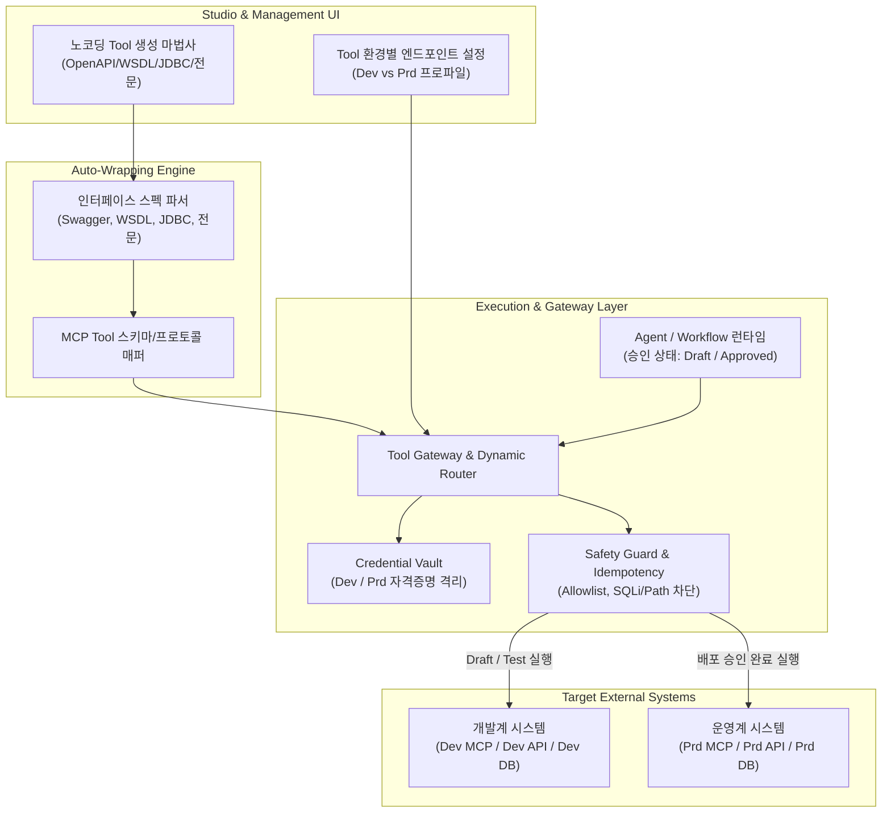

# MCP 및 외부 Tool 연동 노코딩 자동변환 상세 구현 계획서
본 문서는 기능명세서 및 기술요건 대조표 상의 필수 항목인 **T-035(MCP 및 Tool 연동)**와 연관 기능(**F-011, F-021, F-048**)을 실제 상용 플랫폼 환경에 부합하도록 개발하기 위한 상세 아키텍처 및 구현 계획서입니다.

## 1. 개요 및 요구사항 정의
본 구현 계획서는 다음 두 가지 핵심 필수 요구사항을 완결하는 것을 목표로 합니다.
- **요구사항 1: 배포 승인 상태 기반 동적 엔드포인트 전환 아키텍처**
  - 에이전트(Agent) 또는 워크플로우(Workflow)가 외부 Tool/MCP를 호출할 때, 에이전트의 현재 라이프사이클(초안/검증 단계 vs 타인 PADMIN 배포 승인 완료 단계)에 따라 개발용(Dev/Test)과 운영용(Prd) MCP 서버 및 대상 DB 엔드포인트를 런타임에 동적으로 분기·연결합니다.
  - 에이전트 설정 코드나 프롬프트를 수정하지 않고도 플랫폼 게이트웨이가 중앙에서 안전하게 대상 호스트 및 자격증명(Credential)을 스위칭합니다.
- **요구사항 2: 노코딩 기반 사내 인터페이스 Auto-Wrapping 생성 환경**
  - 개발자의 수동 코딩 없이 다음 4대 이기종 인터페이스 명세를 업로드/입력하면 표준 MCP Tool 명세(JSON Schema 및 핸들러)로 즉시 자동 변환(Auto-Wrapping)합니다.
    1. OpenAPI Spec (Swagger 2.0 / OpenAPI 3.0+ JSON/YAML)
    2. WSDL (SOAP 1.1 / 1.2 XML 명세)
    3. JDBC 접속 및 테이블/뷰 가상화 명세 (RDB 스키마)
    4. 금융 전문 명세 (ISO 8583, EAI, FEP 고정길이/구분자 기반 TCP/Socket 전문 레이아웃)

## 2. 시스템 아키텍처 설계
본 플랫폼의 외부 연동 아키텍처는 **Tool Registry**, **Dynamic Routing Gateway**, **Auto-Wrapping Engine**, **Credential Vault**의 4개 핵심 계층으로 구성됩니다.

### 2.1 아키텍처 블록 다이어그램


### 2.2 동적 엔드포인트 전환(Dynamic Routing) 메커니즘
- **호출 컨텍스트 주입**: 에이전트 실행 시 생성되는 `ExecutionAdmissionContext`에 `asset_id`, `version_id`, `publication_status`('draft' | 'approved_published')가 봉인되어 Tool 호출 게이트웨이로 전달됩니다.
- **프로파일 결정 규칙**:
  - `publication_status == 'approved_published'`: 대상 Tool의 `production` 엔드포인트 프로파일과 운영 Credential을 바인딩합니다.
  - `publication_status == 'draft'` 또는 'trial': 대상 Tool의 `development` 엔드포인트 프로파일과 개발용 Credential을 강제 바인딩합니다. (운영 엔드포인트 우회 호출 원천 차단)
- **자격증명(Credential) 격리 보존**:
  - 개발용 API Key/계정과 운영용 API Key/인증서는 DB 컬럼에 AES-256으로 암호화 저장되며, 클라이언트 UI나 에이전트 프롬프트/로그로 절대 노출되지 않고 게이트웨이 내부에서만 복호화되어 전송 헤더에 부착됩니다.

### 2.3 노코딩 Auto-Wrapping 변환 엔진 구조
- **OpenAPI / Swagger 파서**:
  - `paths`의 각 operation(`operationId`, `summary`, `parameters`, `requestBody`)을 읽어 MCP Tool의 `name`, `description`, `inputSchema`로 1:1 변환합니다.
- **WSDL / SOAP 파서**:
  - XML 기반의 `wsdl:portType`, `wsdl:operation`, `wsdl:message`를 파싱하여 복합 타입(ComplexType)을 JSON Schema 오브젝트로 매핑하고 SOAP Envelope 직렬화 템플릿을 생성합니다.
- **JDBC / 가상화 파서**:
  - JDBC 드라이버(Postgres, Oracle, Tibero, MySQL) 및 연결 문자열, 조회 대상 테이블/뷰를 지정하면 메타데이터를 수집하여 읽기 전용 질의 템플릿 및 파라미터 필터 스키마로 변환합니다. (DML 문장 원천 차단)
- **금융 전문(ISO 8583 / EAI / FEP) 파서**:
  - 필드 정의 명세(필드명, 데이터타입, 오프셋, 바이트 길이, 정렬/패딩 방식)를 JSON/CSV 형식으로 수용하여 TCP/Socket 바이트 버퍼 패킹/언패킹 엔진과 결합된 MCP Tool로 감쌉니다.

### 2.4 안전 제어 및 격리 가드레일 (Safety Rails)
- **Egress Host Allowlist**: 등록된 대상 호스트 외 임의 외부 IP/URL 접근 차단 (SSRF 방지).
- **파라미터 심층 검사**: 경로 조작(`../`), 원시 SQL 키워드(`UNION`, `DROP` 등), 비인가 쉘 명령어 문자열 검사.
- **멱등성(Idempotency) 보장**: 동일 클라이언트 요청 ID 기반 호출 시 중복 집행 방지 캐싱.
- **타임아웃 및 서킷 브레이커**: 기본 10초 타임아웃 및 외부 장애 발생 시 안전한 Fallback 에러 반환.

## 3. 데이터베이스 스키마 설계
동적 전환과 자동 래핑 Tool의 영속성을 위해 신규 마이그레이션 `041_tool_mcp_autowrap_schema.sql`을 정의합니다.

```sql
-- 1. Tool 정의 기본 테이블
CREATE TABLE IF NOT EXISTS public.tool_definitions (
    tool_id VARCHAR(64) PRIMARY KEY,
    tenant_id VARCHAR(64) NOT NULL REFERENCES public.tenants(tenant_id),
    name VARCHAR(128) NOT NULL,
    description TEXT NOT NULL,
    source_type VARCHAR(32) NOT NULL, -- 'openapi', 'wsdl', 'jdbc', 'financial_packet', 'custom_mcp'
    category VARCHAR(64) NOT NULL DEFAULT 'general',
    enabled BOOLEAN NOT NULL DEFAULT TRUE,
    created_by VARCHAR(64) NOT NULL REFERENCES public.users(user_id),
    created_at TIMESTAMPTZ NOT NULL DEFAULT CURRENT_TIMESTAMP,
    updated_at TIMESTAMPTZ NOT NULL DEFAULT CURRENT_TIMESTAMP
);

-- 2. Tool 버전 및 스키마 (불변 관리)
CREATE TABLE IF NOT EXISTS public.tool_versions (
    version_id VARCHAR(64) PRIMARY KEY,
    tool_id VARCHAR(64) NOT NULL REFERENCES public.tool_definitions(tool_id) ON DELETE CASCADE,
    revision_number INT NOT NULL,
    mcp_tool_spec JSONB NOT NULL,     -- { name, description, inputSchema, outputSchema }
    raw_source_spec JSONB NOT NULL,   -- 원본 파싱 메타데이터
    execution_timeout_sec INT NOT NULL DEFAULT 10,
    created_at TIMESTAMPTZ NOT NULL DEFAULT CURRENT_TIMESTAMP,
    CONSTRAINT uq_tool_version_revision UNIQUE (tool_id, revision_number)
);

-- 3. 환경별 엔드포인트 프로파일 (Dev vs Prd 분리)
CREATE TABLE IF NOT EXISTS public.tool_endpoint_profiles (
    profile_id VARCHAR(64) PRIMARY KEY,
    tool_id VARCHAR(64) NOT NULL REFERENCES public.tool_definitions(tool_id) ON DELETE CASCADE,
    target_env VARCHAR(16) NOT NULL,  -- 'development', 'production'
    protocol_type VARCHAR(32) NOT NULL, -- 'mcp_http_sse', 'rest_http', 'soap_xml', 'tcp_socket', 'jdbc'
    base_endpoint_url TEXT NOT NULL,
    encrypted_credential TEXT,        -- AES-256 암호화된 API Key, 토큰, DB PW, 인증서 등
    connection_timeout_ms INT NOT NULL DEFAULT 5000,
    active BOOLEAN NOT NULL DEFAULT TRUE,
    updated_by VARCHAR(64) NOT NULL REFERENCES public.users(user_id),
    updated_at TIMESTAMPTZ NOT NULL DEFAULT CURRENT_TIMESTAMP,
    CONSTRAINT uq_tool_env UNIQUE (tool_id, target_env)
);

-- 4. Tool 실행 감사 및 라우팅 로그
CREATE TABLE IF NOT EXISTS public.tool_audit_logs (
    log_id UUID PRIMARY KEY DEFAULT gen_random_uuid(),
    tenant_id VARCHAR(64) NOT NULL,
    user_id VARCHAR(64) NOT NULL,
    asset_id VARCHAR(64),
    execution_id VARCHAR(64),
    tool_id VARCHAR(64) NOT NULL,
    routed_env VARCHAR(16) NOT NULL,  -- 'development' | 'production'
    routed_endpoint TEXT NOT NULL,
    execution_status VARCHAR(32) NOT NULL,
    duration_ms INT NOT NULL,
    client_request_id VARCHAR(64),
    created_at TIMESTAMPTZ NOT NULL DEFAULT CURRENT_TIMESTAMP
);
```

## 4. 상세 API 계약 설계

### 4.1 노코딩 Auto-Wrapping 변환 API
- `POST /api/tools/auto-wrap/parse`
  - **입력**: `source_type` ('openapi' | 'wsdl' | 'jdbc' | 'financial_packet'), 원본 스펙 파일/텍스트
  - **응답**: 파싱된 오퍼레이션 목록, 입출력 필드 트리, 제안되는 MCP Tool 스키마 초안
- `POST /api/tools/auto-wrap/register`
  - **입력**: 확정된 Tool 이름, 설명, 선택된 오퍼레이션, Dev/Prd 엔드포인트 및 Credential
  - **응답**: 생성된 `tool_id`, `version_id`, 엔드포인트 바인딩 결과

### 4.2 Tool 관리 및 환경 프로파일 API
- `GET /api/admin/tools`: 등록된 전체 Tool 목록 조회 (페이징, 테넌트 필터)
- `GET /api/admin/tools/{tool_id}`: Tool 상세, 버전 이력, 연결된 Dev/Prd 엔드포인트 상태 조회
- `PUT /api/admin/tools/{tool_id}/endpoints`: 개발용 및 운영용 엔드포인트 URL 및 Credential 갱신

### 4.3 런타임 호출 게이트웨이 내부 계약
- `invoke_tool(context: ExecutionContext, tool_id: str, args: dict)`
  - Agent 실행 컨텍스트의 `publication_status`를 검사:
    - `approved_published`인 경우 `tool_endpoint_profiles`에서 `target_env='production'` 엔드포인트 선택.
    - 그 외(시험 실행, Draft 등)인 경우 `target_env='development'` 엔드포인트 선택.
  - 보안 필터링 수행 후 대상 프로토콜(HTTP, SOAP, TCP, JDBC)에 맞춰 요청 전송 및 감사 로그(`tool_audit_logs`) 기록.

## 5. UI/UX 구현 설계

### 5.1 관리자 포털: [연계 Connector / Tool 관리] 화면
- **Tool 목록 및 상태 카드**:
  - 현재 등록된 Tool별 유형 배지(OpenAPI / WSDL / JDBC / 전문), 연결된 개발계/운영계 호스트 정상 통신 여부(Health check) 표시.
- **노코딩 자동 생성 마법사 (Modal)**:
  - 1단계: 인터페이스 유형 선택 (Swagger 업로드 / WSDL URL / DB 접속 / 금융 전문 레이아웃).
  - 2단계: 스펙 파싱 결과 확인 및 노출할 파라미터 선택.
  - 3단계: 개발용(Dev) 및 운영용(Prd) 엔드포인트 주소와 인증키 입력.
  - 4단계: 테스트 호출(Dev 엔드포인트 대상 즉시 모의 호출) 및 최종 등록.

### 5.2 AI Studio: Agent Builder 및 Workflow Canvas 연계
- **단일 Agent Builder**:
  - 도구(Tool) 탭에서 승인된 Tool 목록을 조회하고 에이전트에 부착.
  - Playground 시험 실행 시 자동으로 '개발계(Dev)' 엔드포인트로 라우팅됨을 알리는 시각적 배지 제공.
- **Workflow Canvas**:
  - [Tool 노드] 속성 패널에서 생성된 MCP Tool을 드롭다운으로 선택하고 입력 매핑 설정.
  - 배포 승인 요청 시 필요한 Tool 권한 목록이 함께 검토 승인 요청서로 묶여 전달됨.

## 6. 단계별 구현 추진 일정 (Implementation Phases)
본 구현은 기존의 정상 동작 중인 Agent 런타임 및 DB를 보존하면서 단계적으로 확장합니다.

| 단계 | 추진 내용 | 주요 산출물 | 기간 |
| --- | --- | --- | --- |
| **Phase 1: DB 스키마 & 라우팅 게이트웨이** | • 신규 테이블 마이그레이션 (`041_tool_...`)<br/>• 배포 승인 상태 감지 및 Dev/Prd 동적 분기 라우터 구현<br/>• Credential Vault 암호화 엔진 | `src/backend/app/tools/gateway.py`<br/>`src/backend/app/tools/credentials.py` | 1주차 |
| **Phase 2: OpenAPI & JDBC Auto-Wrapping** | • Swagger 2.0 / OpenAPI 3.0 스펙 파서 구현<br/>• JDBC RDB 읽기 가상화 뷰 자동 매퍼 구현<br/>• Auto-Wrapping 기본 API 작성 | `src/backend/app/tools/parsers/openapi.py`<br/>`src/backend/app/tools/parsers/jdbc.py` | 2주차 |
| **Phase 3: WSDL & 금융 전문(ISO/EAI) 파서** | • WSDL/SOAP Envelope 생성 및 파서 구현<br/>• 고정길이 전문(ISO 8583 / FEP) 바이트 패커 구현<br/>• TCP/Socket 비동기 커넥터 연계 | `src/backend/app/tools/parsers/wsdl.py`<br/>`src/backend/app/tools/parsers/financial_packet.py` | 3주차 |
| **Phase 4: 프론트엔드 UI 및 통합 검증** | • 노코딩 변환 마법사 UI 개발<br/>• Tool 관리 및 Dev/Prd 엔드포인트 설정 화면<br/>• E2E 통합 테스트 및 감사 로그 일치 검증 | `src/frontend/src/ToolAdminPage.tsx`<br/>`src/backend/tests/test_tool_gateway.py` | 4주차 |

## 7. 검증 및 수용 기준 (Acceptance Criteria)
- **C-01 (동적 전환 검증)**: 동일한 Agent 프롬프트와 Tool 호출 시, Draft 상태에서는 Dev 엔드포인트가 호출되고, 타인 PADMIN 배포 승인 후에는 Prd 엔드포인트로 호출 대상이 자동 전환되어야 함.
- **C-02 (비인가 운영 호출 차단)**: Draft 또는 승인 이전 에이전트가 조작된 요청을 통해 운영용(Prd) 엔드포인트로 우회 접근하려 할 경우 `403 FORBIDDEN`으로 즉시 차단되어야 함.
- **C-03 (노코딩 변환 무결성)**: 샘플 OpenAPI(JSON), WSDL(XML), 금융 전문 레이아웃 명세를 업로드했을 때 수동 코드 작성 없이 유효한 MCP Tool 스키마로 100% 자동 생성되어야 함.
- **C-04 (보안 및 감사 증적)**: Tool 파라미터 내 SQL Injection, Path Traversal 시도가 감지되면 `422 Unprocessable Entity`로 거부되어야 하며, 모든 라우팅 이력은 `tool_audit_logs`에 암호화/보안 규격을 준수하여 영구 기록되어야 함.
