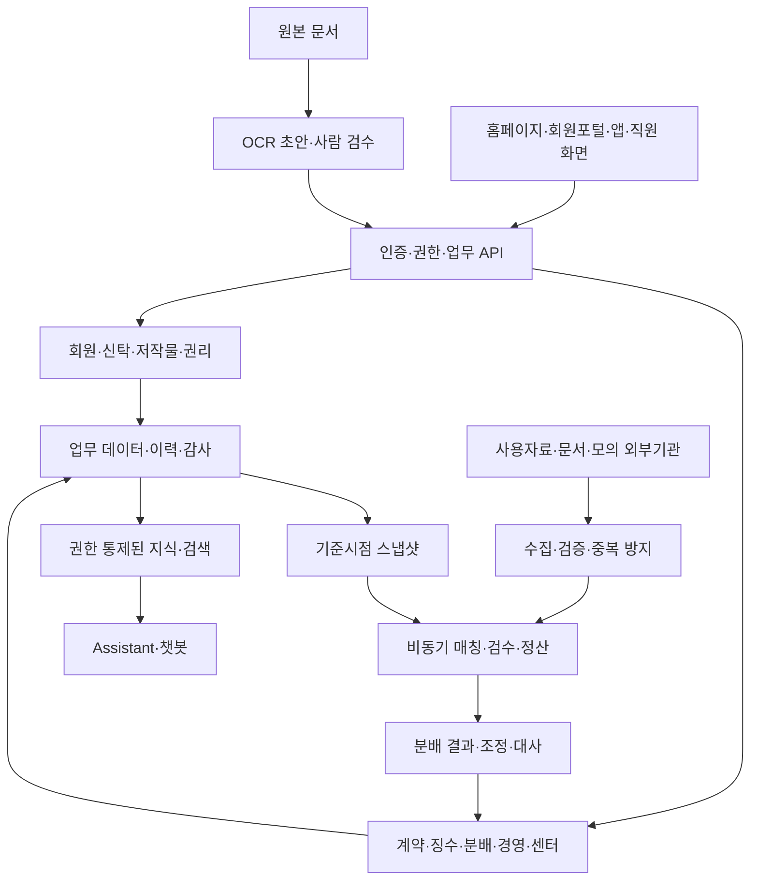

# 목표 구조와 데이터 설계 원칙

아래는 내부 설계 권고안이다. 구현 기술·클라우드·DB·AI 모델 선정은 인원·기존 역량·비용·작은 검증 결과를 확인한 후 결정한다. 제안 자료의 도구를 그대로 구매하는 결정을 포함하지 않는다.

## 작은 시작과 확장 경계

첫 단계는 업무 도메인을 구분한 단일 배포 구조로 시작하고, 대량 수집·매칭·분배 작업과 AI 호출은 비동기 작업으로 분리한다. 모든 기능을 처음부터 별도 서비스로 운영하면 시연 개발의 배포·관측·운영 부담이 커진다. 데이터·API 계약을 유지한 상태에서 실제 부하가 확인된 영역을 분리한다.

## 핵심 개체

| 묶음 | 개체와 필수 연결 |
|---|---|
| 회원·권리 | Party, Membership, TrustContract, Work, Identifier, RightsShare, RightsChange, Evidence |
| 이용·징수 | LicenseContract, TariffVersion, UsageFile, UsageRecord, Invoice, Receipt, Adjustment |
| 매칭·분배 | MatchCandidate, MatchDecision, Snapshot, CalculationRun, Distribution, PaymentDraft, Reconciliation |
| 경영·현장 | JournalDraft, Budget, Staff, Asset, LegalCase, AuditCase, Venue, Visit, FieldEvidence |
| 공통·AI | User, Role, Approval, AuditEvent, Job, InterfaceRun, KnowledgeVersion, ModelVersion, EvaluationRun |

이는 개념 초안이며 물리 테이블 설계가 아니다. 상세 설계 시 식별자·외래키·필수성·정밀도·권한·보존·상태전이를 정의한다.

## 금액·권리 설계에서 지킬 기준

- 권리의 효력기간과 시스템 등록·승인 시점을 분리한다. 기준일의 상태와 사후 수정 이력을 모두 재현한다.
- 분배 실행은 원천 사용자료·계약·요율·지분·환율(적용 시)·절사/잔여금 규칙 버전을 고정한다.
- 미확정 지분·경합·오류·미입금은 보류로 기록하고 승인 없이 지급 단계로 넘어가지 않는다.
- 재산출은 기존 결과 덮어쓰기 대신 새 실행과 차액 조정으로 기록한다. 계산과 실제 지급은 별도 승인 단계다.
- 수집·청구·분배·지급 요청에는 중복 방지 키를 두고 실패·재시도·중복 수신을 시험한다.
- 원본·변환·결정·결과·조정의 계보를 추적하고 건수·지분·금액·예외 건을 각각 대사한다.

## AI와 연계 경계

AI는 후보·문서 초안·설명·조회 보조를 담당한다. 금액 계산과 지급 승인 규칙은 업무 엔진이 수행한다. 자연어 조회는 허용된 API·조회 범위와 권한 검증을 거친다. 모델의 임의 SQL 실행·지급 실행을 허용하지 않는다.

초기 RAG는 내부 작성 지식으로 근거·권한·미응답을 검증하고, 원문 요구의 그래프·다양한 문서 포맷·추천질문·상담·관리 기능은 D2에서 구현한다. OCR은 원본과 필드별 신뢰도·검수 이력을 연결한다. 모델·프롬프트·색인·평가셋 버전을 남긴다.

대외기관은 실제/모의 어댑터를 교체할 수 있게 하고 요청·응답·재처리 이력을 남긴다. 국제 포맷은 보유 사양으로 버전을 확정한 뒤 구현한다. 포맷명을 표시하는 화면만으로 표준 준수를 주장하지 않는다.

## 시연과 운영 구조의 차이

D1은 소량 데이터·단일 실행 환경으로 시작할 수 있다. D3에서는 OLTP와 대량처리 자원 분리, 목표부하·동시성, 고가용성·복구·보존, 비밀정보 관리, 실제 기관별 권한·보안 정책을 별도로 검증한다. 현행 Oracle/SP와의 호환성·이관 정확도는 원천 확보 전에는 미검증이다.

원문 근거: DAR-001~006, SFR-006~007·012, INT-003, ISR-001~005, PER-008, SER-011.
