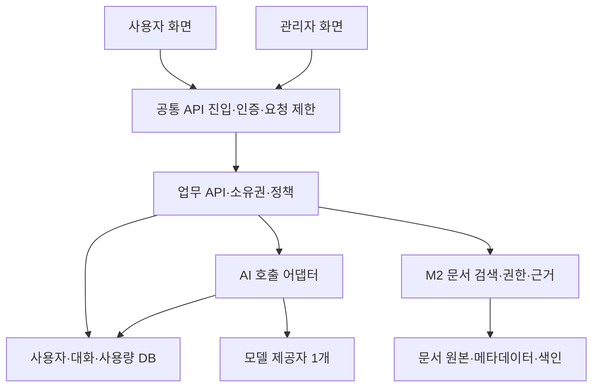

# 포털과 게이트웨이 역할 및 구조

> [!important] 2026-10-04 프로젝트 기준 정정
> 현재 학습·MVP 대상은 **BNK 그룹 공동 생성형 AI 플랫폼**이다. [[개발/AI 통합 포털/05 BNK 플랫폼 기준 정정과 개인 MVP]]를 우선한다. 이 문서의 이전 화면/도메인/범위 판단은 해당 자료에 한정하며 새 플랫폼의 요구범위로 자동 적용하지 않는다.

## 책임 구분

| 구성 | 책임 | 직접 담당하지 않는 영역 | M1 구현 제안 |
|---|---|---|---|
| 사용자 포털 | 채팅·기록·서비스 사용·문서 확인 | 제공자 비밀키·권한 최종 판정 | 기존 화면에서 핵심 메뉴만 연결 |
| 관리자 포털 | 사용자·모델·프롬프트·정책·통계 | 브라우저만의 권한·비용 차단 | 같은 앱 /admin, 서버 관리자 권한 검사 |
| API G/W | 일반 API 진입·인증 검증·라우팅·요청 제한·요청 ID | 개별 대화/문서 소유권 최종 검사 | 작은 서버 공통 처리로 역할부터 학습 |
| 업무 API | 대화·문서·서비스 소유권·정책·저장·RAG 조합 | 모델마다 다른 인증·응답 규격 | 하나의 모듈 구조 서버 |
| AI G/W | 모델 호출 표준화·허용 모델·토큰/비용 계측·타임아웃·라우팅 | 사용자 문서 인덱싱·전체 업무 프로세스 | 서버 내부 AI 어댑터 → M3 독립 프록시 |
| RAG | 문서 파싱·분할·권한 검색·검색결과와 질문 결합·근거 | API G/W의 자동 기능으로 간주하지 않음 | M2 독립 애플리케이션 모듈 |
| 데이터 저장 | 사용자·대화·실행·정책·지식 메타데이터 | AI 응답을 검증 없이 권한 정책으로 사용 | M1 관계형 저장, M2 검색 색인 추가 |

일반 요청 횟수 제한과 AI 토큰/비용 제한은 다르다. Kong 공식 문서는 일반 HTTP 제한과 AI용 제한을 구분한다. [Kong 요청 제한](https://developer.konghq.com/gateway/rate-limiting/).

## 첫 구조 제안

포털 1개와 서버 1개로 시작하되 화면·정책·AI 호출 코드는 역할별로 구분한다. API 진입 처리와 AI 어댑터는 게이트웨이의 핵심 책임 일부를 학습하는 구현이며, 별도 게이트웨이 제품을 구축 완료했다고 부르지 않는다.

## 기술 선택 후보 — 확정 전 검토안

경력 자료 검토 후 현재 추천 기준선은 **React/Vite + FastAPI + PostgreSQL**다. [[개발/AI 통합 포털/04 경력 기반 집중 과제와 착수안]]을 우선 적용한다. 아래 순수 HTML/SQLite는 가장 작은 입문 대안으로 남긴다.

기존 HTML/CSS/JavaScript를 작게 분리하고 API 호출을 붙이는 것이 가장 작은 시작이다. UI 프레임워크 학습은 필요해질 때 선택한다. 서버 후보는 Python/FastAPI, 초기 로컬 저장 후보는 SQLite다. 인증·권한·HTTP·DB를 먼저 실습하고, 외부 공개 단계에서는 실제 사용자 인증·배포 구성을 따로 검증한다. FastAPI 공식 문서의 인증 예제를 학습 자료로 쓸 수 있다. [인증 학습](https://fastapi.tiangolo.com/tutorial/security/oauth2-jwt/).

M3 AI 프록시 후보는 LiteLLM이다. 통합 호출과 사용량·키별 예산을 학습할 수 있다. 단, 예산 통제는 DB 연결 조건을 확인해야 하며, DB 없이 예산 숫자만 설정했다고 차단되는 것은 아니다. 해당 기능을 실습할 때 PostgreSQL 등 문서가 요구하는 저장 구성을 추가하고 실제 차단을 시험한다. [AI 프록시](https://docs.litellm.ai/docs/simple_proxy), [예산 조건](https://docs.litellm.ai/docs/proxy/users).

Kong 등 독립 API 게이트웨이는 M3 이후 인증·라우팅·제한을 비교하는 실습 후보로 둔다. M1에서 AI 모델·DB·검색·게이트웨이 후보를 여러 개 동시에 도입하지 않는다. 라이선스·유료 옵션·현재 버전·제공자 가격은 실제 선택 시 확인하고 버전을 고정한다.

## 채팅 요청 한 건의 흐름

1. 로그인한 사용자 요청에 request_id를 부여한다.
2. 서버가 세션·활성 사용자·서비스 상태·대화 소유권·허용 모델을 확인한다.
3. 승인된 템플릿 버전과 사용자가 보낸 입력을 결합한다. 클라이언트가 owner_id·조직·관리자 역할을 지정해도 서버 인증값으로 판단한다.
4. 사용자 요청수·동시 실행·입력 크기·최대 출력 토큰·예산 조건을 확인한다.
5. AI 어댑터가 서버에 보관된 제공자 키로 모델을 호출하고 결과를 스트리밍한다.
6. 성공/실패/취소, 제공자 request_id, input/output usage, 첫 응답·완료시간을 기록한다.
7. 메시지와 실행 결과를 저장한다. 실패·취소·부분 답변은 완성 답변으로 표시하지 않는다.
8. 관리자가 같은 request_id로 호출 로그와 집계를 확인한다.

API/AI 게이트웨이의 관리 키와 모델 제공자 키는 브라우저로 전달하지 않는다. 예산 계산을 할 때 호출 전 최대 비용 추정 예약과 종료 후 실제 usage 정산을 구분한다. 취소·타임아웃도 과금될 수 있고 토큰 계측값이 누락될 수 있으므로 ‘미확인 비용’ 상태를 남긴다. 비용 추정은 제공자 청구액과 같다고 단정하지 않는다.

## 최소 API 계약 제안

| API | 기능·권한 |
|---|---|
| POST /api/login, POST /api/logout, GET /api/me | 인증·세션·본인 역할 |
| GET/POST /api/conversations | 본인 목록·생성 |
| GET /api/conversations/{id}/messages | 본인 대화만 조회 |
| POST /api/conversations/{id}/messages | 입력 검증·정책·AI 호출·스트리밍 |
| GET /api/services | 본인이 이용 가능한 활성 서비스 |
| GET /api/admin/usage | 관리자 집계·실행 ID 상세 |
| PATCH /api/admin/users/{id} | 활성/중지·한도 설정, 감사이력 |
| PATCH /api/admin/services/{id} | 모델·프롬프트 버전·상태 설정, 감사이력 |
| POST/GET/DELETE /api/documents | M2 본인/공유 범위 문서·파기·검색 반영 |

로그인 방식은 구현 전에 결정한다. 쿠키 세션이면 CSRF·쿠키 속성을, 토큰이면 저장·만료·로그아웃 정책을 함께 검토한다. URL만 숨기거나 관리자 메뉴만 감추는 것으로 권한을 구현하지 않는다.

## 최소 데이터

User(id, role, active), Service(id, state, model_alias, prompt_version), Conversation(id, owner_id), Message(id, conversation_id, role, content, state), Execution(id, request_id, user_id, service_id, provider, model, state, token_usage, latency, estimated_cost, accounting_state), Policy(id, subject_id, request_limit, token_limit, budget, period), AdminChange(actor, target, before, after, time).

M2: Document(id, owner, visibility, version, indexing_state), Chunk(id, document_id, text, locator), Citation(message_id, chunk_id). 검색 전 권한을 적용하고 원본 다운로드에도 같은 권한을 검사한다. 문서 삭제·공유범위 변경은 색인과 인용 조회에도 반영한다. 관리자 사용량 조회 권한이 모든 사용자 대화 본문 열람 권한을 자동 부여하지 않도록 한다.

## 오류와 시험

401 인증 필요 / 403 권한 없음 / 429 요청 제한 / 예산 초과 / 서비스 중지 / 제공자 장애·타임아웃을 별도 표시한다. UI는 요청 중 이중 전송을 막고 서버도 요청 중복을 통제한다. 제공자 호출은 응답 실패만 보고 무조건 재시도하지 않는다. 이미 처리·과금됐는지 모르는 요청을 재시도하면 중복 실행·비용이 생길 수 있다.

완료 시험은 사용자 A/B의 대화 격리, 일반 사용자 관리자 API 거부, 허용되지 않은 모델 차단, 한도 초과 시 제공자 호출 0건, 타임아웃/취소 기록, 모의/실제 통계 분리, 브라우저에 비밀키 미노출을 포함한다. M2는 타인 문서 검색·인용·다운로드 거부와 근거 없는 답변의 확인 불가 처리를 추가한다.
