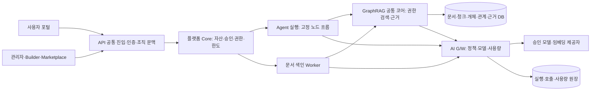

# 플랫폼 통합 작업과 검증 기준

## 권고 구조

그래프/벡터 데이터 접근 전에 플랫폼에서 확인한 문맥을 검증하고 저장소에서도 ACL을 강제한다. 검색 전에 필요한 질의 임베딩, 색인의 임베딩/LLM 추출, 답변 생성은 모두 공통 AI 경로를 사용한다. 모의/실제 호출을 구분한다.

`common_core`는 Knowledge/Agent 내부 패키지로 연결한다. 포털 업무 테이블과 검색 저장소를 분리하고, 기존 별도 backend retriever와 코어 retriever를 둘 다 운영하는 구조는 정리한다. 처음에는 같은 FastAPI 배포 안의 모듈로 배치할 수 있으며 독립 Gateway/Worker 배포는 검증 후 분리한다.

## 실행 계약의 최소 필드

| 계약 | 필드와 의미 |
|---|---|
| 요청 문맥 | tenant_id, actor_id, role, data_scope_id, request_id. 브라우저의 tenant_id만으로 권한 결정 금지 |
| Agent 실행 | execution_id, conversation_id, agent_id/version, prompt_version, policy_snapshot_id, index_version |
| 검색 결과 | retrieval_run_id, strategy, source/version, chunk/page, relation_id, evidence_id, citations, index_version |
| 모델 호출 | call_id, execution_id, model_alias/version, purpose(answer/embedding/extraction), provider_request_id |
| 사용량 | input/output/embedding token, estimated/confirmed/unknown, 통화·단가 버전, 실패/취소·예약/정산 상태 |
| 색인 작업 | job_id, source/version/hash, parser/chunker/embedding/schema version, stage, attempt, error_code |

세부 필드는 새 통합 설계에서 정의할 항목이다. 기존 코어 계약에 전부 존재한다고 간주하지 않는다. 권한 누락은 기본 거부하며 LLM Prompt로 권한을 판단하지 않는다.

## 첫 Agent 두 개

1. **일반 질의/작성 초안:** 텍스트 입력, 승인 Prompt, 단일 모델, 대화 이력·usage. 모의 모델부터 시작.
2. **규정·책무 안내:** 합성 규정/역할/절차 문서 검색, 규정→책무→절차 관계와 원문 근거 표시. 근거 없는 내용은 답변 보류.

도메인 그래프는 REGULATION, RESPONSIBILITY, PROCEDURE 개체와 ASSIGNS, REQUIRES 관계로 작게 시작한다. 실제 BNK 규정으로 오인되지 않도록 합성 자료임을 표시한다. 벡터만으로 답하는 질문과 문서 간 관계를 함께 확인해야 답하는 질문을 나눠 Graph 활용 효과를 측정한다.

## 작업 대장

모든 작업은 미착수다. 아래는 수행 순서 제안이며 실제 구현·배포 승인을 의미하지 않는다.

| ID | 작업 | 의존 | 완료를 판단할 증거 |
|---|---|---|---|
| B00 | 새 BNK 원문·화면·설계 기준 확정, 이전 자료 분리 | 없음 | RFP ID/화면/작업 대응표. 기존 저작권 요구행 미혼입 |
| B01 | GraphRAG 현재 코어/웹 앱 기준선과 의존성 고정 | B00 | 변경 파일 보존, 버전/의존성 기록, 32개 기존 시험 재현 |
| B02 | 조직 A/B·공통영역·역할·소속·개인 문서 ACL | B01 | URL/ID 변조 시 타 조직 검색·인용·다운로드·삭제 모두 차단 |
| B03 | 단일 DB 마이그레이션·실제 저장소 어댑터 | B02 | 테이블/ID 일치, 재시작 후 문서/관계/근거 조회, tenant 조건 시험 |
| B04 | 사용자 포털·Agent 카탈로그·대화 재조회 | B02/B03 | 본인 기록 이어하기, 승인 Agent만 실행, 타 사용자 기록 거부 |
| B05 | 공통 모델 어댑터·정책·usage·한도 | B04 | 중지/한도 초과는 제공자 호출 전 차단, 실패/취소 원장 대사 |
| B06 | 문서 업로드→색인 Job→Publish | B03/B05 | 단계별 상태·재시도·중복 방지, 수행 전 단계 완료 표시 금지 |
| B07 | 규정 도메인·관계 근거 매칭·전략 처리 | B06 | 관계별 정확한 근거, source/ACL 필터 Graph에도 적용, 미지원 전략 오류 |
| B08 | Builder 설정·평가·승인·게시·회수 | B07 | 개발자가 자기 운영 버전 승인 불가, 승인 버전 고정, 회수 즉시 신규 실행 차단 |
| B09 | 검색 비교 평가·관리자 실사용량 화면 | B08 | 동일 질문에 VECTOR/GRAPH/HYBRID 결과·근거·시간·토큰 비교 |

처음 완성할 구간은 B00~B05다. GraphRAG의 코어 구조를 먼저 학습할 수 있지만 개인 문서를 저장·검색하는 기능은 B02/B03 이후 붙인다. B06 이후 지식 Agent를 완성한다.

## 핵심 검증 시나리오

- 조직 A 사용자가 B 문서 ID·Agent ID·대화 ID를 직접 지정해도 차단한다. 같은 조직에서도 다른 사용자의 PRIVATE 문서가 검색되지 않는다.
- 공통 문서 공개 승인을 회수하면 검색·인용·다운로드와 신규 실행에 반영된다.
- 관계 2개와 서로 다른 근거 문서 2개를 만들고 근거가 교차 연결되지 않는지 확인한다.
- 삭제 문서의 청크·관계·근거와 원문 링크가 재검색에서 사라진다. 공유 개체는 남겨야 할 관계/근거가 있으면 유지한다.
- 프로세스 재시작 후 승인 버전·대화·색인·실행 이력이 유지된다.
- 임베딩 실패·추출 실패·재시도를 주입하고 완료 상태 오표시·중복 색인·원장 중복이 없는지 확인한다.
- 스트리밍 중단/사용자 취소에도 execution/call 상태가 종결되고 사용량 불명은 0으로 처리하지 않는다.
- 예상 질문 20개를 단일 문서 6개, 관계 질문 6개, 근거 부족 4개, 권한 거부 4개로 구성한다. 각각 정답·허용 문서·관계·출처 위치를 기록한다. 이는 새로 만들 평가셋의 구성안이며 시험 결과가 아니다.

기존 32개 시험을 유지하면서 위 경계와 DB/API 통합 시험을 추가한다. 개인 MVP 완료는 화면 수보다 실제 호출·저장·차단·근거 일치로 판단한다. 기관 운영의 물리 격리·SSO·DRM·금융 연계·HA·10개 Agent 적합성 검증은 별도 단계다.

## 화면 기준

새 프로젝트의 `04.시연`에 AI Chat, My Agent, Marketplace, Builder, Knowledge RAG, 사용자 역할, Data Scope, 모니터링·미터링 관련 시연 이미지가 있다. 이번에는 파일 목록과 요구범위를 확인했으며 이미지별 세부 UX 검토·화면 동작 시험은 수행하지 않았다. 다음 화면 설계는 이 자료를 기준으로 작성한다.

관련: [[개발/AI 통합 포털/05 BNK 플랫폼 기준 정정과 개인 MVP]], [[개발/AI 통합 포털/06 GraphRAG 재사용 검토]].
